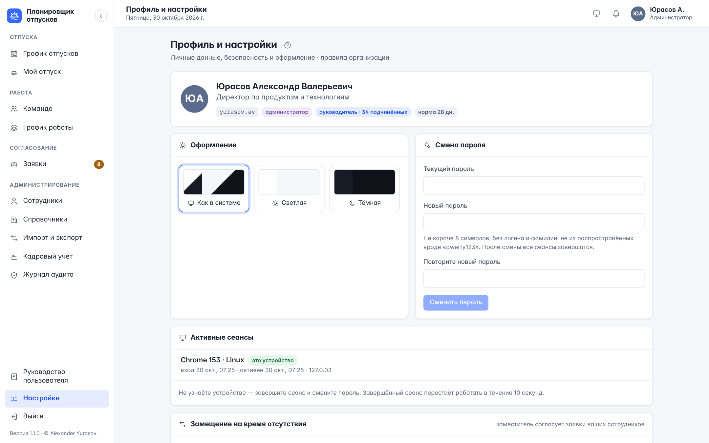

# О руководстве

Руководство описывает работу в «Планировщике отпусков» для сотрудников и руководителей: вход и сеансы, график отпусков, планирование и перенос своего отпуска, подбор удачных дат, извещение о начале отпуска, кампанию планирования на следующий год, график работы офис/удалёнка, согласование заявок, замещение на время отсутствия и аналитику команды. Возможности администратора — в «Руководстве администратора».

Снимки экранов сделаны на демонстрационных данных версии 1.1.0; в вашей организации имена, отделы и даты будут другими.

# Вход в систему

1. Откройте адрес планировщика, который сообщил администратор.
2. Если на экране есть кнопка «Войти через корпоративную учётную запись» — нажмите её и войдите так же, как в почту и другие корпоративные системы. Отдельный пароль планировщика не нужен.
3. Иначе введите корпоративный логин (например, `ivanov.ii`) и пароль. Кнопка «Показать» открывает введённый пароль, затем нажмите «Войти».

Если вход через корпоративную учётную запись не удался, экран входа объяснит причину. «Учётная запись не найдена» означает, что вас ещё не завели в планировщике, — обратитесь в кадровую службу.

**Первый вход.** Пароль, который выдала кадровая служба, действует только для первого входа: после него планировщик откроет экран «Придумайте свой пароль». Введите выданный пароль и новый — не короче длины, заданной в организации (обычно 8 символов), без логина и фамилии и не из распространённых вроде «qwerty123». Затем войдите с новым паролем. Пока пароль не сменён, другие разделы недоступны.

> Слишком частые попытки входа с одного компьютера временно отклоняются — подождите минуту. Если подряд ввести неверный пароль много раз (обычно десять), учётная запись блокируется на 15 минут, а вы получите уведомление. Если это были не вы — смените пароль и сообщите в службу информационной безопасности. Снять блокировку раньше может кадровая служба.

Сеанс продлевается автоматически, пока открыта вкладка. Кнопка «Выйти» внизу меню завершает его на этом устройстве; все свои сеансы на других устройствах видны и завершаются в «Профиле и настройках». Если пароль сменили или сбросили, сеанс завершили из списка сеансов или кадровая служба, а также при увольнении открытые вкладки в течение 10 секунд возвращаются на экран входа с сообщением «Сеанс завершён».

# Устройство интерфейса

Слева — меню разделов, сверху — название раздела, дата, переключатель темы, уведомления и ваш профиль.

| Раздел | Для чего |
|---|---|
| График отпусков | Отпуска всей организации на год |
| Мой отпуск | Ваш остаток дней, периоды, новые заявки |
| Команда | Кто сегодня в офисе, на удалёнке, в отпуске; аналитика отдела |
| График работы | Ваш режим офис/удалёнка |
| Заявки | Очередь согласования (руководителям, заместителям на время замещения) |
| Кадровый учёт | Планирование и утверждение графика, извещения (кадровой службе) |
| Профиль и настройки | Тема оформления, смена пароля, сеансы, замещение |
| Руководство пользователя | Это руководство: содержание, поиск, PDF |

Меню сворачивается кнопкой со стрелкой рядом с названием. Тема переключается значком в верхней панели: как в системе → светлая → тёмная. На телефоне меню открывается кнопкой слева вверху.

**Уведомления** приходят, когда руководитель согласовал или отклонил вашу заявку, а руководителю — когда подчинённый подал заявку, перенос или запрос удаления. Кроме того: извещение о начале вашего отпуска, приглашение и напоминание кампании планирования, замещение (вам передали согласование), заявка, переданная вам эскалацией, и блокировка вашей учётной записи. Счётчик на колокольчике показывает непрочитанные; щелчок по уведомлению отмечает его прочитанным и открывает нужный раздел — заявку на согласование или «Мой отпуск»; «Прочитать все» отмечает все сразу. Новые уведомления появляются сами, без обновления страницы, — обычно в течение пары секунд. «График отпусков» тоже обновляется сам, если коллеги изменили отпуска, но не чаще раза в минуту и только пока вкладка открыта на экране.

**Письма.** Если в организации настроена почта и в вашей карточке указан адрес, те же события приходят письмом со ссылкой на нужный раздел. Руководители по пятницам получают сводку: кто из команды в отпуске на следующей неделе и сколько заявок ждут решения. Письма отключаются в «Профиле и настройках».

## Руководство в приложении

Это руководство открывается в самом планировщике: пункт «Руководство пользователя» внизу меню, над «Настройками». Слева — содержание: щелчок по разделу переходит к нему, а раздел, который вы читаете, подсвечивается. Поле «Найти в руководстве» оставляет в содержании разделы, где встречаются искомые слова — в заголовке или в тексте; если совпадений нет, появится «Ничего не найдено». Снимок экрана увеличивается щелчком и закрывается щелчком или клавишей Esc. На телефоне вместо содержания — список «Перейти к разделу» над текстом.

Знак **«?»** рядом с названием раздела — справка по этому экрану: он открывает руководство сразу на нужной главе. Адрес главы можно скопировать из строки браузера и отправить коллеге — руководство откроется на том же месте.

«Открыть PDF» показывает руководство в новой вкладке, «Скачать PDF» сохраняет файл, чтобы распечатать его или читать без планировщика. Кадровой службе и администратору доступно и «Руководство администратора»: кнопка в заголовке руководства и знак «?» в разделах «Сотрудники», «Справочники», «Кадровый учёт» и «Журнал аудита».

# График отпусков

График показывает отпуска всех сотрудников за год, сгруппированные по отделам.

- **Полосы**: синяя — согласованный отпуск, полосатая жёлтая — на согласовании, фиолетовая — отпуск по уходу за ребёнком. Прошедшие отпуска бледнее.
- **Фон**: серые столбцы — выходные, розовые — праздники; красная вертикальная линия — сегодня. При открытии график прокручивается к текущей дате.
- **Полоса нагрузки** под названиями месяцев показывает долю выбранных сотрудников в отпуске по рабочим дням: чем темнее, тем больше людей отсутствует, красный — выше порога конфликта.
- **Красная штриховка** под полосой — дни, когда в отпуске слишком большая доля отдела (порог задаёт администратор, обычно 50 %).
- **Зелёная точка** у фамилии — сотрудник в отпуске сегодня.

Управление:

| Элемент | Действие |
|---|---|
| ‹ 2026 › | Переключить год |
| Год / Квартал / Месяц | Масштаб: весь год на экране или подробно по дням с днями недели |
| Удалёнка | Показать на полосах дни удалённой работы |
| Сегодня | Вернуться к текущей дате |
| Excel | Выгрузить отпуска года (руководителям, кадровой службе и администраторам) |
| Отдел, поиск | Оставить нужный отдел или найти сотрудника по ФИО или должности |
| Стрелка у названия отдела | Свернуть или развернуть отдел |

Щелчок по фамилии или полосе открывает карточку сотрудника со всеми его периодами за год.

## Сравнение пересечений

Чтобы проверить, могут ли коллеги замещать друг друга, отметьте их значком «+» слева от фамилии (появляется при наведении). Когда отмечено двое и больше, над графиком появляется сравнение: даты, когда отмеченные отсутствуют одновременно, а на графике эти дни подсвечиваются.

# Мой отпуск

Карточка вверху показывает, сколько дней **доступно для планирования** в выбранном году: норма плюс перенос с прошлых лет минус согласованные дни минус дни в заявках на согласовании. Полоса делится на использованное (синий), на согласовании (жёлтый) и свободное (зелёный). Справа — норма, перенос и отметка о части отпуска не короче 14 дней.

> Праздничные нерабочие дни, попавшие в отпуск, не входят в число дней отпуска и продлевают его (ТК РФ, ст. 120). Например, отпуск с 1 по 14 мая с тремя праздниками расходует 11 дней.

Ниже — ближайший отпуск, «год одним взглядом» и список периодов со статусами.

## Извещение о начале отпуска

За две недели до начала согласованного ежегодного отпуска (срок задаёт организация, не меньше 14 дней — ТК РФ, ст. 123) вверху «Моего отпуска» появляется извещение: даты, число дней и дата начала. Нажмите «Ознакомлен» — это ваша подпись под извещением; кадровая служба видит её в журнале. «Для печати» открывает лист извещения для подписи на бумаге, если этого требует порядок вашей организации.

Если отпуск согласован позже чем за две недели до начала, извещение придёт сразу с пометкой: по ст. 124 ТК РФ отпуск можно перенести по вашему письменному заявлению. Если отпуск перенесли или отменили, извещение на прежние даты исчезнет, а на новые даты придёт новое.

## Планирование отпусков на следующий год

Когда кадровая служба собирает график на следующий год, вверху «Моего отпуска» появляется приглашение со сроком и вашим прогрессом: сколько дней из нормы уже запланировано и есть ли часть не короче 14 календарных дней (ТК РФ, ст. 125). Кнопка «Запланировать на …» открывает форму заявки на год кампании. Когда норма запланирована и есть часть в 14 дней, приглашение отмечается зелёным. Незадолго до срока тем, кто не спланировал отпуск полностью, придёт напоминание.

Утверждённый график обязателен и для сотрудника, и для работодателя: изменить даты после утверждения можно переносом — по согласованию с руководителем.

## Новая заявка

1. Нажмите «Запланировать отпуск».
2. Укажите первый и последний день или нажмите «7 / 14 / 28 дней» после выбора начала.
3. Проверьте расчёт: сколько дней отпуска, календарных дней, праздников и сколько останется.
4. При необходимости добавьте комментарий для руководителя и нажмите «Отправить на согласование».

Если дней не хватает, форма предупредит. По правилам организации отправка либо запрещается, либо остаётся на решение руководителя.

## Подбор лучших дат

Кнопка «Подобрать лучшие даты» в форме заявки предлагает до пяти вариантов на выбранную длину и период поиска. Планировщик учитывает:

- отпуска коллег по отделу: варианты, в которых вместе с вами отдел превысит порог, не предлагаются;
- праздники: окно, захватывающее праздники, даёт больше дней отдыха за те же дни отпуска;
- ваши уже запланированные отпуска — пересечения исключаются;
- удобство: старт в понедельник.

У каждого варианта — объяснение и доля отдела в отпуске вместе с вами. «Выбрать» подставляет даты в форму.

## Перенос и отмена

| Ситуация | Что сделать | Результат |
|---|---|---|
| Заявка ещё на согласовании | «Изменить» или значок корзины | Даты меняются сразу; отмена — сразу |
| Отпуск согласован, нужны другие даты | «Перенести» и новые даты | Отпуск уходит на согласование; до решения действуют прежние даты, при отказе они сохраняются |
| Согласованный отпуск не нужен | Значок корзины → «Запросить удаление» | Руководитель согласует удаление или отклоняет — тогда отпуск остаётся |

Отклонённые и отменённые заявки с причиной отказа — в свёрнутом разделе внизу страницы.

На телефоне раздел выглядит так:

# График работы

Режим работы показывает, где вы работаете в обычную неделю, и используется в разделе «Команда» и на графике отпусков (кнопка «Удалёнка»).

1. **Недельный шаблон**: нажимайте на день недели, чтобы переключить «Офис → Удалённо → Не работает», затем «Сохранить».
2. **Разовые исключения**: щёлкните день в календаре месяца, чтобы поменять офис на удалёнку только в эту дату. Повторный щелчок возвращает значение шаблона. Исключения отмечены точкой и перечислены внизу, где их можно снять.

Дни отпуска в календаре зелёные и не переключаются. Руководитель выбирает в списке своих подчинённых и ведёт их график, администратор — график любого сотрудника.

# Команда

## Сегодня

Плитки показывают, сколько человек отдела сегодня в офисе, на удалёнке, в отпуске и на выходном, а также сколько заявок ждут решения. Щелчок по плитке оставляет в таблице только сотрудников с этим статусом. Дата меняется полем вверху — так можно посмотреть состав на любой день, например на день планёрки.

В таблице — статус на дату (для отпуска — до какого числа), следующий отпуск, нераспределённые дни и отметка о части в 14 дней. Если в отпуске больше порога отдела, сверху появится предупреждение.

## Аналитика года

- **Выводы** — что требует внимания: ближайшие конфликты, пиковый месяц и куда лучше планировать, кто не распределил отпуск, у кого нет части в 14 дней, риски малочисленного отдела.
- **Доля отдела в отпуске по месяцам**: синяя часть — согласованные отпуска, жёлтая — заявки на согласовании, пунктир — порог конфликта. При наведении — точные значения и самый загруженный день месяца.
- **Периоды конфликтов** — даты и состав отсутствующих.
- **Распределение дней** — сколько каждый уже запланировал и сколько осталось, сначала те, у кого больше всего нераспределённых дней.

Сотрудник видит свой отдел, руководитель — подразделения, которыми руководит (с вложенными), и отделы, где работают его подчинённые.

# Согласование заявок (руководителям)

Раздел «Заявки» доступен тем, кому есть что согласовывать; число на пункте меню — сколько заявок ждут решения. В очереди — заявки ваших подчинённых: тех, у кого вы указаны руководителем, и — если вы руководите подразделением — сотрудников подразделения без своего руководителя, а также вложенных подразделений, где руководителя нет. Руководители вышестоящих подразделений тоже вправе решить по заявке. Свою заявку согласует ваш руководитель, а не вы.

Каждая карточка показывает сотрудника, вид заявки (новый отпуск, перенос с прежними датами, удаление), период и число дней отпуска с учётом праздников, комментарий сотрудника и **пересечения в отделе**: кто из коллег отсутствует в те же даты.

- **Согласовать** — отпуск согласован (для удаления — отпуск удалён), сотрудник получает уведомление.
- **Отклонить** — обязательно укажите причину: сотрудник увидит её в уведомлении и в архиве заявок. При отклонении переноса сохраняются прежние даты, при отклонении удаления отпуск остаётся.

Вкладки «Новые / Переносы / Удаления» отбирают заявки по виду. Если два руководителя одновременно принимают решение по одной заявке, применится одно, второму планировщик сообщит, что данные изменились.

**Оформить отпуск сотруднику** — для подчинённого, который не может подать заявку сам. Такой отпуск сразу согласован; в форме доступен подбор дат с учётом отдела.

**Замещение.** Уходя в отпуск или командировку, передайте согласование коллеге: «Профиль и настройки → Замещение на время отсутствия», выберите заместителя и даты. На этот период заместитель видит заявки вашей команды в своём разделе «Заявки» (с пометкой «Вы замещаете …»), согласует и отклоняет их и получает уведомления о новых; вы тоже продолжаете их видеть. Замещение можно отменить в любой момент. Кадровая служба может назначить замещение за вас.

**Эскалация.** Если в организации задан срок ответа, заявка без решения дольше этого срока передаётся вашему руководителю — на карточке появится отметка «передана …», а он сможет решить по ней сам. Если вам передали заявку подчинённого вашего сотрудника, она отмечена «передана вам». Заявка передаётся один раз.

# Профиль и настройки

Здесь ваш профиль (логин, роль, норма дней), выбор темы оформления, смена пароля, письма о заявках, сеансы и замещение. Новый пароль — по политике организации: не короче заданной длины (подсказка под полем), без логина и фамилии, не из распространённых и не совпадает с текущим; после смены все сеансы завершаются, и нужно войти заново.

**Сеансы** — где вы вошли: устройство и браузер, адрес, когда начат и когда был активен; текущий отмечен. «Завершить» закрывает сеанс на том устройстве не позже чем через 10 секунд, «Завершить все остальные» — везде, кроме этого браузера. Если в списке есть незнакомое устройство — завершите его и смените пароль.

В блоке «Письма о заявках» включаются и отключаются письма и пятничная сводка; уведомления в колокольчике приходят в любом случае. Если адрес почты не указан, его вносит кадровая служба.

# Частые вопросы

**Почему отпуск на 14 календарных дней расходует меньше дней?** В период попали праздничные нерабочие дни — по закону они не входят в отпуск.

**Почему нельзя отправить заявку?** Даты в прошлом, пересечение с другой вашей заявкой или (при жёсткой политике) не хватает дней. Причина показана в форме.

**Почему «Доступно» меньше, чем норма минус использованные дни?** Доступно учитывает и заявки на согласовании: эти дни зарезервированы до решения руководителя.

**Как узнать, что руководитель принял решение?** Придёт уведомление в колокольчике и, если включены письма, письмо; статус в «Моём отпуске» изменится.

**Извещение пришло меньше чем за две недели до отпуска — что делать?** Так бывает, если отпуск согласовали поздно. Нажмите «Ознакомлен», если согласны; если нет — по ст. 124 ТК РФ отпуск можно перенести по вашему письменному заявлению: обсудите это с руководителем и кадровой службой.

**Я руководитель, но не вижу раздела «Заявки».** Раздел появляется, когда у вас есть подчинённые — по карточкам сотрудников или по структуре компании, — вы замещаете руководителя или вам передана заявка эскалацией. Если руководитель подразделения не назначен, обратитесь в кадровую службу.

**Почему праздничный понедельник после выходного считается днём отпуска?** Если праздник выпал на выходной, следующий рабочий день — перенесённый выходной, а не праздник. По закону дни отпуска продлевают только сами праздники (ТК РФ, ст. 120).
