# О документе

Документ описывает архитектуру программного обеспечения «Планировщик отпусков» версии 1.0.0: назначение и границы системы, состав компонентов и их взаимодействие, модель данных, программный интерфейс, механизмы информационной безопасности, развёртывание, технологическую независимость, наблюдаемость и используемые технологии. Документ входит в комплект, представляемый для включения программы в единый реестр российских программ для ЭВМ и баз данных (постановление Правительства РФ от 16.11.2015 № 1236), и предназначен для экспертов, архитекторов, инженеров сопровождения и службы информационной безопасности заказчика.

Связанные документы комплекта:

| Документ | Содержание |
| --- | --- |
| «Описание функциональных характеристик» | Что умеет система: функции, роли, сценарии |
| «Описание процессов жизненного цикла» | Разработка, тестирование, выпуск, устранение неисправностей, поддержка |
| «Инструкция для эксперта» | Доступ к стенду, установка, порядок проверки |
| «Руководство по развёртыванию» | Установка, настройка, обновление, резервное копирование, мониторинг |
| «Сторонние компоненты и лицензии» | Компоненты в поставке, включая программы в образах контейнеров, их лицензии и уведомления |
| «SBOM и лицензии» (документ 11), `docs/sbom/licenses-report.md` | Состав сторонних компонентов и анализ их лицензий |

Источники истины, на которых построен документ: контракт программного интерфейса `contracts/openapi-vacation-api-v1.yaml` (OpenAPI 3.1), схема данных `server/prisma/schema.prisma`, исходный код ветки `v1.0.0` и записи архитектурных решений `docs/adr/` (ADR-001…ADR-017). Показатели кодовой базы, каталог операций API, каталог ошибок и словарь данных сформированы автоматически из контракта и кода скриптом `tools/docs/gen_tables.py`, поэтому соответствуют поставляемой программе.

# Общие сведения

## Назначение и класс системы

«Планировщик отпусков» — корпоративное веб-приложение для планирования и согласования ежегодных оплачиваемых отпусков. Оно ведёт график отпусков всей организации, заявки сотрудников с согласованием руководителем, балансы дней по нормам Трудового кодекса РФ, режим работы «офис / удалёнка», аналитику пересечений отпусков внутри отделов и неизменяемый журнал изменений. Кадровый цикл по ТК РФ поддерживается целиком: кампания планирования на год, утверждение графика и выгрузка по унифицированной форме Т-7, извещение о начале отпуска за две недели с ознакомлением сотрудника, замещение руководителя и эскалация заявок без решения.

По архитектурному типу это **клиент-серверное веб-приложение**: одностраничный клиент (SPA) и REST API, устанавливаемые на серверы организации (on-premise) в контейнерах Docker. Версия 1.0.0 рассчитана на организации от 1000 до 2000 сотрудников; запас по масштабу подтверждён нагрузочными прогонами на 5000 сотрудников в базе (раздел «Требования к серверу и масштабирование»).

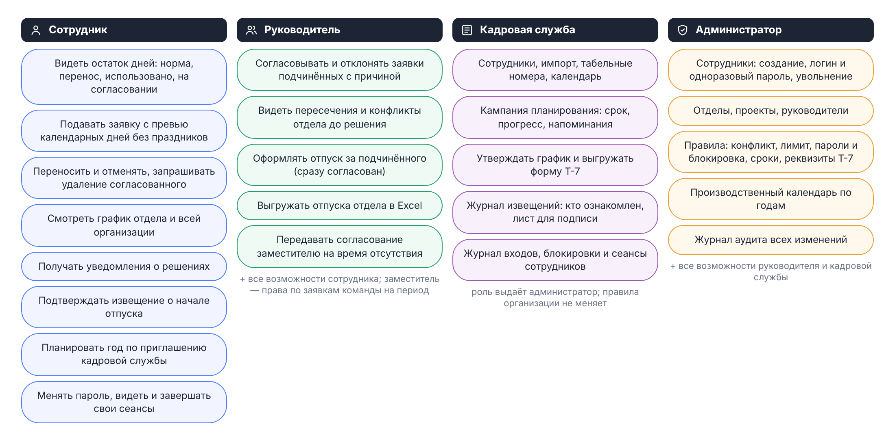

## Архитектурные принципы

| Принцип | Как реализован |
| --- | --- |
| Сервер решает, клиент показывает | Правила — конечный автомат заявки, балансы, лимиты, права, конфликты — реализованы только в серверных сервисах. Проверки в клиенте — подсказки для удобства, а не защита |
| Контракт прежде кода | REST API v1 описан в `contracts/openapi-vacation-api-v1.yaml` и меняется только через ревью владельца; тест `server/test/contract.e2e.test.ts` в CI не даёт реализации и контракту разойтись |
| Одна операция — одна транзакция | Изменение данных, событие истории заявки, запись журнала аудита, уведомление и письмо в очереди фиксируются в одной транзакции PostgreSQL (ADR-006) |
| Чистые вычисления отдельно от ввода-вывода | Баланс (`requests/balance.ts`), аналитика пересечений (`analytics/coverage.ts`), план импорта (`imports/plan.ts`) — модули без обращений к БД и без «текущего времени»: дата расчёта передаётся аргументом, модули покрыты модульными тестами |
| Единое хранилище | Все данные и всё общее состояние процессов сервера (окна лимита входа, версия данных графика, очередь писем, отметки плановых задач, сеансы) хранятся в PostgreSQL; отдельные хранилища и брокеры сообщений не нужны (ADR-012) |
| Сервер без состояния сеанса | Access-токен — JWT, refresh-токены — в таблице PostgreSQL: сервер масштабируется процессами и экземплярами без «липких» сессий |
| Технологическая независимость | Только свободные компоненты под разрешительными лицензиями; программа не обращается к внешним сервисам, кроме настроенных организацией почтового релея и провайдера единого входа; работает в закрытом контуре (раздел «Технологическая независимость») |
| Зависимости под контролем | Каждая новая библиотека обосновывается в `docs/decisions.md` и проходит лицензионный гейт SBOM: copyleft-лицензии и неопределённые лицензии блокируют слияние |
| Секреты — только в окружении | Пароли и ключи рабочего контура задаются переменными окружения (файл `.env` вне системы контроля версий); сервер не стартует, если секрет подписи токенов `JWT_SECRET` не задан или короче 32 символов |
| Решения документируются | Записи архитектурных решений `docs/adr/` (17 записей: контекст, решение, альтернативы, последствия, критерии пересмотра) |
| Наблюдаемость | Структурированный журнал в формате JSON со сквозным идентификатором запроса, метрики Prometheus, правила оповещений и регламент диагностики |

## Показатели кодовой базы

<!-- BEGIN:code-metrics -->
| Показатель | Значение |
|---|---|
| Сервер: файлов TypeScript / строк | 83 / 8 189 |
| Сервер: контроллеров / операций API | 20 / 83 |
| Модель данных: таблиц / миграций | 24 / 12 |
| Клиент: файлов TS и Vue / строк | 50 / 14 447 |
| Клиент: экранов | 13 |
| Тесты сервера: файлов / сценариев | 25 / 207 |
| Тесты клиента (модульные и e2e): файлов / сценариев | 9 / 44 |
<!-- END:code-metrics -->

| Показатель | Значение |
| --- | --- |
| Модулей сервера (каталогов `server/src/<домен>`) | 20 |
| Хранилищ состояния клиента (Pinia) | 6 |
| Записей архитектурных решений (`docs/adr`) | 17, из них 2 заменены последующими (ADR-004 → ADR-010, ADR-007 → ADR-011) |
| Правил оповещений мониторинга (`deploy/monitoring/alerts.yml`) | 15 |

# Контекст системы

Пользователи работают с системой через веб-браузер по HTTPS. Внешние системы организации подключаются по стандартным протоколам и только по решению организации: SMTP, OpenID Connect, файлы выгрузки и HTTP API импорта.

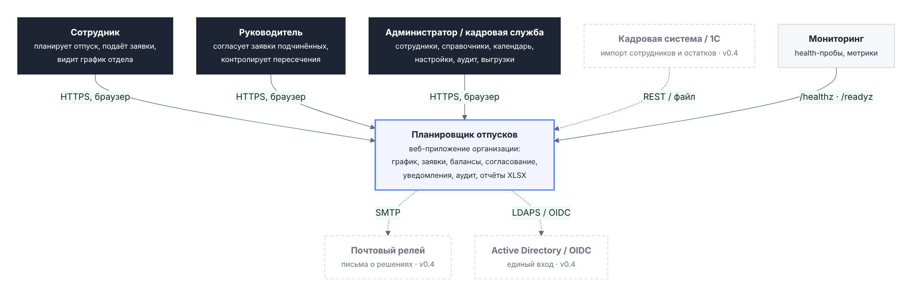

| Участник | Взаимодействие |
| --- | --- |
| Сотрудник | Планирует отпуск, подаёт, переносит и отменяет заявки, видит график отдела и свой режим работы, подтверждает ознакомление с извещением |
| Руководитель, заместитель | Согласует заявки подчинённых, видит пересечения и аналитику отдела, ведёт режим работы команды, передаёт согласование заместителю на период |
| Кадровая служба, администратор | Сотрудники и импорт, справочники, производственный календарь, правила организации, кампания планирования и форма Т-7, журналы извещений, аудита и входов |
| Почтовый релей организации (необязательно) | Принимает письма о заявках, решениях, извещениях и еженедельные сводки по SMTP; без настройки `SMTP_HOST` уведомления остаются только в интерфейсе |
| Провайдер единого входа (необязательно) | OpenID Connect: Keycloak, ADFS, Blitz Identity Provider и другие; без настройки `OIDC_ISSUER` вход только по паролю |
| Кадровая система организации | Выгрузки сотрудников и остатков отпусков в XLSX/CSV загружает кадровая служба; скрипт интеграции может передавать те же данные в JSON через операцию импорта с предпросмотром |
| Мониторинг организации (необязательно) | Опрашивает `/healthz` и `/readyz`, собирает метрики `/metrics` по внутренней сети стенда |
| Хранилище резервных копий | Получает копии из томов `db-backups` и `wal-archive` средствами организации |

Работа системы не требует доступа в интернет; данные организации за пределы её контура не передаются (раздел «Технологическая независимость»).

# Контейнеры и развёртывание

## Состав контейнеров

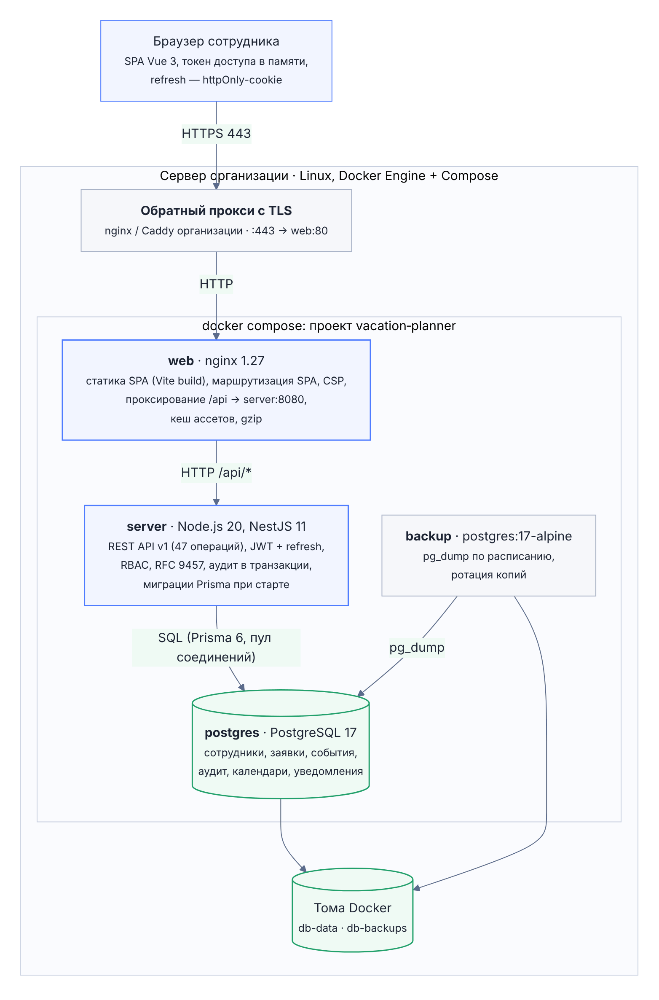

| Контейнер | Образ / технологии | Ответственность |
| --- | --- | --- |
| `web` | nginx 1.27 Alpine; статическая сборка Vite | Отдача SPA с Content Security Policy и заголовками безопасности; кеширование хешированных ресурсов на год, `index.html` без кеша; проксирование `/api/` на `server:8080` с `X-Forwarded-For` и `X-Request-Id`; поток событий `/api/v1/events` без буферизации; адрес `server` разрешается заново каждые 10 секунд; `worker_connections 16384` для открытых потоков событий |
| `server` | Node.js 22 Alpine, NestJS 11, Prisma 6 | REST API v1, бизнес-логика, поток событий (SSE), плановые задачи, метрики; кластер из `WEB_CONCURRENCY` процессов (`auto` — по числу ядер, не больше 32); миграции схемы `prisma migrate deploy` при старте контейнера; штатное завершение по `SIGTERM` |
| `postgres` | PostgreSQL 17 Alpine | Все данные приложения; модуль `pg_stat_statements` и журнал медленных запросов (`PG_SLOW_MS`, по умолчанию 1000 мс); том `db-data` |
| `backup` | postgres:17-alpine | `pg_dump -Fc` раз в `BACKUP_INTERVAL` секунд (по умолчанию сутки), хранение `BACKUP_KEEP_DAYS` дней (по умолчанию 14); запись через временный файл — в томе `db-backups` нет оборванных копий |
| `postgres-replica` | PostgreSQL 17 Alpine (`docker-compose.replica.yml`) | Горячий резерв: асинхронная потоковая репликация по слоту `replica1`, только чтение; при аварии повышается до основного |
| `basebackup` | postgres:17-alpine (`docker-compose.replica.yml`) | Ежедневные физические копии `pg_basebackup` (хранятся 7) и очистка архива WAL — восстановление на момент времени |
| `prometheus` | Prometheus 3.5 (профиль `monitoring`) | Сбор `/metrics` и правила оповещений; слушает только `127.0.0.1:9090`; панель Grafana поставляется файлом для импорта в Grafana организации |
| Обратный прокси (вне compose) | nginx или Caddy организации | Терминирование TLS на порту 443, перенаправление на HTTPS, HSTS; передача `X-Forwarded-For` |

Стенд описывается файлом `docker-compose.yml`: профиль `full` — `server`, `web`, `backup`; профиль `monitoring` — Prometheus; дополнение `docker-compose.replica.yml` — реплика, архив WAL и физические копии. Тома Docker: `db-data` (файлы PostgreSQL), `db-backups` (логические копии), `db-replica` и `wal-archive` (реплика и архив WAL), `prometheus-data`.

Наружу публикуется порт 80 контейнера `web`; порт API 8080 не публикуется, поэтому служебные адреса `/healthz`, `/readyz` и `/metrics` доступны только из внутренней сети стенда — nginx проксирует наружу лишь `/api/`. Порт PostgreSQL 5432 опубликован только на локальном интерфейсе узла (`127.0.0.1`) — для резервного копирования и диагностики с самого сервера; из сети организации БД недоступна.

## Поставка и окружения

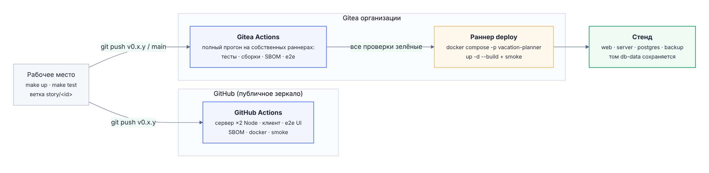

Исходные тексты ведутся в двух репозиториях-зеркалах: GitHub и Gitea организации. Оба запускают основной набор автоматических проверок — тесты сервера на PostgreSQL, проверку обновления на данных, тесты и сборку клиента, e2e интерфейса, SBOM и лицензионный гейт; в GitHub дополнительно проверяются сборка образов, дымовой прогон стенда и переключение на реплику, а в Gitea после успешных проверок раннер `deploy` разворачивает стенд (`docker compose -p vacation-planner --profile full up -d --build`) и выполняет дымовые пробы. Порядок разработки и выпуска описан в «Описании процессов жизненного цикла».

| Окружение | Назначение | Данные |
| --- | --- | --- |
| Локальное | Разработка и отладка | Демонстрационные данные (`make seed`: 131 сотрудник, 14 отделов) |
| CI (GitHub Actions, Gitea Actions) | Проверка каждого изменения | Тестовая БД `vacation_test`, демонстрационные данные для e2e интерфейса |
| Стенд Gitea | Демонстрация и приёмка версии | Том `db-data` стенда |
| Рабочий контур организации | Эксплуатация | Рабочая БД и резервные копии |

## Требования к серверу и масштабирование

Серверная часть работает в контейнерах Docker на 64-битном Linux (x86-64) с Docker Engine 24+ и Docker Compose v2. Клиент — две последние версии Chrome, Edge, Firefox или Safari, на телефонах — мобильные браузеры; интерфейс адаптирован до ширины экрана 360 px. Совместимость с российскими операционными системами из реестра: `[заполняет правообладатель: ОС, версии и результаты испытаний]`.

<!-- sizing -->
Рекомендуемая конфигурация сервера для организаций на 1000 и 2000 сотрудников определяется нагрузочными замерами версии 1.0.0 и будет приведена в этом разделе и в «Руководстве по развёртыванию» по их результатам.

Выполненные ранее нагрузочные прогоны (сценарий: каждый виртуальный пользователь входит под своим логином и в цикле выполняет типовые действия — график отдела и организации, баланс, заявки, аналитика, подбор дат — с паузой 1,5–4,5 с):

| Прогон | Стенд и данные | Нагрузка | Результат |
| --- | --- | --- | --- |
| v0.5.0 (`docs/progress/load-v0.5.0.md`) | Один узел 4 vCPU, 16 ГБ ОЗУ на API, PostgreSQL 16 и генератор нагрузки; `WEB_CONCURRENCY=3`; 5000 сотрудников, 152 отдела, 25 539 отпусков | 500 одновременных пользователей с потоком событий, 16 минут, 208 запросов в секунду | 0 ошибок; p95 чтения 190 мс, записи 285 мс |
| v0.6.0 (`docs/progress/load-v0.6.0.md`) | Тот же стенд, данные наполнены заново после миграций v0.6.0 | Тот же сценарий, 209 запросов в секунду | 0 ошибок; p95 чтения 194 мс, записи 332 мс |

Целевые показатели: p95 чтения не больше 300 мс, записи — не больше 500 мс, без ошибок. Модель нагрузки организации на 1000–2000 сотрудников (рабочий день, пики кампании планирования, утренний вход, длительная работа) и регламент прогонов — `docs/performance/workday-model.md` и `docs/performance/runbook.md`.

| Механизм | Назначение |
| --- | --- |
| Кластер процессов (`WEB_CONCURRENCY`) | Node.js обслуживает запросы одним ядром; главный процесс запускает по процессу на ядро и перезапускает упавшие, при частых падениях (больше 5 за минуту) останавливается, чтобы сбой увидел оркестратор |
| Асинхронный scrypt | Хеширование пароля выполняется в пуле потоков и не останавливает обработку остальных запросов процесса |
| Пул соединений на процесс | min(10, 40 / число процессов), не меньше 3: процессы одного экземпляра держат не больше ~40 соединений с БД; переопределяется `DB_POOL_SIZE` |
| Версия данных графика | Отложенные триггеры таблиц графика увеличивают счётчик (16 строк) один раз за транзакцию при фиксации; ответ `GET /schedule` кэшируется в памяти процесса (до 64 МБ) по версии и отдаётся `304 Not Modified` по `ETag` |
| Лимит входа в PostgreSQL | Минутные окна в нежурналируемой таблице — одинаковый лимит при любом числе процессов и экземпляров |
| Поток событий вместо опроса | Уведомления и сигнал «данные изменились» приходят по SSE; процесс проверяет БД одним запросом раз в 2 секунды на всех своих подключённых (ADR-013) |
| Виртуальный список графика | Браузер отрисовывает только видимые строки графика организации |
| Второй экземпляр `server` | Ставится на другой узел с тем же `.env` и той же БД за балансировщиком организации без привязки сессий: лимит входа, очередь писем, плановые задачи и кэш графика согласованы через PostgreSQL |

# Серверная часть

## Слои и компоненты

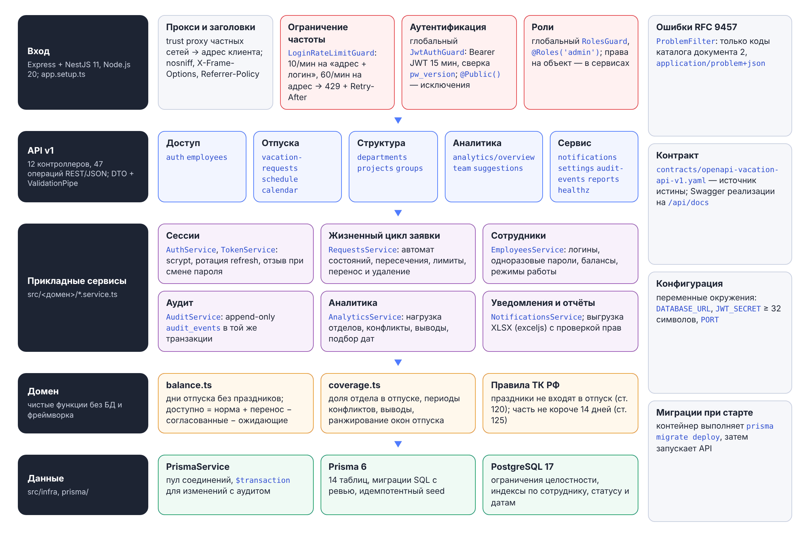

Сервер — модульный монолит на NestJS 11 и TypeScript в строгом режиме (ADR-001, ADR-009). Каждый домен в каталоге `server/src/<домен>/` содержит тонкий контроллер (DTO-валидация, вызов сервиса, ответ) и сервис с логикой; доступ к данным — только через Prisma 6.

| Модуль | Ответственность |
| --- | --- |
| `auth` | Вход по паролю и через единый вход OIDC (`oidc.ts`), обновление и смена пароля, выход; `TokenService` (JWT HS256); глобальные guards; ограничение частоты входа (`rate-limit.ts`); служебные роли (`access.ts`); сеансы, блокировка, журнал входов (`login-journal.service.ts`), политика паролей (`password-policy.ts`), хеширование паролей (`passwords.ts`) |
| `employees` | Сотрудники, логины и одноразовые пароли, балансы, режим работы (недельный шаблон и исключения), состояние учётной записи |
| `requests` | Заявки: конечный автомат, пересечения, лимиты, перенос и удаление; `balance.ts` — расчёт баланса; `approval-scope.ts` — кто решает по заявке; `escalation.service.ts` — передача заявки без решения вышестоящему |
| `delegations` | Замещение руководителя на период |
| `notices` | Извещение о начале отпуска (ст. 123 ТК РФ): плановая задача, ознакомление, отзыв при переносе, отмене и увольнении, журнал |
| `planning` | Кампания планирования на год, прогресс, напоминания, утверждение графика со снимком (ADR-016), форма Т-7 (`t7.ts`) |
| `schedule` | График отпусков за период с конфликтами отделов; кэш по версии данных, `ETag` |
| `analytics` | Нагрузка отделов, периоды конфликтов, выводы руководителю, подбор дат (`coverage.ts`) |
| `directories`, `calendar`, `settings` | Отделы, проекты, личные группы; производственный календарь (праздники ст. 112 и переносы выходных); правила организации |
| `imports` | Импорт сотрудников и остатков из XLSX/CSV и JSON; `plan.ts` — план импорта для предпросмотра и применения |
| `notifications`, `mail` | Уведомления в интерфейсе; письма через очередь `email_outbox` с повторами, еженедельная сводка руководителям |
| `events` | Поток событий SSE: билеты, подключения, опрос новых уведомлений и версии данных |
| `jobs` | Плановые задачи в каждом процессе с идемпотентностью в PostgreSQL (ADR-017) |
| `audit`, `reports` | Неизменяемый журнал изменений; выгрузка отпусков в XLSX |
| `health` | Пробы `/healthz`, `/readyz` и метрики `/metrics` |
| `infra` | `PrismaService`; ошибки RFC 9457 (`problems.ts`); реестр метрик и сложение процессов кластера (`metrics.ts`); число процессов и пул (`concurrency.ts`); версия данных и кэш ответов (`data-version.ts`); журнал с идентификатором запроса (`log.ts`) |

## Ключевые сервисы

| Сервис | Назначение |
| --- | --- |
| `RequestsService` | Жизненный цикл заявки. Создание проверяет права (за себя, за подчинённого, администратор), даты, пересечения с собственными заявками и лимит дней под блокировкой строки сотрудника (`SELECT … FOR UPDATE`); заявка, оформленная руководителем за подчинённого, сразу согласована. Перенос согласованного отпуска хранит прежние даты до решения; запрос удаления помечает заявку и после согласования удаляет её, событие остаётся в истории и аудите |
| Расчёт баланса (`balance.ts`) | Праздничные нерабочие дни внутри отпуска не входят в число дней (ст. 120 ТК РФ); признак части не короче 14 календарных дней (ст. 125); доступно = норма + перенос − согласованные дни − дни на согласовании; при жёсткой политике лимита заявка сверх доступного отклоняется (`409 limit-exceeded`) |
| Согласование (`approval-scope.ts`), `EscalationService` | Очередь «ждут моего решения» и право решения строятся из одних правил: руководитель сотрудника, руководитель отдела, заместитель на период замещения, вышестоящий — по эскалированной заявке; по своей заявке не решает никто, кроме администратора. Эскалация раз в минуту передаёт заявки без решения дольше `escalationDays` руководителю согласующего, без него — уведомляет кадровую службу |
| `ScheduleService` | График собирается четырьмя запросами SQL (сотрудники, отпуска, шаблоны и исключения режима работы), конфликты отделов считаются по дням; версия данных читается раньше данных, поэтому кэшированный ответ не может опередить данные |
| `AnalyticsService` (`coverage.ts`) | Доля отдела в отпуске по месяцам, периоды конфликтов выше порога, выводы руководителю; подбор до пяти непересекающихся окон отпуска с учётом нагрузки отдела, праздников и собственных отпусков, с объяснением |
| `ImportsService` (`plan.ts`) | Одна чистая функция строит план для предпросмотра и для применения; применение — одна транзакция с аудитом каждой записи и только при отсутствии ошибок; повторная загрузка того же файла ничего не меняет |
| `MailService` | Шаблон outbox: письмо пишется в `email_outbox` в транзакции события и отправляется фоном; разбор очереди с `FOR UPDATE SKIP LOCKED` и арендой на 5 минут; повторы через 1, 5, 30 минут, 2 и 12 часов |
| `NoticesService` | Раз в минуту извещает о согласованных ежегодных отпусках, начинающихся через `noticeDays` дней (не меньше 14); уникальный ключ «заявка + дата начала» исключает повторное извещение из разных процессов |
| `PlanningService` | Кампания планирования, прогресс по отделам и сотрудникам, напоминания; утверждение графика фиксирует неизменяемый снимок согласованных отпусков с реквизитами документа; форма Т-7 строится из снимка, переносы после утверждения — по текущим заявкам |
| `JobsService` | В каждом процессе раз в `JOBS_POLL_SECONDS` (по умолчанию 60) проходит плановые задачи: извещения, эскалацию, напоминания о планировании, очистку журнала входов; повтор безопасен за счёт ограничений БД (`INSERT … ON CONFLICT DO NOTHING`, условные `UPDATE`) |
| `EventsService` | Держит открытые потоки SSE; раз в 2 секунды одним запросом находит новые уведомления подключённых сотрудников и проверяет версию данных; раз в 25 секунд отправляет пустой комментарий, чтобы прокси не закрыл соединение |
| `AuditService` | Запись `audit_events` только внутри транзакции изменения, переданной вызывающим сервисом |

## Обработка запроса

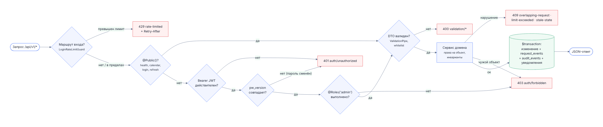

Каждый запрос получает идентификатор `X-Request-Id` (от прокси организации или nginx стенда, иначе создаётся сервером); он возвращается клиенту, попадает в журнал сервера и в поле `requestId` ответа об ошибке. Далее запрос `/api/v1/*` проходит:

1. ограничение частоты (для входа) — `LoginRateLimitGuard`;
2. глобальную аутентификацию `JwtAuthGuard` (кроме маршрутов, явно отмеченных `@Public()`): проверка подписи токена, версии пароля, активности сотрудника, живости сеанса и признака одноразового пароля — одним запросом к БД с кэшем 10 секунд в процессе;
3. проверку роли `RolesGuard`;
4. DTO-валидацию с отбрасыванием неизвестных полей (`ValidationPipe`, `whitelist`);
5. проверку прав на конкретный объект (своя заявка, подчинённый) в сервисе.

Ошибка любого уровня возвращается как `application/problem+json` (RFC 9457) с кодом из каталога; внутренняя ошибка — `500` без подробностей, подробности со стеком — в журнале сервера.

# Клиентская часть

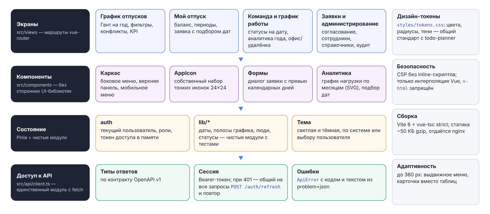

Клиент — Vue 3 и TypeScript в строгом режиме, сборка Vite, состояние — Pinia, без сторонних библиотек компонентов (ADR-011): собственная дизайн-система на токенах оформления, собственные компоненты и иконки.

| Слой | Каталог | Ответственность |
| --- | --- | --- |
| Экраны и маршруты | `web/src/views`, `web/src/router` | 13 экранов; охрана маршрутов по входу, ролям и признаку одноразового пароля |
| Компоненты | `web/src/components` | Форма заявки с подбором дат, панели кампании планирования и извещений, журнал входов, редактор замещения, диалог импорта, график месячной нагрузки; общие компоненты (иконки, уведомления, подтверждения) |
| Состояние | `web/src/stores` | Хранилища Pinia: вход и профиль, согласование, календарь, живые обновления, уведомления, интерфейс |
| Чистые функции | `web/src/lib` | Даты, раскладка графика, разбор производственного календаря (формат xmlcalendar.ru и CSV), отображение людей (инициалы, краткое ФИО); покрыты модульными тестами |
| Доступ к API | `web/src/api/client.ts` | Единственный модуль, обращающийся к сети: добавляет Bearer-токен, при `401` один раз обновляет его по httpOnly-cookie (параллельные запросы ждут общий результат), превращает problem+json в `ApiError` с идентификатором запроса |
| Оформление | `web/src/styles` | Токены светлой и тёмной темы (`tokens.css`), базовые паттерны (`base.css`); тема — светлая, тёмная или по настройке системы |

| Экран | Назначение |
| --- | --- |
| График отпусков | Диаграмма Ганта на год: масштабы год / квартал / месяц, отделы, праздники, линия «сегодня», полоса нагрузки, слой удалёнки, сравнение сотрудников, выгрузка в Excel |
| Мой отпуск | Баланс с разбивкой, заявки, подбор дат, перенос и отмена; извещение с кнопкой «Ознакомлен»; приглашение кампании планирования с прогрессом |
| Команда | Кто сегодня в офисе, на удалёнке, в отпуске; аналитика года: выводы, нагрузка по месяцам, конфликты |
| График работы | Недельный шаблон офис / удалёнка и разовые исключения |
| Заявки | Очередь «ждут моего решения» с пересечениями в отделе, отклонение с причиной, оформление отпуска за подчинённого |
| Кадровый учёт | Кампания планирования, утверждение графика и форма Т-7; журнал извещений с выгрузкой и листом для печати под подпись |
| Сотрудники, справочники, журнал аудита | Учётные записи (блокировка, сеансы, сброс пароля), замещение, импорт; отделы, проекты, производственный календарь; журнал изменений и журнал входов |
| Профиль и настройки | Тема, письма, смена пароля, свои сеансы, правила организации (администратор) |
| Вход, смена пароля | Вход по паролю и через единый вход; смена одноразового пароля при первом входе |

Сборка не обращается к внешним CDN и шрифтам: используются системные шрифты, иконки — встроенные SVG. Токен доступа хранится только в памяти вкладки; браузерное хранилище используется лишь для настроек интерфейса (тема, масштаб графика, свёрнутое меню).

## Живые обновления

Клиент открывает поток Server-Sent Events `GET /api/v1/events` по одноразовому билету на 60 секунд (`POST /api/v1/events/ticket`): так токен не попадает в адрес запроса и журналы прокси. Сервер присылает события `hello`, `notifications` (число непрочитанных), `data` (версия данных графика изменилась, не чаще раза в 15 секунд) и `revoked` (сеанс отозван). При обрыве клиент переподключается с нарастающей паузой от 4 до 60 секунд и на это время возвращается к опросу уведомлений раз в 30 секунд. Подход не требует WebSocket-инфраструктуры и брокера сообщений (ADR-013).

# Модель данных

Данные хранятся в PostgreSQL 17; схема описана в `server/prisma/schema.prisma`, изменения — только версионными миграциями `server/prisma/migrations`, которые применяются автоматически при старте контейнера `server`. Даты отпусков хранятся типом `date`, статусы и типы заявок и режимы работы — перечислениями PostgreSQL, снимок утверждённого графика и значения журнала аудита — JSONB. Целостность обеспечивают внешние ключи, уникальные индексы, блокировки строк в транзакциях и отложенные триггеры версии данных.

| Группа | Таблицы | Назначение |
| --- | --- | --- |
| Организация | `employees`, `departments`, `projects`, `groups`, `group_members` | Кто работает, в каком отделе и проекте, кто чей руководитель |
| Отпуска и режим | `vacation_requests`, `request_events`, `notifications`, `work_patterns`, `work_overrides` | Заявки с историей, уведомления, офис и удалёнка |
| Кадровый учёт | `approval_delegations`, `vacation_notices`, `planning_campaigns`, `schedule_approvals` | Замещение, извещения, кампания планирования, утверждённый график |
| Служебные | `audit_events`, `refresh_tokens`, `login_state`, `login_events`, `org_settings`, `calendars`, `email_outbox`, `job_runs`, `data_version`, `login_attempts` | Журнал изменений, сеансы, состояние и журнал входов, правила организации, праздники, очередь писем, плановые задачи, версия данных, окна лимита входа |

## Организация

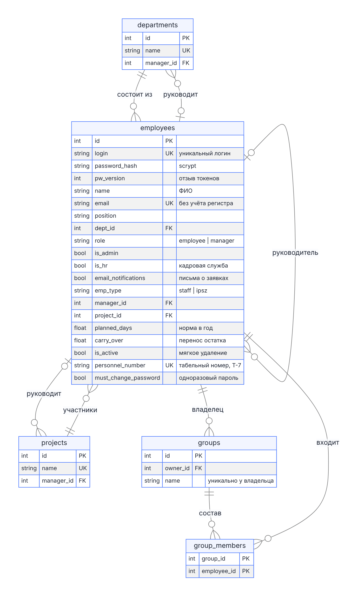

Руководитель сотрудника (`employees.manager_id`) согласует его заявки и ведёт его режим работы; руководитель отдела (`departments.manager_id`) решает по сотрудникам отдела без руководителя и выгружает отпуска отдела. Признак `is_hr` даёт права кадровой службы. Сотрудник физически не удаляется: увольнение снимает признак `is_active`, история отпусков и журналы сохраняются. Табельный номер уникален во всей организации, включая уволенных.

## Отпуска и режим работы

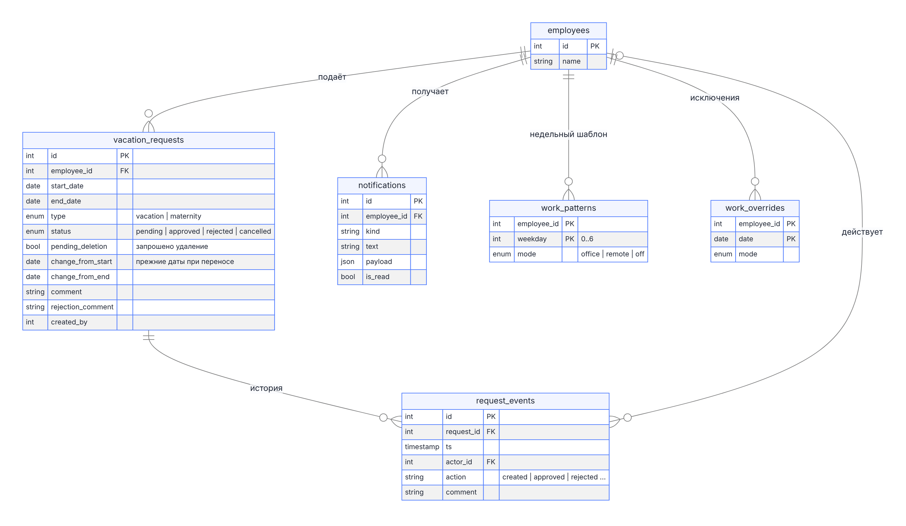

Заявка хранит актуальные даты; при переносе согласованного отпуска прежние даты лежат в `change_from_start` и `change_from_end` до решения руководителя, запрос удаления — флаг `pending_deletion`. История действий по заявке (`request_events`) только дополняется.

## Кадровый учёт

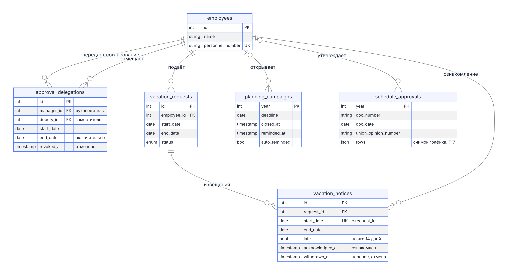

Утверждённый график (`schedule_approvals`) — одна строка на год с реквизитами документа, мнением профсоюза и неизменяемым снимком строк графика в JSONB (ADR-016): повторная выгрузка формы Т-7 через год даёт тот же документ, а переносы и отмены после утверждения берутся из текущих заявок.

## Служебные данные

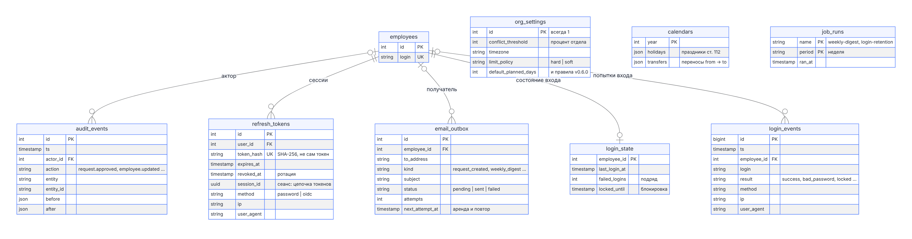

Сеанс — цепочка строк `refresh_tokens` с общим `session_id`; в БД хранится только SHA-256 refresh-токена. Состояние входа (неудачные попытки подряд, блокировка) хранится в `login_state` отдельно от `employees`, чтобы вход не менял версию данных графика. Таблица `login_attempts` нежурналируемая (`UNLOGGED`): не пишется в WAL и не реплицируется — для минутных счётчиков это допустимо.

## Целостность данных

| Инвариант | Где обеспечивается | Ответ при нарушении |
| --- | --- | --- |
| Активные заявки одного сотрудника не пересекаются | Сервис заявок под блокировкой строки сотрудника (`SELECT … FOR UPDATE`) | `409 overlapping-request` |
| При жёсткой политике заявка не превышает доступный остаток | Сервис заявок под той же блокировкой | `409 limit-exceeded` |
| Решение по заявке применяется один раз | Блокировка строки заявки и повторное чтение в транзакции | `409 stale-state` |
| Изменение данных и запись журнала неразделимы | Одна транзакция Prisma; в API нет операций изменения и удаления журнала | — |
| В системе остаётся хотя бы один администратор | Сервис сотрудников | `409 last-admin` |
| Refresh-токен обменивается один раз | `UPDATE … WHERE revoked_at IS NULL RETURNING` в транзакции обновления | `401` |
| Одно извещение на заявку и дату начала, в том числе из разных процессов | Уникальный индекс, `INSERT … ON CONFLICT DO NOTHING` | — |
| Письмо создаётся вместе с событием и отправляется один раз | Outbox в транзакции уведомления; разбор с `FOR UPDATE SKIP LOCKED` и арендой | — |
| Версия данных растёт при любом изменении графика | Отложенные триггеры на таблицах графика при фиксации транзакции | — |
| Пароль не хранится и не возвращается | Только scrypt-хеш; DTO ответа без хеша | — |

Полный перечень инвариантов, индексов и правил изменения схемы — документ 4 «Модель данных»; состав полей — приложение А «Словарь данных».

## Жизненный цикл заявки

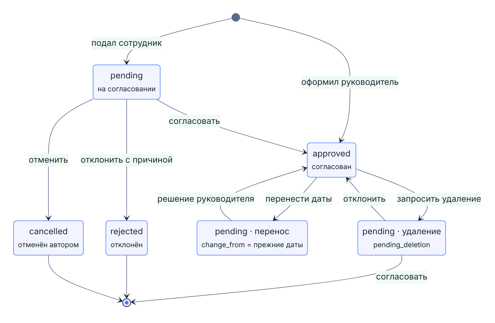

# Ключевые сценарии взаимодействия

## Вход и продление сеанса

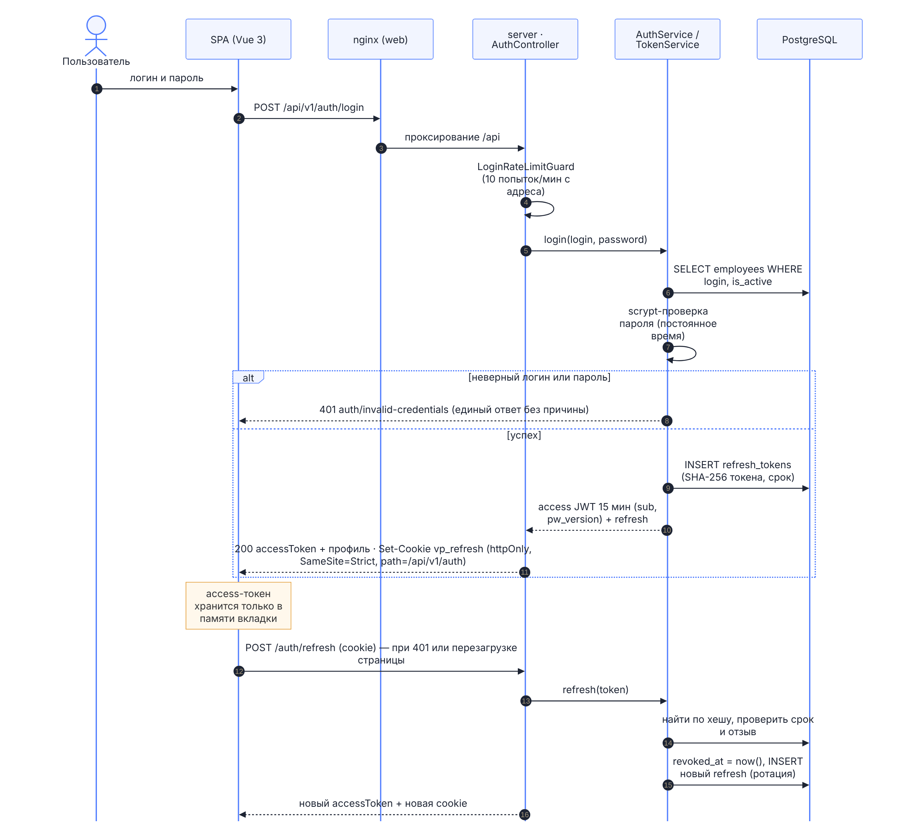

## Подача заявки

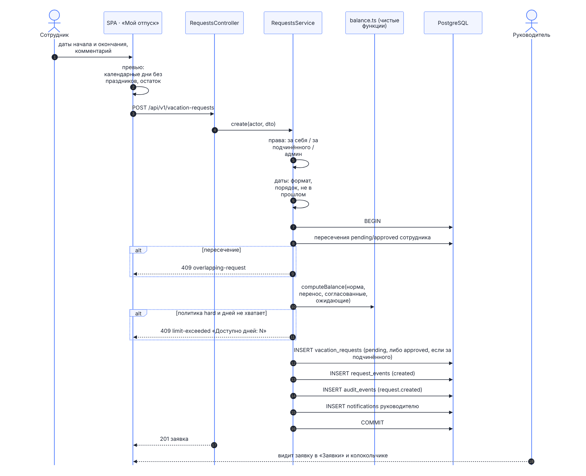

Сервер проверяет права, формат и порядок дат, «не в прошлом» (кроме администратора), пересечения с заявками сотрудника и лимит дней; заявка, событие истории, запись аудита и уведомление согласующему фиксируются одной транзакцией. Из двух одновременно отправленных пересекающихся заявок создаётся ровно одна.

## Согласование и отклонение

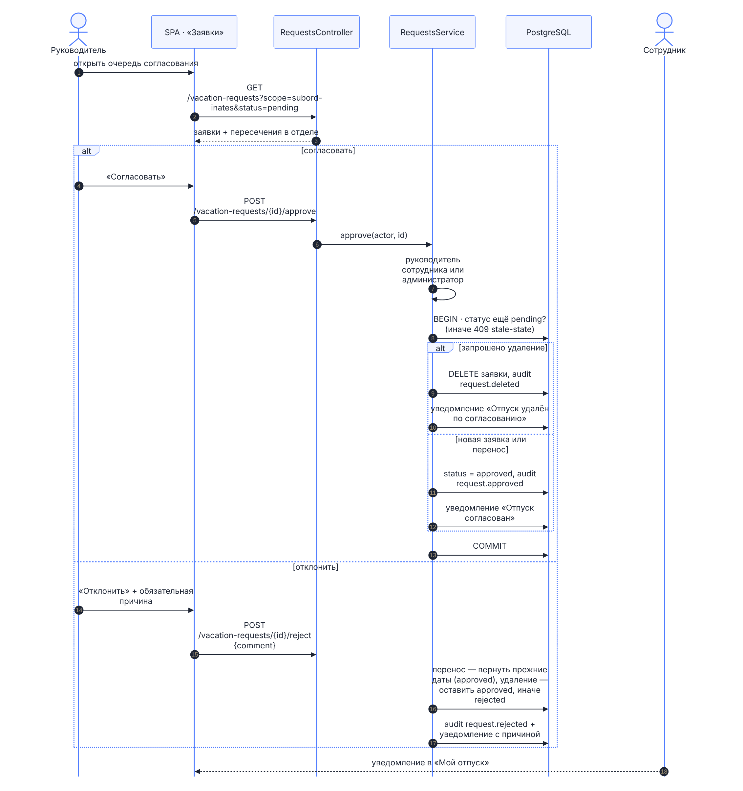

Отклонение требует причины (3–1000 символов). Для переноса отклонение возвращает прежние даты, для запроса удаления — оставляет отпуск согласованным. Из двух одновременных решений применяется одно, второе получает `409 stale-state`.

## Построение графика

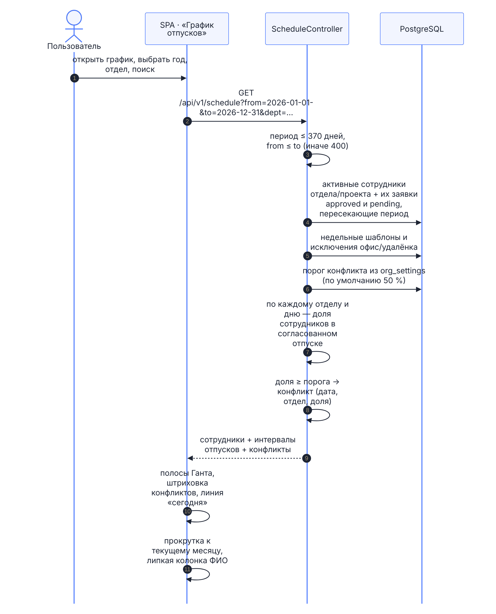

# Программные интерфейсы

REST API v1 доступен по префиксу `/api/v1`; обмен — JSON в кодировке UTF-8, загрузка файлов импорта — `multipart/form-data` (до 2 МБ). Формальный контракт — `contracts/openapi-vacation-api-v1.yaml` (OpenAPI 3.1); сервер публикует интерактивную спецификацию реализации на `/api/docs`. Основные правила протокола:

| Правило | Содержание |
| --- | --- |
| Аутентификация | Заголовок `Authorization: Bearer <access JWT>`; refresh-токен передаётся только httpOnly-cookie `vp_refresh` |
| Публичные операции | Вход, обновление токена по cookie, политика паролей, операции единого входа, поток событий по билету, праздники года; остальные операции требуют входа |
| Пагинация | `page` (с 1) и `per_page` (1–200, по умолчанию 50); ответ `{ items, meta }` |
| Изменения | `PATCH` только с изменяемыми полями; неизвестные поля запроса отбрасываются, клиент игнорирует неизвестные поля ответа |
| Ошибки | Только `application/problem+json` (RFC 9457) с кодом из каталога; перегрузка или недоступность БД — `503` с `Retry-After` |
| Кэширование | `GET /schedule` отдаёт слабый `ETag` по версии данных; запрос с совпадающим `If-None-Match` получает `304` без тела |
| Ограничение тяжёлых чтений | График — не длиннее 370 дней, график работы и подбор дат — не длиннее 400 дней |
| Версионирование | Версия — в префиксе пути. Несовместимое изменение — новый префикс `/api/v2`, обе версии работают не меньше 6 месяцев; добавляющие изменения — в рамках v1 |

Служебные адреса вне контракта: `GET /healthz` (процесс жив), `GET /readyz` (доступна БД), `GET /metrics` (метрики Prometheus, при заданном `METRICS_TOKEN` — с Bearer-токеном). Через nginx стенда они наружу не публикуются.

Полный каталог операций сформирован из контракта; права по ролям — подраздел «Модель авторизации» раздела «Информационная безопасность», права на каждое действие — матрица прав документа 2 «Спецификация API v1».

<!-- BEGIN:api-catalog -->
Всего операций: **83** в 67 путях; формат — JSON, ошибки — `application/problem+json`.

**Вход и сессии** (13)

| Метод | Путь | Назначение | Операция |
|---|---|---|---|
| POST | `/api/v1/auth/login` | Вход по логину и паролю | `login` |
| POST | `/api/v1/auth/refresh` | Новый access-токен по refresh-cookie (ротация; старый refresh отзывается) | `refresh` |
| POST | `/api/v1/auth/password` | Смена своего пароля (все сессии завершаются) | `changeOwnPassword` |
| GET | `/api/v1/auth/password-policy` | Требования к паролю — минимальная длина (для форм смены пароля) | `getPasswordPolicy` |
| GET | `/api/v1/auth/sessions` | Мои активные сеансы | `listMySessions` |
| DELETE | `/api/v1/auth/sessions/{id}` | Завершить свой сеанс (текущий — как выход) | `revokeMySession` |
| POST | `/api/v1/auth/sessions/revoke-others` | Завершить все свои сеансы, кроме текущего | `revokeOtherSessions` |
| POST | `/api/v1/auth/logout` | Завершить сессию | `logout` |
| GET | `/api/v1/auth/me` | Текущий пользователь и его права | `getMe` |
| PATCH | `/api/v1/auth/me` | Личные настройки — письма о заявках | `updateMyPreferences` |
| GET | `/api/v1/auth/oidc/config` | Единый вход — включён ли, подпись кнопки, разрешён ли вход по паролю | `getSsoConfig` |
| GET | `/api/v1/auth/oidc/start` | Начать вход через провайдер OpenID Connect | `startSso` |
| GET | `/api/v1/auth/oidc/callback` | Возврат от провайдера | `ssoCallback` |

**Аудит** (2)

| Метод | Путь | Назначение | Операция |
|---|---|---|---|
| GET | `/api/v1/login-events` | Журнал входов (администратор, кадровая служба) | `listLoginEvents` |
| GET | `/api/v1/audit-events` | Журнал изменений (администратор, кадровая служба) | `listAuditEvents` |

**Замещение** (3)

| Метод | Путь | Назначение | Операция |
|---|---|---|---|
| GET | `/api/v1/delegations` | Замещения: переданные мной и полученные мной (действующие и будущие) | `listDelegations` |
| POST | `/api/v1/delegations` | Передать согласование заместителю на период | `createDelegation` |
| DELETE | `/api/v1/delegations/{id}` | Отменить замещение (руководитель или кадровая служба) | `revokeDelegation` |

**Извещения** (4)

| Метод | Путь | Назначение | Операция |
|---|---|---|---|
| GET | `/api/v1/notices/mine` | Мои действующие извещения о начале отпуска (предстоящие и за последние 90 дней) | `listMyNotices` |
| GET | `/api/v1/notices` | Журнал извещений (кадровая служба, администратор) | `listNotices` |
| GET | `/api/v1/notices/{id}` | Извещение для печати под подпись (сотрудник — своё, кадровая служба — любое) | `getNotice` |
| POST | `/api/v1/notices/{id}/acknowledge` | Ознакомлен с извещением (только сам сотрудник) | `acknowledgeNotice` |

**Планирование и форма Т-7** (7)

| Метод | Путь | Назначение | Операция |
|---|---|---|---|
| GET | `/api/v1/planning/mine` | Открытая кампания планирования и мой прогресс | `getMyPlanning` |
| GET | `/api/v1/planning/{year}` | Кампания, утверждение и прогресс по отделам (кадровая служба, администратор) | `getPlanning` |
| GET | `/api/v1/planning/{year}/employees` | Прогресс планирования по сотрудникам (кадровая служба) | `listPlanningEmployees` |
| POST | `/api/v1/planning/{year}/open` | Открыть планирование на год, открыть снова или изменить срок | `openPlanning` |
| POST | `/api/v1/planning/{year}/close` | Закрыть планирование (planning.closed в аудите) | `closePlanning` |
| POST | `/api/v1/planning/{year}/remind` | Напомнить не спланировавшим отпуск | `remindPlanning` |
| POST | `/api/v1/planning/{year}/approve` | Утвердить график отпусков на год | `approveSchedule` |

**Сотрудники** (10)

| Метод | Путь | Назначение | Операция |
|---|---|---|---|
| GET | `/api/v1/employees` | Список сотрудников (постранично, с фильтрами) | `listEmployees` |
| POST | `/api/v1/employees` | Создать сотрудника (кадровая служба, администратор; служебные права выдаёт администратор) | `createEmployee` |
| GET | `/api/v1/employees/{id}` | Карточка сотрудника | `getEmployee` |
| PATCH | `/api/v1/employees/{id}` | Изменить поля сотрудника | `updateEmployee` |
| DELETE | `/api/v1/employees/{id}` | Уволить/удалить сотрудника (кадровая служба — кроме администраторов и коллег по службе; администратор) | `deleteEmployee` |
| PUT | `/api/v1/employees/{id}/password` | Смена пароля (свой — со старым; чужой — кадровая служба, пароль одноразовый) | `changePassword` |
| POST | `/api/v1/employees/{id}/password-reset` | Сброс пароля — сервер выдаёт одноразовый пароль (кадровая служба) | `resetPassword` |
| GET | `/api/v1/employees/{id}/security` | Учётная запись: последний вход, блокировка, одноразовый пароль, сеансы (кадровая служба) | `getEmployeeSecurity` |
| POST | `/api/v1/employees/{id}/unlock` | Снять блокировку после неудачных попыток входа (кадровая служба) | `unlockEmployee` |
| POST | `/api/v1/employees/{id}/sessions/revoke` | Завершить все сеансы сотрудника (кадровая служба) | `revokeEmployeeSessions` |

**Баланс** (1)

| Метод | Путь | Назначение | Операция |
|---|---|---|---|
| GET | `/api/v1/employees/{id}/balance` | Баланс дней отпуска за год | `getBalance` |

**График и режим работы** (5)

| Метод | Путь | Назначение | Операция |
|---|---|---|---|
| PUT | `/api/v1/employees/{id}/work-pattern` | Недельный шаблон офис/удалёнка (свой или подчинённый) | `setWorkPattern` |
| PUT | `/api/v1/employees/{id}/work-overrides` | Ручное переопределение режима на дату | `setWorkOverride` |
| GET | `/api/v1/employees/{id}/work-schedule` | График работы — недельный шаблон и исключения за период (с v0.3.0) | `getWorkSchedule` |
| DELETE | `/api/v1/employees/{id}/work-overrides/{date}` | Снять исключение — на дату снова действует недельный шаблон (с v0.3.0) | `deleteWorkOverride` |
| GET | `/api/v1/schedule` | График отпусков и режимов за период | `getSchedule` |

**Заявки на отпуск** (7)

| Метод | Путь | Назначение | Операция |
|---|---|---|---|
| GET | `/api/v1/vacation-requests` | Заявки (свои, подчинённых или все — по правам) | `listVacationRequests` |
| POST | `/api/v1/vacation-requests` | Создать заявку (за себя или за подчинённого) | `createVacationRequest` |
| GET | `/api/v1/vacation-requests/{id}` | Заявка с историей | `getVacationRequest` |
| PATCH | `/api/v1/vacation-requests/{id}` | Изменить свою pending-заявку или запросить перенос approved | `updateVacationRequest` |
| DELETE | `/api/v1/vacation-requests/{id}` | Отменить свою pending-заявку или запросить удаление approved | `cancelVacationRequest` |
| POST | `/api/v1/vacation-requests/{id}/approve` | Согласовать (руководитель сотрудника или администратор) | `approveVacationRequest` |
| POST | `/api/v1/vacation-requests/{id}/reject` | Отклонить с обязательным комментарием | `rejectVacationRequest` |

**Справочники** (12)

| Метод | Путь | Назначение | Операция |
|---|---|---|---|
| GET | `/api/v1/departments` | Отделы с руководителями и численностью | `listDepartments` |
| POST | `/api/v1/departments` | Создать отдел (кадровая служба, администратор) | `createDepartment` |
| PATCH | `/api/v1/departments/{name}` | Переименовать, сменить руководителя | `updateDepartment` |
| DELETE | `/api/v1/departments/{name}` | Удалить отдел (нельзя при наличии сотрудников) | `deleteDepartment` |
| GET | `/api/v1/projects` | Проекты | `listProjects` |
| POST | `/api/v1/projects` | Создать проект (кадровая служба, администратор) | `createProject` |
| PATCH | `/api/v1/projects/{id}` | Изменить проект | `updateProject` |
| DELETE | `/api/v1/projects/{id}` | Удалить проект (нельзя при наличии участников) | `deleteProject` |
| GET | `/api/v1/groups` | Пользовательские группы для фильтров | `listGroups` |
| POST | `/api/v1/groups` | Создать группу | `createGroup` |
| PATCH | `/api/v1/groups/{id}` | Изменить название или состав | `updateGroup` |
| DELETE | `/api/v1/groups/{id}` | Удалить группу | `deleteGroup` |

**Настройки** (3)

| Метод | Путь | Назначение | Операция |
|---|---|---|---|
| GET | `/api/v1/settings` | Настройки организации | `getSettings` |
| PATCH | `/api/v1/settings` | Изменить настройки (только администратор) | `updateSettings` |
| POST | `/api/v1/settings/test-email` | Проверочное письмо администратору (проверка SMTP после развёртывания) | `sendTestEmail` |

**Производственный календарь** (2)

| Метод | Путь | Назначение | Операция |
|---|---|---|---|
| GET | `/api/v1/calendar/holidays/{year}` | Праздники и переносы производственного календаря | `getHolidays` |
| PUT | `/api/v1/calendar/holidays/{year}` | Загрузить или изменить календарь года (кадровая служба, администратор) | `setHolidays` |

**Уведомления** (3)

| Метод | Путь | Назначение | Операция |
|---|---|---|---|
| GET | `/api/v1/notifications` | Уведомления текущего пользователя | `listNotifications` |
| POST | `/api/v1/notifications/read-all` | Пометить прочитанными все уведомления (с v0.5.0) | `markAllNotificationsRead` |
| POST | `/api/v1/notifications/{id}/read` | Пометить прочитанным | `markNotificationRead` |

**imports** (2)

| Метод | Путь | Назначение | Операция |
|---|---|---|---|
| POST | `/api/v1/imports/employees` | Импорт сотрудников и остатков — предпросмотр или применение | `importEmployees` |
| GET | `/api/v1/imports/employees/template` | Шаблон XLSX для импорта сотрудников | `getImportTemplate` |

**events** (2)

| Метод | Путь | Назначение | Операция |
|---|---|---|---|
| POST | `/api/v1/events/ticket` | Билет на поток событий (60 секунд) | `getEventsTicket` |
| GET | `/api/v1/events` | Поток событий (text/event-stream) | `streamEvents` |

**Отчёты** (3)

| Метод | Путь | Назначение | Операция |
|---|---|---|---|
| GET | `/api/v1/reports/vacations` | Выгрузка отпусков за период (XLSX) | `exportVacations` |
| GET | `/api/v1/reports/t7` | График отпусков по унифицированной форме Т-7 (XLSX; кадровая служба) | `exportT7` |
| GET | `/api/v1/reports/notices` | Журнал извещений за период (XLSX; кадровая служба, администратор) | `exportNotices` |

**Аналитика** (4)

| Метод | Путь | Назначение | Операция |
|---|---|---|---|
| GET | `/api/v1/analytics/departments` | Отделы, доступные пользователю для аналитики (с v0.3.0) | `listAnalyticsDepartments` |
| GET | `/api/v1/analytics/overview` | Нагрузка отдела по месяцам, периоды конфликтов, распределение дней, выводы (с v0.3.0) | `getDepartmentOverview` |
| GET | `/api/v1/analytics/team` | Состав отдела или проекта на дату — офис, удалёнка, отпуск, выходной (с v0.3.0) | `getTeamToday` |
| GET | `/api/v1/analytics/suggestions` | Лучшие окна для отпуска с учётом нагрузки отдела и праздников (с v0.3.0) | `suggestVacationDates` |
<!-- END:api-catalog -->

## Коды ошибок

Поле `type` ответа об ошибке — `https://vacation.planner/problems/<код>`: это идентификатор кода, а не адрес, по нему программа не обращается. `title` — короткий текст для человека, `detail` — уточнение для конкретного случая.

<!-- BEGIN:error-catalog -->
| Код (type) | HTTP | Заголовок (title) |
|---|---|---|
| `auth/invalid-credentials` | 401 | Неверный логин или пароль |
| `auth/token-expired` | 401 | Сессия истекла |
| `auth/forbidden` | 403 | Недостаточно прав для этого действия |
| `auth/account-locked` | 423 | Учётная запись временно заблокирована после неудачных попыток входа |
| `auth/password-change-required` | 403 | Смените пароль, выданный администратором |
| `validation/invalid-field` | 400 | Некорректно заполнено поле |
| `validation/weak-password` | 400 | Пароль не соответствует политике паролей |
| `validation/bad-date-range` | 400 | Дата окончания раньше даты начала или даты в прошлом |
| `not-found` | 404 | Запись не существует или удалена |
| `overlapping-request` | 409 | Период пересекается с существующей заявкой |
| `limit-exceeded` | 409 | Превышен остаток дней отпуска |
| `stale-state` | 409 | Данные изменились: обновите страницу и повторите |
| `last-admin` | 409 | Нельзя удалить или разжаловать последнего администратора |
| `department-not-empty` | 409 | В отделе ещё есть сотрудники |
| `rate-limited` | 429 | Слишком много запросов. Повторите позже. |
| `calendar-missing` | 400 | Для этого года не загружен производственный календарь |
| `service-unavailable` | 503 | Сервис перегружен. Повторите через несколько секунд. |
<!-- END:error-catalog -->

# Информационная безопасность

## Аутентификация и сеансы

| Механизм | Реализация |
| --- | --- |
| Хранение паролей | scrypt (N = 16384, r = 8, p = 1) с 16-байтной случайной солью, вычисление в пуле потоков, сравнение за постоянное время (`server/src/auth/passwords.ts`); для несуществующего логина проверяется подставной хеш — время ответа не выдаёт, есть ли учётная запись. Пароли не попадают в журналы, ответы и выгрузки |
| Access-токен | JWT HS256 сроком 15 минут; принимается только алгоритм HS256; хранится в памяти вкладки, не в браузерном хранилище |
| Refresh-токен | Случайные 32 байта в cookie `vp_refresh` (`HttpOnly`, `SameSite=Strict`, `Secure` в режиме production, путь `/api/v1/auth`) сроком 30 дней; в БД хранится только SHA-256 |
| Ротация | Каждое обновление атомарно отзывает использованный refresh-токен и выдаёт новый. Повтор того же токена в течение 30 секунд (параллельные вкладки) получает пару того же сеанса; позднее повторное предъявление считается кражей — сеанс завершается целиком, в журнал входов пишется `refresh_reuse` (ADR-015) |
| Сеансы | Цепочка refresh-токенов одного входа; access-токен несёт идентификатор сеанса. Сотрудник видит свои сеансы (способ входа, адрес, браузер, время) и завершает любой или все остальные; кадровая служба завершает сеансы сотрудника. Завершённый сеанс теряет доступ и поток событий не позже чем через 10 секунд |
| Блокировка | После `lockoutThreshold` неудачных попыток подряд (по умолчанию 10; 0 — выключено) учётная запись блокируется на `lockoutMinutes` (по умолчанию 15). Неверный старый пароль при смене пароля тоже считается неудачной попыткой — с похищенным сеансом пароль не подобрать перебором. `423 auth/account-locked` при входе выдаётся только при верном пароле, иначе — обычный `401`: подбирающий не узнаёт, что пароль угадан. Сотрудник получает уведомление, кадровая служба снимает блокировку |
| Политика паролей | Длина не меньше `passwordMinLength` (8–64), без логина и фамилии, не из распространённых (с учётом русской раскладки и транслита), не последовательность клавиш или цифр, не совпадает с текущим (`server/src/auth/password-policy.ts`) |
| Одноразовый пароль | Пароль, выданный при создании, импорте или сбросе, требуется сменить при первом входе: до смены API отвечает `403 auth/password-change-required` на всё, кроме смены пароля, профиля и выхода; сброс генерирует сервер |
| Смена пароля и увольнение | Смена пароля увеличивает версию пароля, увольнение снимает признак активности: выданные токены перестают действовать (`401 auth/token-expired`), refresh-токены отзываются сразу |
| Ограничение частоты входа | 10 попыток в минуту на пару «адрес + логин» и 60 на адрес → `429` с `Retry-After`; окна хранятся в PostgreSQL и общие для всех процессов и экземпляров (ADR-012); адрес клиента берётся из `X-Forwarded-For` только от доверенных прокси частных сетей (`TRUST_PROXY`) |
| Поток событий | Открывается по одноразовому билету на 60 секунд с отдельной аудиторией JWT: билетом нельзя вызвать другие операции, токен не попадает в адрес и журналы прокси |
| Ответ на неверный вход | Единый `401 auth/invalid-credentials` без указания причины |
| Единый вход (OIDC) | Authorization code + PKCE (S256); `state`, `nonce` и `code_verifier` — в подписанной httpOnly-cookie на 10 минут; `id_token` проверяется по ключам JWKS провайдера (подпись, издатель, получатель, срок, `nonce`); сотрудник сопоставляется по логину из утверждения `OIDC_LOGIN_CLAIM`; уволенного или неизвестного сотрудника единый вход не пускает |
| Отключение входа по паролю | `LOCAL_LOGIN=false`: пароль остаётся только у администраторов — аварийный вход при недоступности провайдера |
| Секрет подписи | `JWT_SECRET` из окружения; сервер не запускается, если секрет не задан или короче 32 символов, а `docker compose` — если он не задан в `.env`: значения по умолчанию нет. Access-токен принимается только с идентификатором живого сеанса из БД, поэтому одного секрета для подделки токена недостаточно |

## Защита запросов

| Угроза | Мера |
| --- | --- |
| Межсайтовый скриптинг (XSS) | Данные пользователей выводятся только интерполяцией Vue с автоэкранированием, `v-html` в клиенте запрещён правилами разработки; Content Security Policy nginx: `default-src 'self'; script-src 'self'` без inline-скриптов, `frame-ancestors 'none'`, `base-uri 'self'`, `form-action 'self'`. E2e-тесты интерфейса выполняются под той же политикой и падают при её нарушении |
| Подделка межсайтовых запросов (CSRF) | Изменяющие операции требуют заголовка `Authorization` с токеном из памяти вкладки; refresh-cookie — `SameSite=Strict` и только для пути `/api/v1/auth` |
| Внедрение SQL | Запросы через Prisma; сырые запросы — только параметризованные (`$queryRaw` с параметрами) |
| Подмена полей запроса | DTO-валидация (class-validator) с `whitelist`: неизвестные поля отбрасываются, длины и форматы ограничены |
| Встраивание во фреймы, подмена типа, утечки Referer | `X-Frame-Options: DENY`, `X-Content-Type-Options: nosniff`, `Referrer-Policy: strict-origin-when-cross-origin`, `Permissions-Policy` — на статике (`web/nginx.conf`) и на ответах API (`server/src/app.setup.ts`); nginx не раскрывает версию (`server_tokens off`) |
| Перехват трафика | HTTPS и HSTS на обратном прокси организации; refresh-cookie с признаком `Secure` в режиме production |
| Несанкционированный доступ к метрикам | `/metrics` не проксируется nginx наружу; при заданном `METRICS_TOKEN` требуется Bearer-токен, сравнение за постоянное время |
| Раскрытие сведений в ошибках | Только коды из каталога; внутренние ошибки — `500` без подробностей; журнал сервера не содержит паролей, токенов, тел запросов и параметров SQL |
| Чрезмерные загрузки | Файл импорта — не больше 2 МБ и один на запрос; тяжёлые чтения ограничены периодом |
| Гонки при параллельной работе | Блокировки строк (`FOR UPDATE`, `FOR NO KEY UPDATE`), повторное чтение в транзакции, атомарные `UPDATE … RETURNING`, уникальные ключи для плановых задач |
| Перегрузка | Нет свободного соединения с БД или БД недоступна — `503 service-unavailable` с `Retry-After`; клиент повторяет чтение после паузы |

## Модель авторизации

| Роль | Права |
| --- | --- |
| Сотрудник | Свои заявки, баланс, режим работы, извещения и сеансы; общий график; команда и аналитика своего отдела; подбор дат для себя |
| Руководитель | Дополнительно: согласование заявок и оформление отпусков прямых подчинённых (руководитель отдела — и сотрудников отдела без руководителя), их режим работы, аналитика своих отделов, выгрузка своей области; передача согласования заместителю |
| Заместитель | На период замещения — права руководителя по заявкам его команды; свою заявку не согласует |
| Вышестоящий по эскалации | Решение по заявке, переданной ему после `escalationDays` дней без решения |
| Кадровая служба | Сотрудники и импорт, оргструктура, производственный календарь, выгрузки и аналитика всей организации, журналы аудита и входов, блокировки, сеансы и сброс паролей сотрудников, кампания планирования, утверждение графика и форма Т-7, журнал извещений. Не меняет правила организации, не согласует заявки, не меняет учётные записи администраторов и коллег по службе |
| Администратор | Всё, включая правила организации, выдачу служебных ролей и согласование любых заявок; последнего администратора удалить или разжаловать нельзя (`409 last-admin`) |

Роли и права на объекты проверяются на сервере в каждом запросе; права служебных ролей читаются из БД (`server/src/auth/access.ts`), а не из токена, поэтому снятие роли действует сразу. Данные чужих отделов в браузер не передаются: аналитика считается на сервере. Карточку коллеги сотрудник без служебной роли получает справочной — ФИО, должность, отдел, руководитель; логин, почта, нормы дней, табельный номер и служебные права видны только самому сотруднику, его руководителю, кадровой службе и администратору. Каждая операция API каждой ролью проверяется автоматическим тестом матрицы прав (`server/test/rights-matrix.e2e.test.ts`): новая операция без строки в матрице не проходит CI. Подробная матрица «действие × роль» — документ 2, раздел «Матрица прав».

## Журналирование и аудит

| Журнал | Содержание |
| --- | --- |
| Журнал изменений `audit_events` | Каждое изменение данных: кто, когда, действие, объект, значения до и после. Запись выполняется в той же транзакции, что и само изменение (ADR-006), поэтому не может потеряться или появиться без изменения. Журнал только дополняется: в API нет операций его изменения и удаления. Администратор и кадровая служба просматривают его с фильтрами и раскрытием изменённых полей; выгрузки отчётов тоже фиксируются |
| Журнал входов `login_events` | Успешный вход паролем и через единый вход, неверный пароль, неизвестный логин, блокировка, отказ по частоте, вход при отключённом пароле, неизвестный пользователь единого входа, повтор refresh-токена — с адресом и браузером. Запись не прерывает вход при ошибке; срок хранения — `loginRetentionDays` (по умолчанию 365 дней), старые записи удаляет ежедневная задача (ADR-015) |
| Журнал сервера | Строки JSON в stdout контейнера (`LOG_FORMAT=json`): время, уровень, сообщение, идентификатор запроса; медленные запросы и ответы 5xx с маршрутом, кодом, длительностью, идентификатором сотрудника и адресом; медленные запросы к БД — без параметров. Пароли, токены и тела запросов не пишутся |
| Журнал nginx | Каждый запрос с идентификатором `rid=` и временем ответа |

## Подтверждение мер защиты

Сводка требований безопасности для приёмки службой ИБ — 16 требований с указанием, как каждое выполнено и каким автоматическим тестом подтверждается, — приведена в проектной документации (`docs/specs/01-architecture.md`, раздел «Чек-лист безопасности»). Тесты выполняются в конвейерах CI: `auth.e2e`, `security.e2e`, `oidc.e2e`, `passwords.unit`, `password-policy.unit`, `contract.e2e` и e2e-сценарии интерфейса, включая проверку CSP на всех экранах.

В рамках версии 1.0.0 выполняются самооценка по OWASP ASVS (уровень 1) и автоматическая проверка матрицы прав «каждая операция контракта × каждая роль» (история E50-02); их результаты оформляются отдельным отчётом. Документ не заявляет сертификатов соответствия.

## Настраивает организация при развёртывании

- TLS-сертификат, перенаправление на HTTPS и HSTS на обратном прокси или балансировщике;
- собственный `JWT_SECRET` — случайная строка не короче 32 символов (без него `docker compose` стенд не запускает);
- пароль учётной записи PostgreSQL; порт PostgreSQL опубликован только на локальном интерфейсе узла (`127.0.0.1:5432`), из сети стенда он доступен контейнерам;
- провайдер единого входа и почтовый релей — при необходимости;
- отдельное хранилище для резервных копий и архива WAL;
- доступ к `/metrics` только для мониторинга, при общей сети — `METRICS_TOKEN`;
- `TRUST_PROXY`, если прокси организации имеет публичный адрес;
- правила организации по паролям, блокировке и сроку хранения журнала входов.

# Технологическая независимость

| Требование | Как обеспечено |
| --- | --- |
| Нет обращений к внешним сервисам при работе | Программный код сервера обращается только к собственной БД и к адресам, которые задаёт организация: почтовому релею (`SMTP_HOST`) и провайдеру единого входа (`OIDC_ISSUER`); обе интеграции необязательны. Клиент обращается только к собственному серверу: CSP `connect-src 'self'`, `img-src 'self' data:`, `font-src 'self'` |
| Нет передачи данных правообладателю и телеметрии | В программе нет модулей сбора статистики, отчётов об ошибках и связи с серверами правообладателя; журналы, метрики и резервные копии остаются в контуре организации |
| Нет принудительного обновления и удалённого управления | Программа не проверяет наличие обновлений, не загружает и не устанавливает их; обновление выполняет администратор организации по своему решению (раздел «Обновление» «Руководства по развёртыванию»); механизмов удалённого управления нет |
| Работа в закрытом контуре | Работа без доступа в интернет — требование технического задания; образ `server` содержит утилиту миграций и все зависимости, поэтому стенд запускается и применяет миграции без сети; сборка клиента не использует внешние CDN и шрифты |
| Свободные компоненты под разрешительными лицензиями | SBOM CycloneDX 1.5 серверной и клиентской частей формируется в каждом прогоне CI; copyleft-лицензии и неопределённые лицензии блокируют слияние. По отчёту `docs/sbom/licenses-report.md` — 852 компонента, все лицензии разрешительные, препятствий для регистрации не выявлено |
| Нет зависимости от облачных сервисов иностранных производителей | Все компоненты устанавливаются на серверы организации; общее состояние — в PostgreSQL без внешних хранилищ и брокеров |

Утилита миграций Prisma CLI, которая запускается при старте контейнера `server` (`prisma migrate deploy`), умеет проверять наличие новой версии на сервере разработчика утилиты (`checkpoint.prisma.io`). В образе `server` эта проверка отключена переменной `CHECKPOINT_DISABLE=1` — и при сборке, и при работе (`server/Dockerfile`, версия 1.0.0).

## Сетевые взаимодействия

| Направление | Протокол | Когда | Настраивает |
| --- | --- | --- | --- |
| Браузер → обратный прокси → `web` | HTTPS → HTTP | Всегда | Организация (TLS) |
| `web` → `server` | HTTP внутри сети стенда | Всегда | Поставка |
| `server` → `postgres` | Протокол PostgreSQL внутри сети стенда | Всегда | Поставка |
| `server` → почтовый релей организации | SMTP (STARTTLS или TLS) | Если задан `SMTP_HOST` | Организация |
| `server` → провайдер единого входа организации | HTTPS (discovery, JWKS, обмен кода) | Если задан `OIDC_ISSUER` | Организация |
| Prometheus → `server` | HTTP `/metrics` внутри сети стенда | Профиль `monitoring` или Prometheus организации | Организация |
| `postgres` → `postgres-replica` | Потоковая репликация | С `docker-compose.replica.yml` | Организация |

## Образы и зависимости

| Компонент | Источник | Назначение |
| --- | --- | --- |
| `node:22-alpine` | Реестр образов Docker | Сборка и выполнение сервера, сборка клиента |
| `nginx:1.27-alpine` | Реестр образов Docker | Отдача клиента и проксирование API |
| `postgres:17-alpine` | Реестр образов Docker | СУБД, резервные копии, реплика, физические копии |
| `prom/prometheus:v3.5.0` | Реестр образов Docker | Необязательный сбор метрик |
| npm-пакеты сервера и клиента | Реестр npm; версии зафиксированы в `package-lock.json` | Зависимости приложения; состав — SBOM |

Сборка образов из исходных текстов требует доступа к реестру npm и реестру образов Docker либо к их зеркалам в контуре организации; работа собранной системы доступа к ним не требует. SBOM охватывает npm-зависимости сервера и клиента; программы в базовых образах контейнеров и их лицензии перечислены в документе «Сторонние компоненты и лицензии». Способ передачи готовых образов для установки без доступа к реестрам: `[заполняет правообладатель: дистрибутив образов и контрольные суммы]`.

## Независимость процессов разработки

Исходные тексты ведутся в Git и зеркалируются в GitHub и в Gitea организации. Конвейер Gitea Actions (`.gitea/workflows/server-ci.yml`) выполняет на собственных раннерах организации основной набор проверок — тесты сервера на PostgreSQL, проверку обновления на данных, сборку и тесты клиента, e2e интерфейса, SBOM и лицензионный гейт — и развёртывает стенд раннером `deploy`, получая код архивом из самого Gitea. Gitea — свободное ПО для размещения на собственных серверах, поэтому разработка, проверка и выпуск версий не зависят от доступности GitHub; размещение сервера Gitea указано в «Описании процессов жизненного цикла». Для полной автономии конвейера в контуре разработчика зеркалируются внешние источники, к которым обращаются задания: реестр npm, реестр образов Docker, используемые действия (`actions/checkout`, `actions/upload-artifact`) и браузер Chromium для Playwright.

# Наблюдаемость и эксплуатация

| Задача | Средство |
| --- | --- |
| Живость и готовность | `GET /healthz` (процесс), `GET /readyz` (запрос к БД); healthcheck контейнера PostgreSQL в compose |
| Метрики | `GET /metrics` в формате Prometheus: задержки и коды ответов по шаблонам маршрутов, задержка цикла событий, процессор и память, потоки SSE; из БД — соединения по состояниям, очередь писем, плановые задачи, реплики и архив WAL. Процессы кластера складываются; реестр метрик собственный, без сторонней библиотеки |
| Оповещения и панель | `deploy/monitoring/alerts.yml` — 15 правил: доступность API и БД, ошибки 5xx, задержки чтения и записи, перегрузка и соединения БД, долгие транзакции, задержка цикла событий, почта и сводка, реплика и архив WAL; панель `deploy/monitoring/grafana-dashboard.json` импортируется в Grafana организации (Grafana в поставку не входит) |
| Журналы и разбор инцидентов | JSON-журнал сервера и журнал nginx, связанные идентификатором запроса; «Код запроса» показывается пользователю при ошибке сервера; регламент «симптом → метрика → причина → действие», `pg_stat_statements`, профиль процессора и снимок памяти — `docs/runbooks/diagnostics.md` |
| Резервное копирование | Сервис `backup`: `pg_dump -Fc` раз в сутки, хранение 14 дней; ежемесячная проверка восстановления в отдельную БД |
| Реплика и архив WAL | `docker-compose.replica.yml`: горячий резерв, архив WAL (`archive_timeout` 5 минут), ежедневные физические копии; ручное проверяемое переключение на реплику (ADR-014), отрабатывается в CI GitHub |
| Целевые показатели восстановления | С репликой и архивом WAL: RPO — секунды (реплика) или до 5 минут (архив), RTO — около 15 минут по инструкции. Без них: RPO 24 часа, RTO 1 час |
| Миграции | `prisma migrate deploy` при старте `server`; повторный запуск безопасен; CI проверяет обновление с данными предыдущего выпуска (`scripts/upgrade-check.sh`) |
| Штатный останов | Процесс сервера получает `SIGTERM` от `docker compose stop`, завершает запросы и потоки событий; главный процесс кластера ждёт рабочие до 15 секунд |

# Технологический стек

| Область | Компоненты | Лицензии |
| --- | --- | --- |
| Клиент | Vue 3.5, Pinia 2.3, vue-router 4.6, Vite 6, TypeScript 5 | MIT, Apache-2.0 (TypeScript) |
| Сервер | Node.js 22 LTS (минимальная поддерживаемая — 20), NestJS 11 (платформа Express), class-validator, jsonwebtoken, cookie-parser, exceljs, nodemailer, @nestjs/swagger | MIT, MIT-0 (nodemailer) |
| Данные | PostgreSQL 17, Prisma 6 (схема, миграции, клиент) | PostgreSQL License, Apache-2.0 (Prisma) |
| Инфраструктура | Docker, Docker Compose, nginx 1.27, Prometheus 3 (необязательно) | — |
| Качество | Vitest, supertest, Playwright, ESLint 9, vue-tsc, CycloneDX (`@cyclonedx/cyclonedx-npm`) | MIT, Apache-2.0 |

Все компоненты — свободное ПО; полный перечень npm-зависимостей с версиями и лицензиями — SBOM (`sbom/server.cdx.json`, `sbom/web.cdx.json`, CycloneDX 1.5) и отчёт `docs/sbom/licenses-report.md`. Инструменты разработки и тестирования в рабочие образы не входят: образ `server` собирается без dev-зависимостей.

# Ключевые архитектурные решения

| Решение | Альтернатива | Обоснование |
| --- | --- | --- |
| Модульный монолит NestJS (ADR-001, ADR-009) | Микросервисы | Масштаб организации обслуживается одним приложением; DI, guards и OpenAPI из коробки; модули повторяют предметные области |
| PostgreSQL с первой версии (ADR-010) | SQLite с последующим переходом | Конкурентная запись, транзакции, репликация; нет миграционного долга |
| JWT и refresh с ротацией в БД (ADR-003, ADR-015) | Серверные сессии | Сервер без состояния для горизонтального масштабирования; отзыв и сеансы — через таблицу |
| scrypt из `node:crypto` (ADR-003) | bcrypt, argon2 | Без нативных зависимостей, достаточная стойкость |
| Аудит в транзакции изменения (ADR-006) | Асинхронные события | Журнал всегда согласован с данными |
| Vue 3 без библиотек компонентов (ADR-011) | PrimeVue, Quasar | Единая дизайн-система; минимальный состав сторонних компонентов |
| Общее состояние в PostgreSQL (ADR-012) | Redis | Одно хранилище в поставке и резервном копировании |
| SSE и опрос БД (ADR-013) | WebSocket, брокер сообщений | Сигналу «есть изменения» не нужен двусторонний канал; меньше компонентов |
| Реплика и архив WAL штатными средствами (ADR-014) | Patroni, repmgr | RPO и RTO требований достигаются без сервиса согласования |
| Утверждённый график — снимок (ADR-016) | Пометка на заявках | Запланированная дата формы Т-7 неизменна после утверждения |
| Плановые задачи с идемпотентностью в БД (ADR-017) | Отдельный планировщик, выбор лидера | Работают при любом числе процессов и экземпляров без новых компонентов |

# Направления развития архитектуры

Записи ADR фиксируют условия, при которых решения пересматриваются:

- больше 20 000 пользователей или несколько площадок — внешнее хранилище для лимитов и событий (ADR-012);
- больше 10 000 одновременных вкладок или доставка данных, а не сигнала, — пересмотр механизма живых обновлений (ADR-013);
- требование RTO меньше 5 минут или несколько площадок — автоматическое переключение кластера PostgreSQL (ADR-014);
- требование второго фактора — TOTP поверх существующей модели сеансов; мгновенное завершение сеансов во всех процессах — публикация события через `LISTEN/NOTIFY` (ADR-015);
- тяжёлые плановые задачи — отдельный рабочий процесс с очередью в PostgreSQL (ADR-017).

# Приложение А. Словарь данных

Состав полей всех таблиц сформирован из `server/prisma/schema.prisma`. Связи между таблицами показаны на ER-диаграммах раздела «Модель данных»; признаки: PK — первичный ключ, UK — уникальное значение, null — необязательное поле.

<!-- BEGIN:data-dictionary -->
**`employees`** — Сотрудники: учётные записи, роли, нормы дней

| Поле | Тип | Признаки | Примечание |
|---|---|---|---|
| `id` | Int | PK |  |
| `login` | String | UK |  |
| `password_hash` | String |  |  |
| `pw_version` | Int |  |  |
| `name` | String |  |  |
| `email` | String | null | уникальность без учёта регистра — частичным индексом в миграции employee_email |
| `position` | String | null |  |
| `dept_id` | Int | null |  |
| `role` | String |  | employee \| manager |
| `is_admin` | Boolean |  |  |
| `is_hr` | Boolean |  | кадровая служба: сотрудники, календарь, импорт, выгрузки, аудит |
| `emp_type` | String |  | staff \| ipsz |
| `manager_id` | Int | null |  |
| `projectId` | Int | null |  |
| `planned_days` | Float |  |  |
| `carry_over` | Float |  |  |
| `is_active` | Boolean |  |  |
| `email_notifications` | Boolean |  | отписка — в профиле |
| `must_change_password` | Boolean |  | пароль выдан при создании или сбросе (v0.6.0) |
| `password_changed_at` | DateTime | null |  |
| `personnel_number` | String | UK null | табельный номер — графа 4 формы Т-7 (v0.6.0) |
| `created_at` | DateTime |  |  |
| `updated_at` | DateTime |  |  |

**`departments`** — Отделы и их руководители

| Поле | Тип | Признаки | Примечание |
|---|---|---|---|
| `id` | Int | PK |  |
| `name` | String | UK |  |
| `manager_id` | Int | null |  |

**`projects`** — Проекты и руководители проектов

| Поле | Тип | Признаки | Примечание |
|---|---|---|---|
| `id` | Int | PK |  |
| `name` | String | UK |  |
| `manager_id` | Int | null |  |

**`groups`** — Личные группы для фильтров графика

| Поле | Тип | Признаки | Примечание |
|---|---|---|---|
| `id` | Int | PK |  |
| `owner_id` | Int |  |  |
| `name` | String |  |  |

**`group_members`** — Состав личных групп

| Поле | Тип | Признаки | Примечание |
|---|---|---|---|
| `group_id` | Int |  |  |
| `employee_id` | Int |  |  |

**`vacation_requests`** — Заявки на отпуск и их состояние

| Поле | Тип | Признаки | Примечание |
|---|---|---|---|
| `id` | Int | PK |  |
| `employee_id` | Int |  |  |
| `start_date` | DateTime |  |  |
| `end_date` | DateTime |  |  |
| `type` | RequestType |  |  |
| `status` | RequestStatus |  |  |
| `pending_deletion` | Boolean |  |  |
| `change_from_start` | DateTime | null |  |
| `change_from_end` | DateTime | null |  |
| `comment` | String | null |  |
| `rejection_comment` | String | null |  |
| `created_by` | Int |  |  |
| `created_at` | DateTime |  |  |
| `updated_at` | DateTime |  |  |
| `pending_since` | DateTime | null |  |
| `escalated_to` | Int | null |  |
| `escalated_at` | DateTime | null |  |

**`request_events`** — История действий по заявке

| Поле | Тип | Признаки | Примечание |
|---|---|---|---|
| `id` | Int | PK |  |
| `request_id` | Int |  |  |
| `ts` | DateTime |  |  |
| `actor_id` | Int | null |  |
| `action` | String |  |  |
| `comment` | String | null |  |

**`work_patterns`** — Недельный шаблон офис/удалёнка

| Поле | Тип | Признаки | Примечание |
|---|---|---|---|
| `employee_id` | Int |  |  |
| `weekday` | Int |  | 0 (вс) … 6 (сб) |
| `mode` | WorkMode |  |  |

**`work_overrides`** — Разовые исключения режима работы

| Поле | Тип | Признаки | Примечание |
|---|---|---|---|
| `employee_id` | Int |  |  |
| `date` | DateTime |  |  |
| `mode` | WorkMode |  |  |

**`org_settings`** — Правила организации (одна строка)

| Поле | Тип | Признаки | Примечание |
|---|---|---|---|
| `id` | Int | PK |  |
| `conflict_threshold` | Int |  |  |
| `timezone` | String |  |  |
| `limit_policy` | String |  | hard \| soft |
| `default_planned_days` | Int |  |  |
| `password_min_length` | Int |  |  |
| `lockout_threshold` | Int |  | неудачных попыток подряд; 0 — без блокировки |
| `lockout_minutes` | Int |  |  |
| `login_retention_days` | Int |  |  |
| `escalation_days` | Int |  |  |
| `notice_days` | Int |  |  |
| `org_name` | String | null |  |
| `org_okpo` | String | null |  |
| `head_position` | String | null |  |
| `head_name` | String | null |  |
| `hr_head_position` | String | null |  |
| `hr_head_name` | String | null |  |

**`calendars`** — Производственный календарь по годам

| Поле | Тип | Признаки | Примечание |
|---|---|---|---|
| `year` | Int | PK |  |
| `holidays` | Json |  | ["2026-01-01", …] |
| `transfers` | Json |  | [{"from":"2026-01-03","to":"2026-01-09"}, …] |

**`notifications`** — Уведомления пользователей

| Поле | Тип | Признаки | Примечание |
|---|---|---|---|
| `id` | Int | PK |  |
| `employee_id` | Int |  |  |
| `kind` | String |  |  |
| `text` | String |  |  |
| `payload` | Json | null |  |
| `is_read` | Boolean |  |  |
| `created_at` | DateTime |  |  |

**`audit_events`** — Неизменяемый журнал изменений

| Поле | Тип | Признаки | Примечание |
|---|---|---|---|
| `id` | Int | PK |  |
| `ts` | DateTime |  |  |
| `actor_id` | Int | null |  |
| `action` | String |  |  |
| `entity` | String |  |  |
| `entity_id` | String |  |  |
| `before` | Json | null |  |
| `after` | Json | null |  |

**`refresh_tokens`** — Хеши refresh-токенов (ротация, отзыв); цепочка одного входа — сеанс

| Поле | Тип | Признаки | Примечание |
|---|---|---|---|
| `id` | Int | PK |  |
| `user_id` | Int |  |  |
| `token_hash` | String | UK |  |
| `expires_at` | DateTime |  |  |
| `revoked_at` | DateTime | null |  |
| `created_at` | DateTime |  |  |
| `session_id` | String |  |  |
| `session_started_at` | DateTime |  |  |
| `method` | String |  | password \| oidc |
| `ip` | String | null |  |
| `user_agent` | String | null |  |

**`login_state`** — Состояние входа сотрудника: последний вход, неудачные попытки подряд, блокировка

| Поле | Тип | Признаки | Примечание |
|---|---|---|---|
| `employee_id` | Int | PK |  |
| `last_login_at` | DateTime | null |  |
| `failed_logins` | Int |  |  |
| `locked_until` | DateTime | null |  |

**`login_events`** — Журнал входов: успешные и неуспешные попытки, блокировки; срок хранения — правило организации

| Поле | Тип | Признаки | Примечание |
|---|---|---|---|
| `ts` | DateTime |  |  |
| `employee_id` | Int | null |  |
| `login` | String |  |  |
| `result` | String |  |  |
| `method` | String |  |  |
| `ip` | String | null |  |
| `user_agent` | String | null |  |

**`email_outbox`** — Очередь писем (outbox): пишется в транзакции события, отправляется фоном с повторами

| Поле | Тип | Признаки | Примечание |
|---|---|---|---|
| `id` | Int | PK |  |
| `employee_id` | Int | null |  |
| `to_address` | String |  |  |
| `kind` | String |  |  |
| `subject` | String |  |  |
| `body` | String |  |  |
| `status` | String |  | pending \| sent \| failed |
| `attempts` | Int |  |  |
| `next_attempt_at` | DateTime |  |  |
| `last_error` | String | null |  |
| `created_at` | DateTime |  |  |
| `sent_at` | DateTime | null |  |

**`job_runs`** — Отметки плановых задач: строка (задача, период) — задача за период уже выполнена

| Поле | Тип | Признаки | Примечание |
|---|---|---|---|
| `name` | String |  |  |
| `period` | String |  |  |
| `ran_at` | DateTime |  |  |

**`data_version`** — Версия данных графика: 16 строк-счётчиков, увеличиваются триггерами; версия — сумма

| Поле | Тип | Признаки | Примечание |
|---|---|---|---|
| `shard` | Int | PK |  |

**`login_attempts`** — Окна лимита входа по минутам (нежурналируемая таблица, общая для всех процессов)

| Поле | Тип | Признаки | Примечание |
|---|---|---|---|
| `key` | String |  |  |
| `window_start` | DateTime |  |  |
| `hits` | Int |  |  |

**`approval_delegations`** — Замещение руководителя: заместитель согласует заявки его команды на период

| Поле | Тип | Признаки | Примечание |
|---|---|---|---|
| `id` | Int | PK |  |
| `manager_id` | Int |  |  |
| `deputy_id` | Int |  |  |
| `start_date` | DateTime |  |  |
| `end_date` | DateTime |  |  |
| `created_by` | Int | null |  |
| `created_at` | DateTime |  |  |
| `revoked_at` | DateTime | null |  |

**`vacation_notices`** — Извещения о начале отпуска под подпись (ст. 123 ТК РФ): отправка, ознакомление, отзыв

| Поле | Тип | Признаки | Примечание |
|---|---|---|---|
| `id` | Int | PK |  |
| `request_id` | Int |  |  |
| `employee_id` | Int |  |  |
| `start_date` | DateTime |  |  |
| `end_date` | DateTime |  |  |
| `days` | Float |  | дни отпуска без праздников (ст. 120) |
| `sent_at` | DateTime |  |  |
| `late` | Boolean |  | позже чем за 14 дней: отпуск согласован поздно |
| `acknowledged_at` | DateTime | null |  |
| `withdrawn_at` | DateTime | null | отпуск отменён или перенесён |

**`planning_campaigns`** — Кампания планирования отпусков на год: срок, открытие и закрытие, напоминания

| Поле | Тип | Признаки | Примечание |
|---|---|---|---|
| `year` | Int | PK |  |
| `deadline` | DateTime |  |  |
| `opened_at` | DateTime |  |  |
| `opened_by` | Int | null |  |
| `closed_at` | DateTime | null |  |
| `closed_by` | Int | null |  |
| `reminded_at` | DateTime | null |  |
| `auto_reminded` | Boolean |  |  |

**`schedule_approvals`** — Утверждённый график отпусков: реквизиты документа, мнение профсоюза, снимок строк для формы Т-7

| Поле | Тип | Признаки | Примечание |
|---|---|---|---|
| `year` | Int | PK |  |
| `doc_number` | String |  |  |
| `doc_date` | DateTime |  |  |
| `union_opinion_date` | DateTime | null |  |
| `union_opinion_number` | String | null |  |
| `approved_at` | DateTime |  |  |
| `approved_by` | Int | null |  |
| `rows` | Json |  |  |
<!-- END:data-dictionary -->
