# О документе

Документ содержит описание функциональных характеристик программного обеспечения «Планировщик отпусков» версии 1.0.0 и предназначен для включения программы в единый реестр российских программ для электронных вычислительных машин и баз данных (постановление Правительства Российской Федерации № 1236). В нём перечислены назначение и область применения, категории пользователей и их права, полный состав функций с идентификаторами, типовые сценарии использования, нефункциональные характеристики, требования к программно-аппаратному окружению и ограничения версии.

Документ описывает возможности программы, а не порядок работы с ней. Порядок работы приведён в эксплуатационной документации:

| Документ | Для кого |
| --- | --- |
| «Руководство пользователя» | Сотрудники и руководители |
| «Руководство администратора» | Администраторы и кадровая служба |
| «Руководство по развёртыванию» | Системные администраторы, инженеры сопровождения |
| «Описание архитектуры» | Архитекторы, эксперты, служба информационной безопасности заказчика |
| «Инструкция для эксперта» | Эксперты, проверяющие заявленные функции |

Экранные формы в документе получены на демонстрационных данных, поставляемых с программой (131 сотрудник, 14 отделов).

# Общие сведения о программе

| Характеристика | Значение |
| --- | --- |
| Полное наименование | Программа для ЭВМ «Планировщик отпусков» — система планирования и согласования ежегодных отпусков организации |
| Краткое наименование | «Планировщик отпусков» |
| Версия | 1.0.0 |
| Правообладатель | `[указывает правообладатель: наименование или ФИО, ОГРН/ОГРНИП, ИНН]` |
| Тип программы | Прикладное клиент-серверное веб-приложение: одностраничный клиент (SPA) и REST API |
| Способ распространения | Установка на серверы заказчика (on-premise) в контейнерах Docker; поставка дистрибутива и документации |
| Язык интерфейса и документации | Русский |
| Языки программирования | TypeScript: сервер — Node.js 22, NestJS 11, Prisma 6; клиент — Vue 3, Vite, Pinia |
| СУБД | PostgreSQL 17 (свободно распространяемая; входит в поставку в виде контейнера) |
| Предполагаемый класс ПО по классификатору Минцифры | `[указывает правообладатель: класс и код по действующей редакции классификатора]` |

## Назначение

«Планировщик отпусков» ведёт планирование и согласование ежегодных оплачиваемых отпусков организации по нормам Трудового кодекса Российской Федерации:

- **график отпусков** всей организации на год с нагрузкой отделов, конфликтами и сравнением сотрудников;
- **заявки на отпуск** с проверками на сервере, переносом, отменой и запросом удаления;
- **баланс дней**: норма, перенос с прошлых лет, согласованные и ожидающие решения дни; праздничные нерабочие дни в отпуск не входят (ст. 120 ТК РФ), контролируется часть отпуска не короче 14 календарных дней (ст. 125 ТК РФ);
- **согласование** руководителем по оргструктуре с показом пересечений в отделе, **замещение** руководителя на период и **эскалация** заявки без решения вышестоящему;
- **подбор лучших дат** с учётом нагрузки отдела, праздников и собственных отпусков;
- **кадровый цикл по ст. 123 ТК РФ**: кампания планирования на год, утверждение графика и выгрузка по унифицированной форме Т-7, извещение о начале отпуска не позднее чем за две недели с ознакомлением сотрудника;
- **режим работы** «офис / удалёнка» и состав отдела на любую дату;
- **аналитика отдела**: доля в отпуске по месяцам, периоды конфликтов, распределение дней, выводы;
- **сотрудники и оргструктура**, импорт из кадровой системы, производственный календарь, правила организации;
- **неизменяемый журнал** всех изменений и журнал входов.

## Область применения

Коммерческие и государственные организации, их кадровые службы и руководители подразделений, которым нужно:

- собрать график отпусков на год и утвердить его в срок, установленный ст. 123 ТК РФ;
- согласовывать отпуска, видя, кто ещё из отдела отсутствует в те же даты;
- не допускать перерасхода дней и ошибок в расчёте праздников;
- извещать сотрудников о начале отпуска под подпись и видеть, кто не ознакомлен;
- работать в закрытом контуре без зависимости от внешних облачных сервисов.

Программа рассчитана на организации до 5000 пользователей на одной установке; целевой масштаб при вводе в эксплуатацию — 1000 пользователей.

## Ключевые особенности

| Особенность | Чем отличается |
| --- | --- |
| Расчёт по Трудовому кодексу | Праздники по производственному календарю не расходуют дни отпуска; часть не короче 14 дней отмечается в балансе, форме и аналитике; извещение за две недели и утверждённый график по форме Т-7 (ОКУД 0301020) |
| Решения принимает сервер | Конечный автомат заявки, баланс, лимиты, права и пересечения вычисляются только на сервере; данные чужих отделов не передаются в браузер |
| Нагрузка отдела видна до решения | Полоса нагрузки и штриховка конфликтов на графике, пересечения в карточке заявки, подбор дат с учётом порога, аналитика года с выводами |
| Согласование без простоев | Замещение руководителя на период и автоматическая передача заявки без решения вышестоящему руководителю |
| Полный журнал | Каждое изменение данных — с автором и значениями «до» и «после», записывается в той же транзакции, что и изменение; отдельный журнал попыток входа |
| Работа в закрытом контуре | Нет обращений к интернету, CDN, внешним шрифтам и телеметрии; все данные — в БД PostgreSQL заказчика; почта и единый вход — через серверы организации |
| Интеграция стандартными способами | Импорт сотрудников и остатков из XLSX, CSV и JSON, единый вход OpenID Connect, отправка писем через SMTP-релей организации |

# Пользователи и роли

| Категория | Как определяется | Основные возможности |
| --- | --- | --- |
| Сотрудник | Любая действующая учётная запись | Свой баланс, заявки, перенос и отмена; подбор дат; свой график работы; график организации; команда и аналитика своего отдела; свои извещения, уведомления и сеансы |
| Руководитель (согласующий) | Есть прямые подчинённые (поле «Руководитель» в их карточках) или назначен руководителем отдела | Дополнительно: согласование заявок, оформление отпуска подчинённому, график работы подчинённых, аналитика своих отделов, выгрузка своей области, передача согласования заместителю |
| Заместитель по согласованию | Назначен руководителем или кадровой службой на период | На период замещения — очередь, согласование и отклонение заявок команды замещаемого руководителя |
| Вышестоящий руководитель | Руководитель согласующего | Решение по заявке, переданной ему эскалацией |
| Кадровая служба | Признак «Кадровая служба» в карточке; выдаёт администратор | Сотрудники и импорт, оргструктура, производственный календарь, кампания планирования, утверждение графика и форма Т-7, журнал извещений, журналы аудита и входов, блокировки и сеансы сотрудников, выгрузки и аналитика организации |
| Администратор | Признак «Администратор системы» в карточке | Все функции; правила организации; выдача служебных ролей; решение по любой заявке |
| Системный администратор | Доступ к серверу | Установка, обновление, резервное копирование, мониторинг (вне интерфейса программы) |

Права проверяются на сервере при каждом запросе; служебные права читаются из базы данных, поэтому снятие роли действует сразу. Интерфейс показывает только доступные пользователю разделы и действия.

## Разграничение прав

| Действие | Сотрудник | Руководитель | Кадровая служба | Администратор |
| --- | --- | --- | --- | --- |
| Смотреть график организации | да | да | да | да |
| Подавать, переносить, отменять свои заявки | да | да | да | да |
| Оформлять отпуск за другого (сразу согласован) | — | прямым подчинённым | — | любому |
| Согласовывать и отклонять | — | заявки прямых подчинённых и сотрудников своего отдела без руководителя; заместителю — команды замещаемого; вышестоящему — эскалированные | — | все заявки |
| Передавать согласование заместителю | — | своё | за любого руководителя | за любого руководителя |
| Видеть баланс и график работы | свои | свои и подчинённых | любые | любые |
| Менять график работы | свой | свой и подчинённых | свой | любой |
| Команда и аналитика | свой отдел | свои отделы | все отделы | все отделы |
| Подбор дат | для себя | для себя и подчинённых | для любого | для любого |
| Выгрузка отпусков в Excel | — | свой отдел, если руководит им, иначе подчинённые | организация | организация |
| Сотрудники, импорт, сброс паролей, блокировки и сеансы сотрудников | — | — | кроме администраторов и коллег по службе | да |
| Оргструктура, производственный календарь | — | — | да | да |
| Журнал аудита и журнал входов | — | — | да | да |
| Кампания планирования, утверждение графика, форма Т-7, журнал извещений | — | — | да | да |
| Свои сеансы; ознакомление со своим извещением | да | да | да | да |
| Правила организации, проверочное письмо | — | — | — | да |
| Выдача ролей «Администратор системы» и «Кадровая служба» | — | — | — | да |

Права руководителя и кадровой службы складываются: руководитель отдела кадров согласует заявки своих подчинённых. По своей заявке не решает никто, кроме администратора.

# Состав функций

Функции сгруппированы в 18 функциональных подсистем. Идентификатор функции (`Ф-XX.YY`) используется в «Инструкции для эксперта» и в приложении о трассировке.

## Ф-01. Вход, сеансы и защита учётных записей

| ID | Функция | Описание |
| ---- | ---------- | ------------------------ |
| Ф-01.01 | Вход по логину и паролю | Логин и пароль, кнопка «Показать»; при ошибке — единый ответ «Неверный логин или пароль» без указания, что именно неверно |
| Ф-01.02 | Единый вход (OpenID Connect) | Кнопка «Войти через корпоративную учётную запись» при подключённом провайдере (Keycloak, ADFS, Blitz Identity Provider и др.); authorization code с PKCE, проверка id_token по ключам провайдера; сотрудник определяется по логину из утверждения провайдера; вход по паролю можно оставить только администраторам как аварийный |
| Ф-01.03 | Продление сеанса | Сеанс продлевается автоматически, пока открыта вкладка; повторный вход не требуется, если сотрудник открывает программу хотя бы раз в 30 дней |
| Ф-01.04 | Выход | «Выйти» завершает сеанс на устройстве |
| Ф-01.05 | Смена своего пароля | По текущему паролю и политике паролей; после смены завершаются все сеансы сотрудника |
| Ф-01.06 | Смена выданного пароля при первом входе | Пароль, выданный при создании, импорте или сбросе, одноразовый: открывается экран «Придумайте свой пароль», до смены другие разделы и операции недоступны |
| Ф-01.07 | Мои сеансы | Устройство и браузер, адрес, время входа и последней активности, отметка «это устройство», способ входа; «Завершить» и «Завершить остальные» |
| Ф-01.08 | Немедленное прекращение доступа | После смены или сброса пароля, завершения сеанса, увольнения открытые вкладки не позже чем через 10 секунд переходят на экран входа с сообщением «Сеанс завершён» |
| Ф-01.09 | Политика паролей | Не короче заданной длины (8–64 символа), без логина и фамилии, не из распространённых, не последовательность клавиш или цифр, не совпадает с текущим; причина отказа показывается |
| Ф-01.10 | Ограничение частоты входа | Не больше 10 попыток в минуту на пару «адрес + логин» и 60 на адрес; затем сообщение «Слишком много попыток входа» с паузой |
| Ф-01.11 | Временная блокировка | После серии неудачных попыток подряд (по умолчанию 10) учётная запись блокируется на заданное время (по умолчанию 15 минут); сотрудник получает уведомление; кадровая служба снимает блокировку |
| Ф-01.12 | Защита от кражи сеанса | Токен продления меняется при каждом обновлении; повторное предъявление уже использованного токена завершает сеанс целиком и фиксируется в журнале входов |
| Ф-01.13 | Профиль | ФИО, должность, логин, служебная роль, число подчинённых, норма дней |

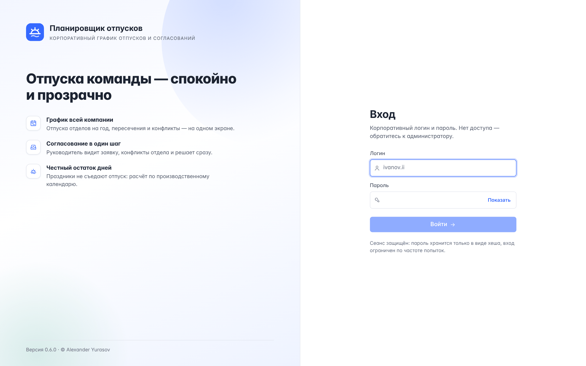{width=70%}

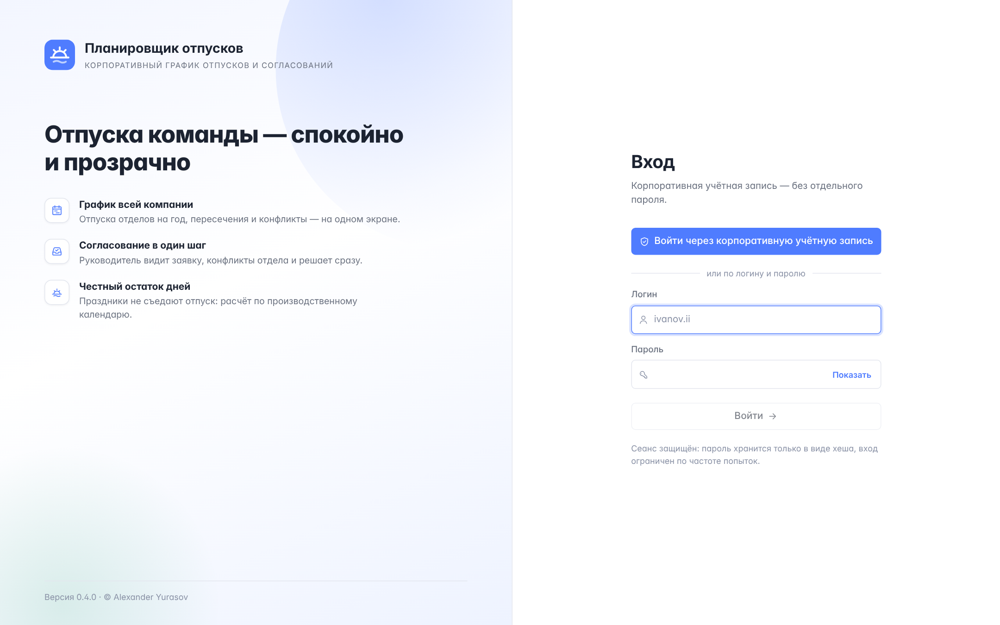{width=70%}

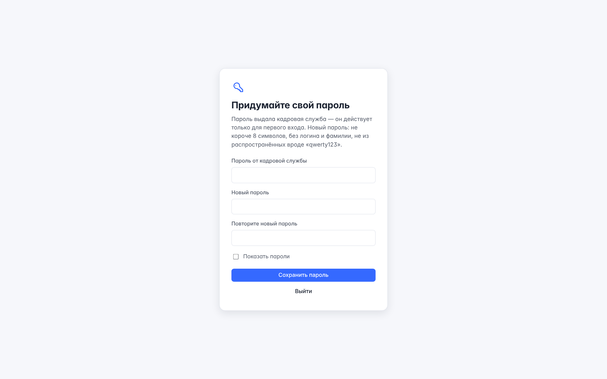{width=60%}

## Ф-02. График отпусков организации

| ID | Функция | Описание |
| ---- | ---------- | ------------------------ |
| Ф-02.01 | График на год | Отпуска всех сотрудников, сгруппированные по отделам: согласованные, на согласовании, отпуска по уходу за ребёнком; прошедшие отпуска бледнее; отметка «в отпуске сегодня» |
| Ф-02.02 | Масштаб и навигация | «Год», «Квартал», «Месяц» с днями недели; переключение года; «Сегодня»; при открытии график прокручивается к текущей дате |
| Ф-02.03 | Календарный фон | Выходные и праздники по производственному календарю, линия текущего дня |
| Ф-02.04 | Нагрузка и конфликты | Полоса нагрузки — доля выбранных сотрудников в отпуске по рабочим дням; штриховка дней, когда в отпуске доля отдела выше порога конфликта; число конфликтных дней у отдела |
| Ф-02.05 | Удалённая работа | Кнопка «Удалёнка» показывает на полосах дни удалённой работы |
| Ф-02.06 | Отбор | Отдел, поиск по ФИО или должности, сворачивание и разворачивание отделов |
| Ф-02.07 | Карточка сотрудника | Щелчок по фамилии или полосе — все периоды сотрудника за год |
| Ф-02.08 | Сравнение пересечений | Отметка сотрудников значком «+»: при двух и более — даты одновременного отсутствия, подсветка этих дней на графике |
| Ф-02.09 | Автоматическое обновление | Изменения коллег появляются без перезагрузки страницы, пока вкладка видна на экране |
| Ф-02.10 | Выгрузка в Excel | Отпуска года в XLSX: сотрудник, должность, отдел, даты, календарные дни, дни отпуска без праздников, статус, тип, комментарий; объём — по правам; без логинов и паролей; каждая выгрузка — в журнале аудита |

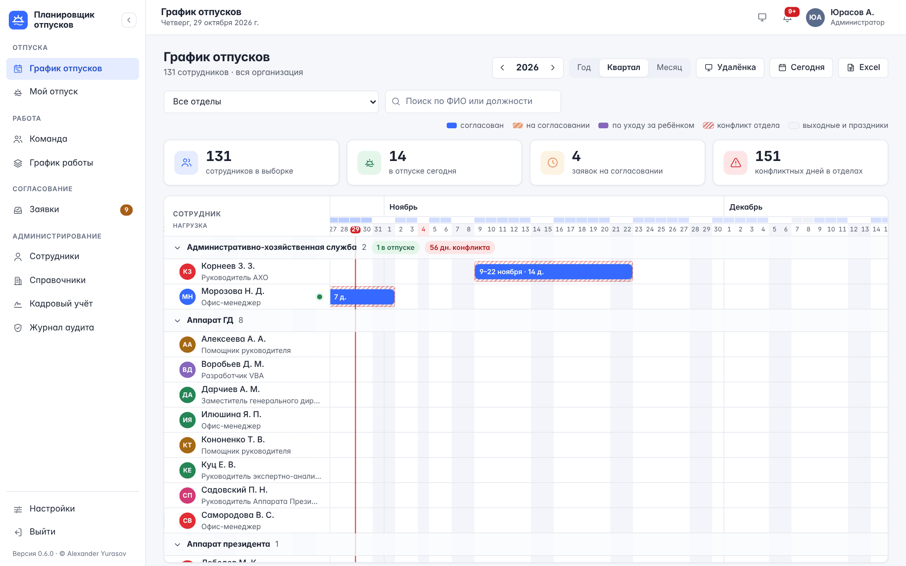

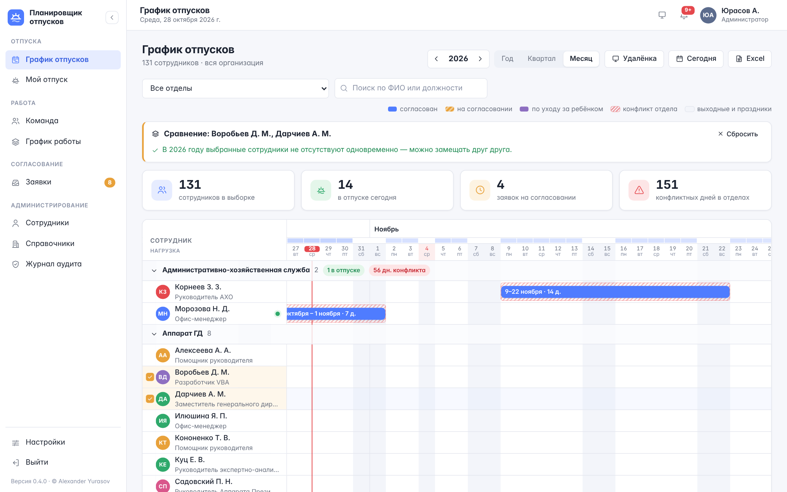

## Ф-03. Мой отпуск: баланс и заявки

| ID | Функция | Описание |
| ---- | ---------- | ------------------------ |
| Ф-03.01 | Баланс дней | «Доступно» = норма + перенос с прошлых лет − согласованные дни − дни на согласовании; полоса «использовано / на согласовании / свободно»; норма года, перенос, всего положено; переключение года |
| Ф-03.02 | Праздники не расходуют отпуск | Нерабочие праздничные дни внутри периода не входят в дни отпуска (ст. 120 ТК РФ); перенесённый выходной входит; без календаря года дни считаются календарными |
| Ф-03.03 | Часть не короче 14 дней | Отметка, есть ли часть отпуска не короче 14 календарных дней (ст. 125 ТК РФ) |
| Ф-03.04 | Обзор отпусков | Ближайший отпуск или «Сейчас вы в отпуске», «Год одним взглядом», периоды со статусами; свёрнутый раздел отклонённых и отменённых заявок с причиной отказа |
| Ф-03.05 | Новая заявка | Первый и последний день, быстрый выбор 7 / 14 / 28 дней; расчёт дней отпуска, календарных дней, праздников и остатка после заявки; комментарий для руководителя |
| Ф-03.06 | Проверки заявки на сервере | Порядок дат, даты не в прошлом, пересечение с другими своими заявками, лимит дней по политике организации: «Запрещено» — отказ, «Предупреждение» — отправка с предупреждением |
| Ф-03.07 | Изменение и отмена | Заявку на согласовании можно изменить или отменить сразу |
| Ф-03.08 | Перенос согласованного отпуска | Новые даты уходят на согласование; до решения действуют прежние даты, при отказе они сохраняются |
| Ф-03.09 | Запрос удаления | Согласованный отпуск удаляется только после согласования руководителем; при отказе отпуск остаётся |
| Ф-03.10 | Сотрудники без права на отпуск | Для индивидуальных предпринимателей и самозанятых заявки не оформляются («Отпуск не предусмотрен») |

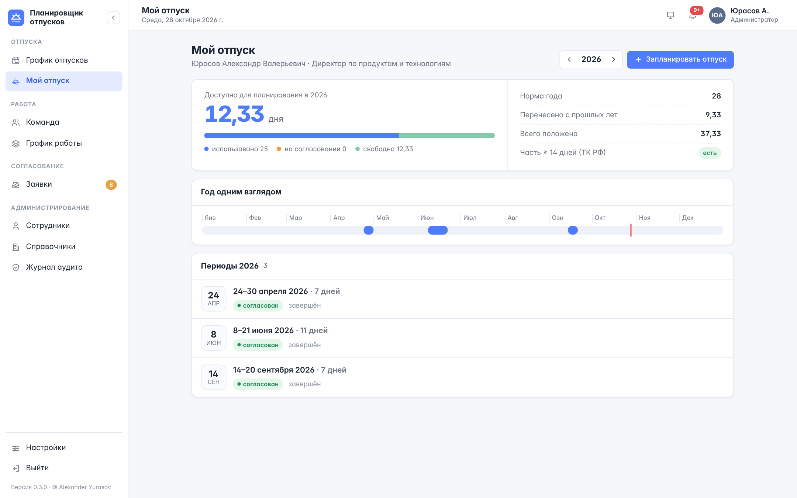

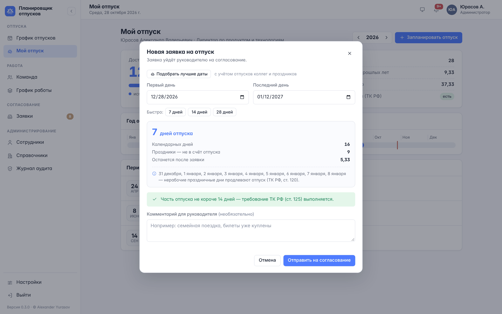

## Ф-04. Подбор дат отпуска

| ID | Функция | Описание |
| ---- | ---------- | ------------------------ |
| Ф-04.01 | Варианты дат | До пяти непересекающихся окон заданной длины в периоде «Не раньше» — «Не позже» |
| Ф-04.02 | Учёт ограничений | Исключаются окна, в которых отдел вместе с сотрудником превысит порог конфликта, и окна, пересекающиеся с его отпусками; праздники внутри окна дают больше дней отдыха за те же дни отпуска |
| Ф-04.03 | Объяснение и выбор | Причины выбора (праздники, начало в понедельник), наибольшая доля отдела в отпуске вместе с сотрудником; «Выбрать» подставляет даты в форму |
| Ф-04.04 | Подбор за другого сотрудника | Руководитель — для прямых подчинённых при оформлении им отпуска, администратор — для любого сотрудника |

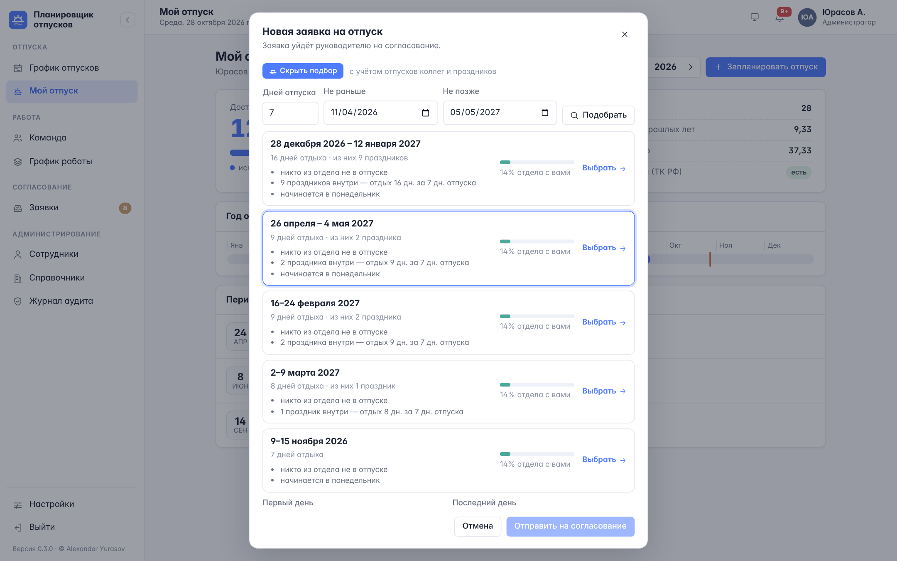

## Ф-05. Согласование заявок

| ID | Функция | Описание |
| ---- | ---------- | ------------------------ |
| Ф-05.01 | Очередь «Ждут вашего решения» | Заявки прямых подчинённых; у руководителя отдела — также сотрудников отдела без своего руководителя; команды замещаемого руководителя; переданные эскалацией. Собственных заявок в очереди нет. Число ожидающих — у пункта меню «Заявки»; администратор видит заявки всей организации |
| Ф-05.02 | Карточка заявки | Сотрудник, вид заявки (новый отпуск, перенос с прежними датами, удаление), период и дни отпуска с учётом праздников, комментарий, пересечения в отделе — кто отсутствует в те же даты; вкладки «Все», «Новые», «Переносы», «Удаления» |
| Ф-05.03 | Согласование | Новая заявка и перенос становятся согласованными, запрос удаления удаляет отпуск; сотрудник получает уведомление |
| Ф-05.04 | Отклонение с причиной | Причина обязательна (3–1000 символов) и видна сотруднику; при отклонении переноса сохраняются прежние даты, при отклонении удаления отпуск остаётся |
| Ф-05.05 | Защита от одновременных решений | Если два согласующих решают по одной заявке одновременно, применяется одно решение, второй получает «Данные изменились: обновите страницу и повторите» |
| Ф-05.06 | Оформление отпуска сотруднику | Руководитель — прямому подчинённому (раздел «Заявки»), администратор — любому сотруднику (раздел «Сотрудники»); отпуск сразу согласован, доступен подбор дат; администратор может указать прошедшие даты |
| Ф-05.07 | Запрет решения по своей заявке | Свою заявку согласует вышестоящий руководитель или администратор, но не сам автор |

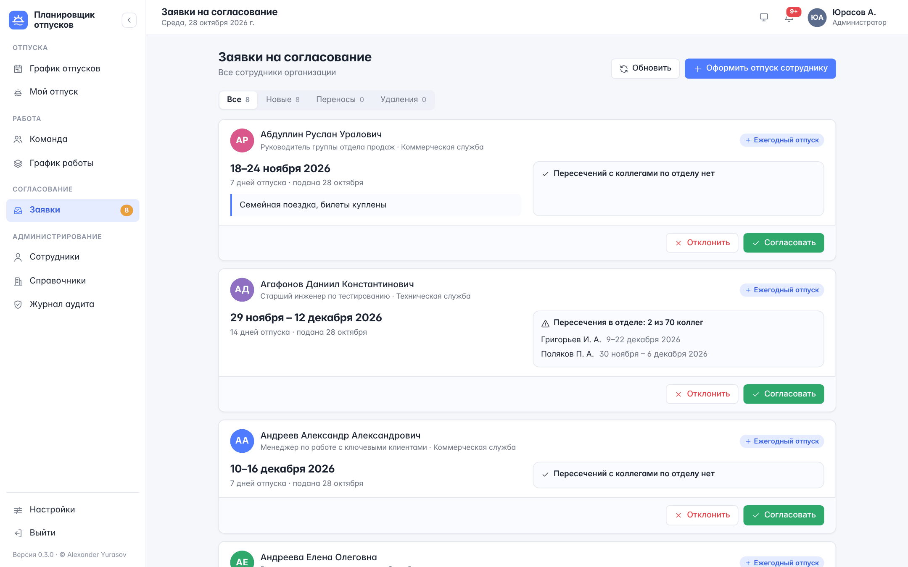

## Ф-06. Замещение и эскалация согласования

| ID | Функция | Описание |
| ---- | ---------- | ------------------------ |
| Ф-06.01 | Передача согласования заместителю | «Профиль и настройки → Замещение на время отсутствия»: заместитель и период. Даты не в прошлом, не дольше года; заместитель — действующий сотрудник и не сам руководитель; у руководителя есть команда; на любой день — одно замещение |
| Ф-06.02 | Права заместителя | На период замещения — раздел «Заявки» с пометкой «Вы замещаете …», согласование и отклонение заявок команды, уведомления о новых заявках; свою заявку заместитель не согласует; руководитель продолжает видеть заявки |
| Ф-06.03 | Отмена замещения | Руководителем или кадровой службой в любой момент |
| Ф-06.04 | Замещение за руководителя | Кадровая служба назначает и отменяет замещение в карточке руководителя («Замещение руководителя») |
| Ф-06.05 | Эскалация | Заявка без решения дольше срока из правил организации передаётся руководителю согласующего: он получает право решения и уведомление, в очереди — отметки «эскалирована» и «передана вам»; если выше никого нет, уведомление получает кадровая служба. Заявка передаётся один раз |

## Ф-07. Команда и аналитика отдела

| ID | Функция | Описание |
| ---- | ---------- | ------------------------ |
| Ф-07.01 | Состав на дату | Плитки «В офисе», «Удалённо», «В отпуске», «Выходной» и число заявок, ждущих решения; щелчок по плитке отбирает сотрудников; дата меняется полем вверху |
| Ф-07.02 | Таблица состава | Статус на дату (для отпуска — до какого числа), следующий отпуск, нераспределённые дни, отметка о части в 14 дней; предупреждение, если в отпуске больше порога |
| Ф-07.03 | Выводы | Ближайшие конфликты, пиковый месяц и когда лучше планировать, кто не распределил отпуск, у кого нет части в 14 дней, риски малочисленного отдела — с уровнем важности |
| Ф-07.04 | Доля отдела в отпуске по месяцам | Согласованные отпуска и заявки на согласовании, порог конфликта; при наведении — точные значения и самый загруженный день месяца |
| Ф-07.05 | Периоды конфликтов | Даты и состав отсутствующих |
| Ф-07.06 | Распределение дней | Сколько каждый запланировал и сколько осталось; сначала те, у кого больше нераспределённых дней |
| Ф-07.07 | Область аналитики | Сотрудник — свой отдел; руководитель — отделы, где работают его подчинённые, и руководимые отделы; кадровая служба и администратор — все отделы. Данные других отделов в браузер не передаются |

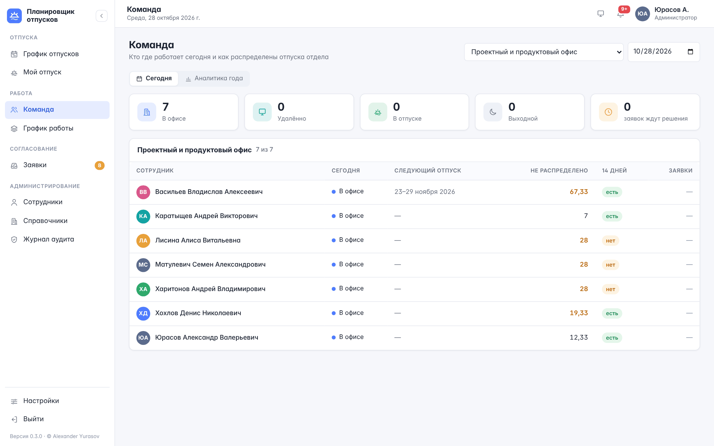

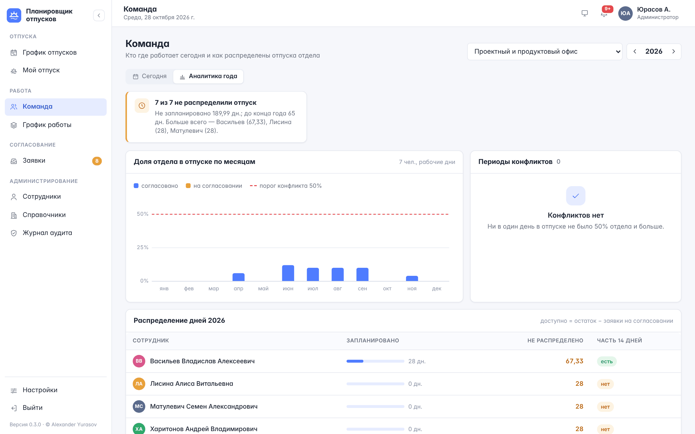

## Ф-08. График работы: офис и удалённая работа

| ID | Функция | Описание |
| ---- | ---------- | ------------------------ |
| Ф-08.01 | Недельный шаблон | По дням недели: «Офис» → «Удалённо» → «Не работает»; «Сохранить» |
| Ф-08.02 | Разовые исключения | Щелчок по дню календаря месяца меняет режим только в эту дату; исключения отмечены и перечислены в «Предстоящих исключениях», снимаются по одному |
| Ф-08.03 | Вычисление статуса дня | Отпуск важнее всего, затем разовое исключение, затем выходной или праздник, затем недельный шаблон (по умолчанию — офис); дни отпуска в календаре не переключаются |
| Ф-08.04 | График подчинённых | Руководитель ведёт график прямых подчинённых, администратор — любого сотрудника; кадровая служба видит графики всех |
| Ф-08.05 | Использование режима | Статусы «офис / удалёнка» — в разделе «Команда» и на графике отпусков (кнопка «Удалёнка») |

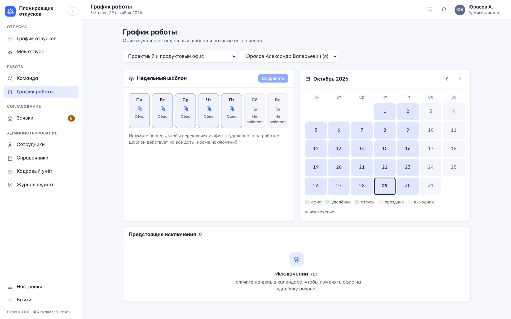

## Ф-09. Уведомления и письма

| ID | Функция | Описание |
| ---- | ---------- | ------------------------ |
| Ф-09.01 | Центр уведомлений | Колокольчик со счётчиком непрочитанных; щелчок отмечает уведомление прочитанным и открывает нужный раздел; «Прочитать все» |
| Ф-09.02 | События | Руководителю и его заместителю — новая заявка, перенос, запрос удаления; сотруднику — согласование, отклонение с причиной, удаление отпуска; извещение о начале отпуска; приглашение и напоминание кампании планирования; назначенное замещение; заявка, переданная эскалацией; кадровой службе — заявка без решения, которую некому передать; сотруднику — блокировка учётной записи |
| Ф-09.03 | Доставка без перезагрузки | Новые уведомления приходят потоком событий сервера обычно за пару секунд; при недоступности потока интерфейс опрашивает уведомления раз в 30 секунд |
| Ф-09.04 | Письма | При настроенном SMTP-релее организации те же события приходят письмом со ссылкой на раздел; письма ставятся в очередь в одной транзакции с событием и повторяются при сбое почты (через 1, 5, 30 минут, 2 и 12 часов); недоступность почты не мешает работе |
| Ф-09.05 | Еженедельная сводка | Руководителям по пятницам после 12:00 по времени организации: кто из команды в отпуске на следующей неделе и сколько заявок ждут решения |
| Ф-09.06 | Отказ от писем | Блок «Письма о заявках» в профиле; уведомления в колокольчике приходят в любом случае |

## Ф-10. Кампания планирования и утверждение графика

| ID | Функция | Описание |
| ---- | ---------- | ------------------------ |
| Ф-10.01 | Открытие кампании | На текущий или следующий год со сроком; всем штатным сотрудникам — приглашение уведомлением и письмом |
| Ф-10.02 | Приглашение в «Моём отпуске» | Срок, сколько дней из нормы запланировано, есть ли часть не короче 14 дней; кнопка «Запланировать на <год>»; при полном плане — зелёная отметка |
| Ф-10.03 | Прогресс | Сотрудников, спланировали, полностью, доля запланированных дней нормы; таблица «По отделам» с раскрытием до сотрудников и отбором «Не запланировал / Частично / Полностью»; учитываются согласованные отпуска и заявки на согласовании |
| Ф-10.04 | Напоминание | «Напомнить не спланировавшим» — каждому с его цифрами, не чаще раза в час; автоматически — за три дня до срока |
| Ф-10.05 | Срок и закрытие | Изменение срока, закрытие и повторное открытие кампании до утверждения графика |
| Ф-10.06 | Утверждение графика | Номер и дата документа, дата и номер мнения профсоюза; предупреждения перед утверждением (заявки на согласовании не войдут, нет табельных номеров, не заполнены реквизиты); один раз и до начала года, при наличии хотя бы одного согласованного отпуска; сохраняется снимок согласованных отпусков, кампания закрывается |
| Ф-10.07 | Форма Т-7 | Выгрузка в XLSX по унифицированной форме Т-7 (ОКУД 0301020): до утверждения — «Проект Т-7»; после утверждения переносы попадают в графы 8–9, отмены — в примечание, начавшиеся отпуска — в графу фактической даты |
| Ф-10.08 | Реквизиты и табельные номера | Наименование организации, код ОКПО, должности и ФИО утверждающего руководителя и руководителя кадровой службы — в правилах организации; табельный номер — в карточке сотрудника, поиске и импорте (графа 4 формы Т-7) |

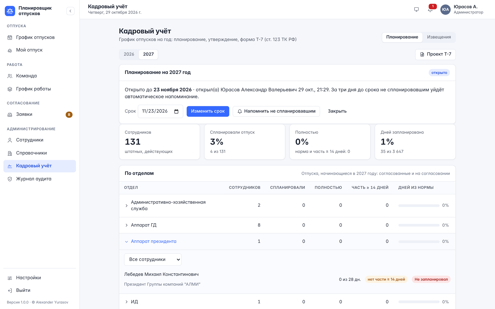

## Ф-11. Извещения о начале отпуска

| ID | Функция | Описание |
| ---- | ---------- | ------------------------ |
| Ф-11.01 | Автоматическое извещение | За заданное число дней (14–60, по умолчанию 14) до начала согласованного ежегодного отпуска штатного сотрудника — извещение, уведомление и письмо; одно извещение на заявку и дату начала |
| Ф-11.02 | Позднее извещение | Отпуск, согласованный позже срока, получает извещение сразу с пометкой о праве перенести отпуск по письменному заявлению (ст. 124 ТК РФ) |
| Ф-11.03 | Ознакомление | Кнопка «Ознакомлен» в «Моём отпуске» — подтверждение сотрудника; повтор ничего не меняет; отметка — в журнале аудита |
| Ф-11.04 | Лист для подписи | «Для печати» — лист извещения для подписи на бумаге: сотруднику — своё, кадровой службе — любое |
| Ф-11.05 | Отзыв извещения | Перенос на новые даты, отмена отпуска и увольнение отзывают извещение; отклонённый перенос возвращает его в силу |
| Ф-11.06 | Журнал извещений | По дате начала отпуска с отбором по периоду, отделу и состоянию: «Ждёт ознакомления», «Нет подписи — скоро отпуск» (до начала три дня и меньше), «Ознакомлен» с датой, «Отозвано»; печать листа; выгрузка в XLSX |

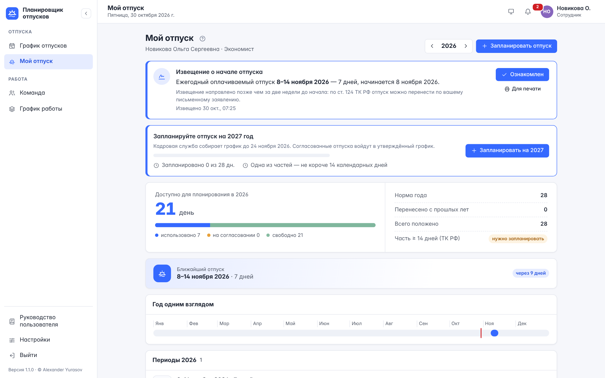

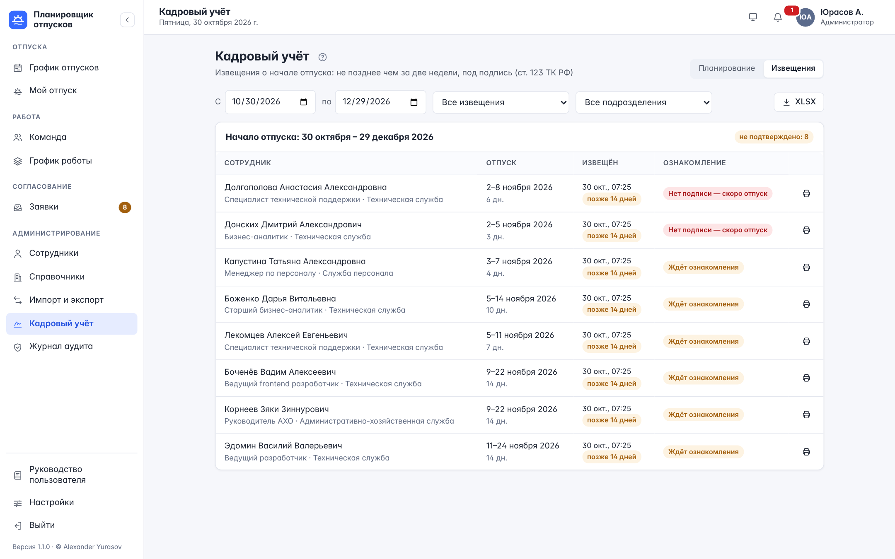

## Ф-12. Сотрудники и учётные записи

| ID | Функция | Описание |
| ---- | ---------- | ------------------------ |
| Ф-12.01 | Список сотрудников | Действующие сотрудники с отделом, ролью, нормой дней (с переносом) и логином; отбор по отделу, поиск по ФИО, должности и табельному номеру; по 50 записей на странице |
| Ф-12.02 | Создание сотрудника | ФИО, email, табельный номер, должность, отдел, руководитель, тип занятости, норма дней, перенос с прошлых лет (с точностью до сотых); логин по ФИО транслитом и одноразовый пароль создаются автоматически, если не заданы, и показываются один раз с кнопкой «Скопировать» |
| Ф-12.03 | Изменение карточки | Перевод в другой отдел, смена руководителя, нормы и переноса; отпуска и история сохраняются, аналитика пересчитывается |
| Ф-12.04 | Служебные права | Признаки «Кадровая служба» и «Администратор системы» отмечает только администратор; кадровая служба не меняет учётные записи администраторов и коллег по службе (в их строке — значок щита) |
| Ф-12.05 | Увольнение | Учётная запись отключается, сеансы завершаются, история отпусков и журнал сохраняются; последнего администратора нельзя уволить или лишить прав |
| Ф-12.06 | Сброс пароля | Сервер выдаёт новый одноразовый пароль (показывается один раз), все сеансы сотрудника завершаются в течение 10 секунд |
| Ф-12.07 | Учётная запись | Последний вход, неудачные попытки подряд, блокировка и её окончание, сменён ли выданный пароль, число сеансов; «Снять блокировку», «Завершить все сеансы» |

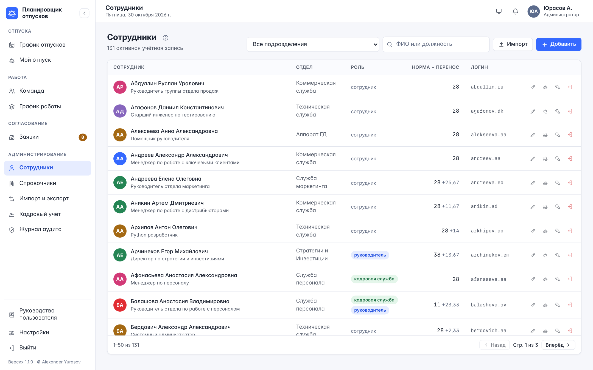

## Ф-13. Импорт сотрудников

| ID | Функция | Описание |
| ---- | ---------- | ------------------------ |
| Ф-13.01 | Загрузка файла | XLSX или CSV до 2 МБ и 5000 строк; шаблон с колонками ФИО, Логин, Должность, Отдел, Руководитель, Норма дней, Перенос, Тип занятости, Email, Табельный номер |
| Ф-13.02 | Предпросмотр | План без изменения данных: новые сотрудники, изменения «было → станет», строки без изменений, ошибки с номером строки и причиной |
| Ф-13.03 | Правила сопоставления | По логину; без логина — по ФИО среди работающих (несколько совпадений — ошибка строки); новому — логин транслитом с числовым суффиксом при совпадении; пустая ячейка не меняет значение; новые отделы создаются; руководитель — логин или ФИО, в том числе из того же файла; табельный номер уникален |
| Ф-13.04 | Применение | Только без ошибок и целиком; одноразовые пароли новых сотрудников показываются один раз |
| Ф-13.05 | Повторная загрузка | Повторная загрузка того же файла ничего не меняет — файл можно загружать регулярно, например для обновления переноса остатков |
| Ф-13.06 | Синхронизация через API | Та же операция принимает JSON и режим предпросмотра — для автоматической синхронизации с кадровой системой |
| Ф-13.07 | Права и аудит | Кадровая служба и администратор; в журнале аудита — итог импорта и каждая созданная и изменённая запись с указанием источника |

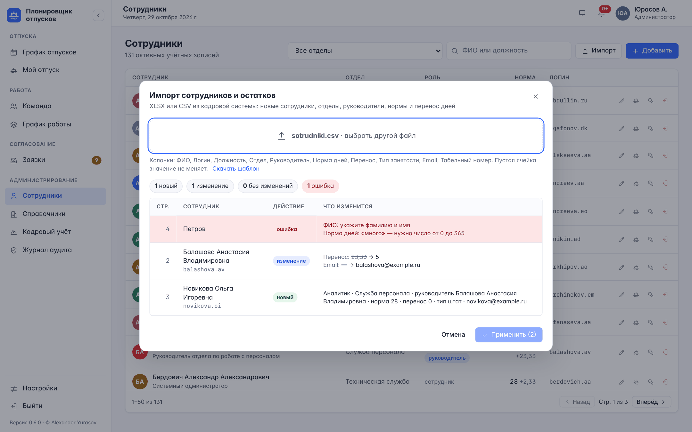

## Ф-14. Справочники и производственный календарь

| ID | Функция | Описание |
| ---- | ---------- | ------------------------ |
| Ф-14.01 | Отделы | Название, руководитель, численность; создание, переименование, смена руководителя; удалить можно только пустой отдел |
| Ф-14.02 | Проекты | Название, руководитель, численность; удалить можно только проект без участников |
| Ф-14.03 | Производственный календарь по годам | Праздники (ст. 112 ТК РФ) и переносы выходных: праздники не входят в дни отпуска и подсвечиваются на графике; перенесённый выходной — нерабочий день, но входит в отпуск; рабочая суббота считается рабочим днём в аналитике |
| Ф-14.04 | Редактор календаря | Сетка года: щелчок по дню отмечает или снимает праздник, переносы задаются парами дат |
| Ф-14.05 | Загрузка календаря из файла | Файл открытых данных xmlcalendar.ru (XML) или текст / CSV: одна дата в строке — праздник, две — перенос |
| Ф-14.06 | Контроль наличия календаря | Если календарь года не загружен, раздел предупреждает, а дни отпуска считаются календарными |

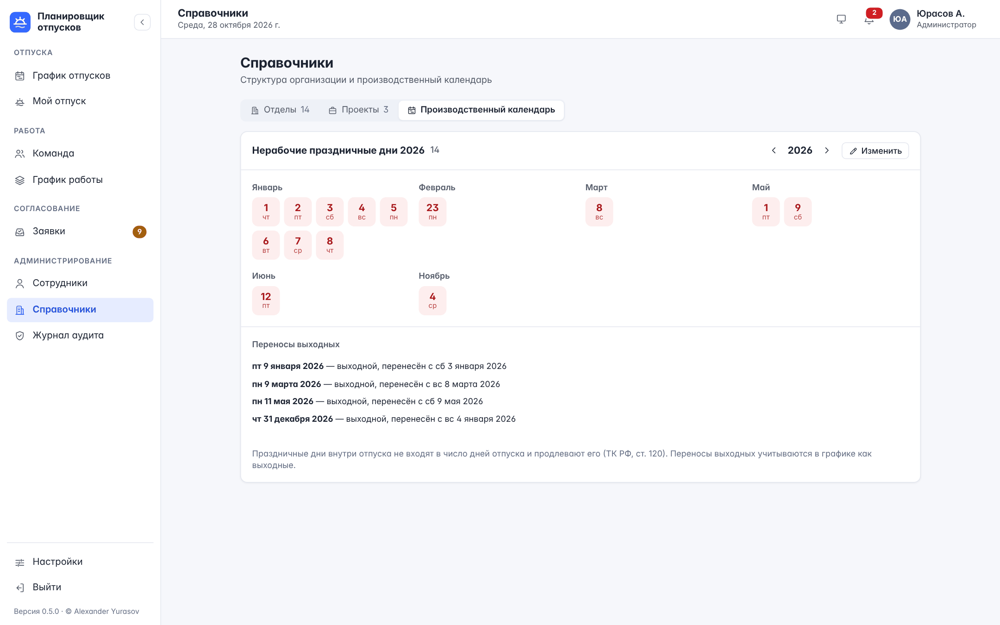

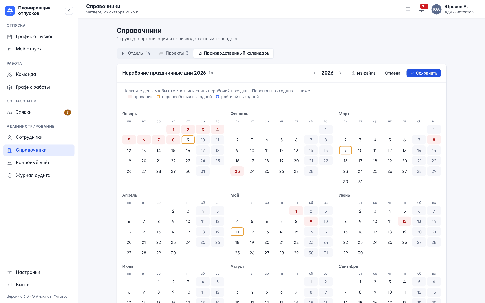

## Ф-15. Правила организации

| ID | Функция | Описание |
| ---- | ---------- | ------------------------ |
| Ф-15.01 | Порог конфликта отдела | Доля отдела в отпуске (20–80 %, по умолчанию 50 %), начиная с которой день конфликтный: штриховка на графике, предупреждения в аналитике, исключение вариантов в подборе дат |
| Ф-15.02 | Превышение остатка дней | «Запрещено» — заявку сверх доступного отправить нельзя; «Предупреждение» — сотрудник видит предупреждение, решает руководитель |
| Ф-15.03 | Норма дней для новых сотрудников | Подставляется в карточку нового сотрудника (20–60, по умолчанию 28) |
| Ф-15.04 | Сроки | Эскалация заявки без решения (0–60 дней, 0 — не передаётся); извещение о начале отпуска (14–60 дней) |
| Ф-15.05 | Безопасность входа | Минимальная длина пароля (8–64); неудачных попыток до блокировки (0 — без блокировки, иначе 3–50); время блокировки (1–1440 минут); срок хранения журнала входов (30–3650 дней) |
| Ф-15.06 | Реквизиты формы Т-7 | Наименование организации, код ОКПО (8 или 10 цифр), должность и ФИО утверждающего руководителя и руководителя кадровой службы |
| Ф-15.07 | Проверочное письмо | Проверка почты после развёртывания: результат и ответ почтового сервера при ошибке |
| Ф-15.08 | Доступ и аудит | Правила меняет только администратор; каждое изменение — в журнале аудита |

## Ф-16. Журналы аудита и входов

| ID | Функция | Описание |
| ---- | ---------- | ------------------------ |
| Ф-16.01 | Журнал изменений | Кто, когда, какое действие, с каким объектом; «Изменения (N)» раскрывает изменённые поля: прежнее значение зачёркнуто, новое выделено; отбор по типу объекта |
| Ф-16.02 | Состав событий | Заявки (создана, изменена или перенесена, согласована, отклонена, отменена, запрошено удаление, удалена); сотрудники, пароли, личные настройки, график работы; импорт; отделы и проекты; блокировки и сеансы; замещения и эскалация; кампания планирования, утверждение графика, ознакомление с извещением; правила; производственный календарь; выгрузки в Excel |
| Ф-16.03 | Неизменяемость | Запись журнала создаётся в той же транзакции, что и изменение данных; журнал только дополняется, изменить или очистить его из программы нельзя |
| Ф-16.04 | Журнал входов | Каждая попытка входа: время, сотрудник и логин, результат (вход, единый вход, неверный пароль, неизвестный логин, блокировка, отказ по частоте, пароль отключён, единый вход — сотрудник не найден, повтор токена — сеанс завершён), браузер и адрес; отбор по логину, результату и периоду; записи старше срока хранения удаляются автоматически |
| Ф-16.05 | Доступ к журналам | Администратор и кадровая служба |

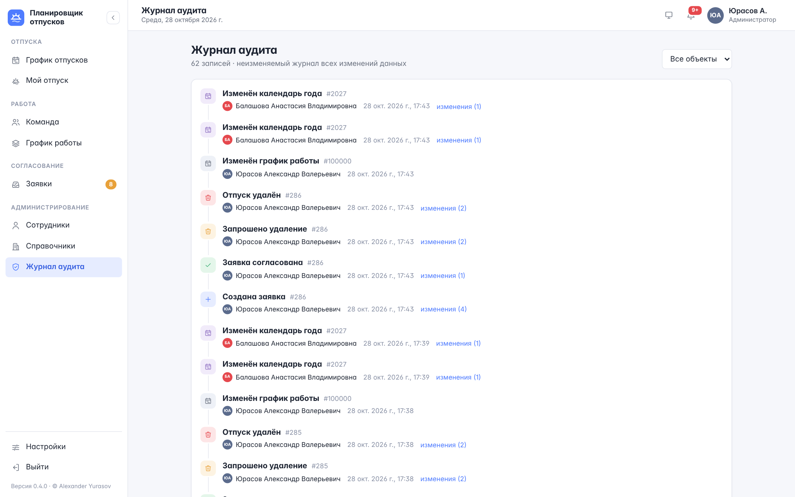

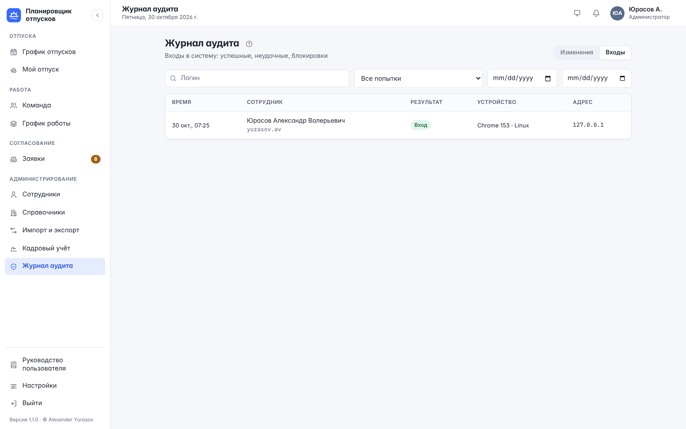

## Ф-17. Интерфейс и мобильный доступ

| ID | Функция | Описание |
| ---- | ---------- | ------------------------ |
| Ф-17.01 | Адаптивный интерфейс | Работа в браузере компьютера, планшета и смартфона при ширине экрана от 360 px; на телефоне меню открывается кнопкой слева вверху |
| Ф-17.02 | Темы оформления | «Как в системе», «Светлая», «Тёмная» — переключателем в верхней панели или в профиле; меню сворачивается, состояние запоминается |
| Ф-17.03 | Доступность интерфейса | Работа с клавиатуры; модальные окна удерживают фокус и закрываются клавишей Esc; контраст текста не ниже 4,5:1 (WCAG 2.1 AA) в обеих темах; состояние не передаётся только цветом |
| Ф-17.04 | Локализация | Русский язык интерфейса и сообщений об ошибках, даты в русской записи («14 мая 2027», «28 окт., 10:12»); ежедневные задачи, сводка и время окончания блокировки — по часовому поясу организации |
| Ф-17.05 | Меню по правам | Раздел «Заявки» — тем, кому есть что согласовывать; разделы «Сотрудники», «Справочники», «Кадровый учёт», «Журнал аудита» — кадровой службе и администратору; номер версии программы — внизу меню |

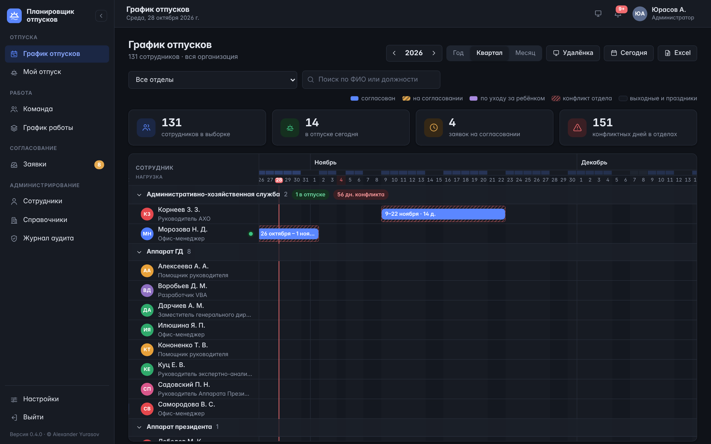

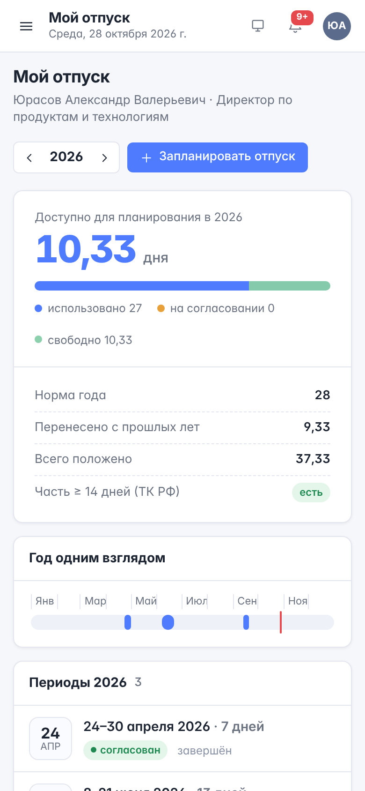{width=40%}

## Ф-18. Эксплуатационные функции

| ID | Функция | Описание |
| ---- | ---------- | ------------------------ |
| Ф-18.01 | Проверки состояния | `/healthz` — процесс жив, `/readyz` — база данных доступна; для оркестратора и балансировщика |
| Ф-18.02 | Метрики и оповещения | Метрики Prometheus (`/metrics`): задержки и коды ответов по маршрутам, процессы, соединения с БД, очередь писем, плановые задачи, реплика и архив WAL; адрес не публикуется наружу и может требовать токен; 15 правил оповещений и панель Grafana в поставке |
| Ф-18.03 | Журнал сервера и идентификатор запроса | Журнал строками JSON; каждый ответ несёт заголовок `X-Request-Id`, ошибка — поле `requestId`, сообщение о сбое сервера в интерфейсе — код запроса; журнал медленных запросов API и операций БД с настраиваемым порогом |
| Ф-18.04 | Поведение при перегрузке | Нехватка соединений или недоступность БД — ответ `503` с заголовком `Retry-After` и понятным сообщением вместо внутренней ошибки |
| Ф-18.05 | Автоматические миграции | Схема БД обновляется при старте контейнера сервера |
| Ф-18.06 | Резервное копирование | Копия БД раз в сутки (интервал настраивается), хранение 14 дней; незавершённые копии не сохраняются; регламент восстановления и ежемесячной проверки |
| Ф-18.07 | Реплика и архив WAL | Потоковая реплика PostgreSQL, архив WAL, ежедневные физические копии; переключение на реплику и восстановление на момент времени по инструкции |
| Ф-18.08 | Масштабирование | Процессы API по числу ядер с перезапуском упавших; общее состояние — в PostgreSQL, поэтому второй экземпляр сервера ставится за балансировщиком без привязки сеансов |
| Ф-18.09 | Плановые задачи | Извещения о начале отпуска, эскалация, напоминания о планировании, очистка журнала входов — в каждом процессе раз в минуту (интервал настраивается); еженедельная сводка — вместе с разбором очереди писем; повтор не дублирует результат |
| Ф-18.10 | Спецификация API | Контракт REST API v1 в формате OpenAPI 3.1; спецификация реализации — по адресу `/api/docs` |
| Ф-18.11 | Демонстрационные данные | Идемпотентное наполнение демонстрационными данными для стенда; повторный запуск ничего не дублирует |

# Сценарии использования

Ниже приведены формализованные варианты использования. Подробные пошаговые сценарии с экранными формами — в «Руководстве пользователя» и «Руководстве администратора».

## ВИ-01. Сотрудник планирует отпуск, руководитель согласует

| Элемент | Содержание |
| ------- | ------------------------------ |
| Участники | Сотрудник, руководитель |
| Предусловие | У сотрудника есть руководитель; загружен производственный календарь года |
| Основной поток | 1. Сотрудник открывает «Мой отпуск» и видит доступные дни. 2. Нажимает «Запланировать отпуск», затем «Подобрать лучшие даты» и выбирает вариант. 3. Проверяет расчёт дней с учётом праздников и отправляет заявку. 4. Руководитель получает уведомление, открывает «Заявки» и видит пересечения в отделе. 5. Руководитель согласует заявку. |
| Альтернатива | 3а. Дней не хватает при политике «Запрещено» — отправка невозможна. 5а. Руководитель отклоняет заявку с обязательной причиной — сотрудник видит её в уведомлении |
| Результат | Отпуск согласован; график и баланс обновлены без перезагрузки страницы |
| Функции | Ф-03.01, Ф-03.05, Ф-03.06, Ф-04.01–Ф-04.03, Ф-05.01–Ф-05.04, Ф-09.01–Ф-09.03 |

## ВИ-02. Перенос согласованного отпуска

| Элемент | Содержание |
| ------- | ------------------------------ |
| Участники | Сотрудник, руководитель |
| Основной поток | 1. Сотрудник выбирает согласованный отпуск и «Перенести». 2. Заявка уходит на согласование; до решения действуют прежние даты. 3. Руководитель видит перенос с прежними датами и согласует. 4. Извещение на прежние даты отзывается, на новые даты придёт новое. |
| Альтернатива | 3а. Руководитель отклоняет перенос — отпуск остаётся на прежних датах, извещение возвращается в силу |
| Функции | Ф-03.08, Ф-05.02–Ф-05.04, Ф-11.05 |

## ВИ-03. Руководитель уходит в отпуск: замещение

| Элемент | Содержание |
| ------- | ------------------------------ |
| Участники | Руководитель, заместитель, кадровая служба |
| Основной поток | 1. Руководитель в профиле передаёт согласование заместителю на период отсутствия. 2. Заместитель получает уведомление; в его разделе «Заявки» — заявки команды с пометкой «Вы замещаете …». 3. Заместитель согласует заявки команды. 4. По окончании периода права заместителя прекращаются. |
| Альтернатива | 1а. Руководитель не успел назначить замещение — кадровая служба назначает его в карточке руководителя |
| Ограничение | Свою заявку заместитель не согласует |
| Функции | Ф-06.01–Ф-06.04, Ф-05.01 |

## ВИ-04. Заявка без решения передаётся выше

| Элемент | Содержание |
| ------- | ------------------------------ |
| Участники | Сотрудник, согласующий, вышестоящий руководитель, кадровая служба |
| Предусловие | В правилах организации задан срок эскалации |
| Основной поток | 1. Заявка ждёт решения дольше срока. 2. Плановая задача передаёт её руководителю согласующего; он получает уведомление и право решения. 3. Вышестоящий руководитель согласует или отклоняет заявку. |
| Альтернатива | 2а. У согласующего нет руководителя — уведомление о заявке без решения получает кадровая служба |
| Функции | Ф-06.05, Ф-15.04, Ф-18.09 |

## ВИ-05. Кампания планирования и утверждение графика по ст. 123 ТК РФ

| Элемент | Содержание |
| ------- | ------------------------------ |
| Участники | Кадровая служба, сотрудники, руководители, администратор |
| Предусловие | Загружен производственный календарь следующего года; администратор заполнил реквизиты формы Т-7 |
| Основной поток | 1. Кадровая служба открывает планирование следующего года со сроком — сотрудники получают приглашение. 2. Сотрудники планируют отпуск из приглашения в «Моём отпуске»; руководители согласуют заявки. 3. Кадровая служба следит за прогрессом по отделам и напоминает не спланировавшим. 4. Кадровая служба утверждает график с номером и датой документа и мнением профсоюза. 5. Выгружает форму Т-7. |
| Альтернатива | 4а. Год уже начался или нет ни одного согласованного отпуска года — утверждение недоступно, причина показана на экране |
| Результат | Утверждённый график — снимок согласованных отпусков; переносы после утверждения отражаются в графах 8–9 формы Т-7 |
| Функции | Ф-10.01–Ф-10.08, Ф-15.06 |

## ВИ-06. Извещение о начале отпуска

| Элемент | Содержание |
| ------- | ------------------------------ |
| Участники | Сотрудник, кадровая служба |
| Основной поток | 1. За две недели до начала согласованного отпуска сотрудник получает извещение. 2. Нажимает «Ознакомлен». 3. Кадровая служба видит отметку в журнале извещений. |
| Альтернатива | 2а. Сотрудник не подтверждает, до отпуска три дня и меньше — журнал показывает «Нет подписи — скоро отпуск»; кадровая служба печатает лист и получает подпись на бумаге. 1а. Отпуск согласован позже срока — извещение приходит сразу с пометкой о ст. 124 ТК РФ |
| Функции | Ф-11.01–Ф-11.06, Ф-09.02 |

## ВИ-07. Ввод сотрудников из кадровой системы

| Элемент | Содержание |
| ------- | ------------------------------ |
| Участники | Кадровая служба, сотрудники |
| Основной поток | 1. Кадровая служба выгружает сотрудников и остатки из кадровой системы в XLSX или CSV по шаблону. 2. Загружает файл в «Сотрудники → Импорт» и проверяет план. 3. Применяет — создаются сотрудники, отделы и связи с руководителями. 4. Передаёт сотрудникам логины и одноразовые пароли. 5. При первом входе сотрудник придумывает свой пароль. |
| Альтернатива | 2а. В файле ошибки — применение недоступно, ошибки показаны по строкам. 4а. Подключён единый вход — пароли не нужны |
| Функции | Ф-13.01–Ф-13.07, Ф-01.06, Ф-01.09 |

## ВИ-08. Подбор пароля или утерянное устройство

| Элемент | Содержание |
| ------- | ------------------------------ |
| Участники | Сотрудник, кадровая служба |
| Основной поток | 1. После серии неверных паролей учётная запись блокируется, сотрудник получает уведомление. 2. Кадровая служба смотрит журнал входов: адреса и браузеры попыток. 3. Попытки не от сотрудника — кадровая служба сбрасывает пароль и завершает все сеансы; иначе снимает блокировку. 4. Открытые вкладки на утерянном устройстве в течение 10 секунд переходят на экран входа. |
| Функции | Ф-01.08, Ф-01.11, Ф-12.06, Ф-12.07, Ф-16.04 |

## ВИ-09. Подготовка к новому году

| Элемент | Содержание |
| ------- | ------------------------------ |
| Участники | Кадровая служба, администратор |
| Основной поток | 1. После публикации постановления о переносе выходных кадровая служба загружает календарь следующего года из файла xmlcalendar.ru или отмечает праздники в сетке. 2. Администратор проверяет правила организации: порог конфликта, политику лимита, сроки эскалации и извещения, реквизиты Т-7. 3. Кадровая служба обновляет перенос остатков повторным импортом. |
| Результат | Расчёт дней, подбор дат и аналитика следующего года идут по новому календарю; изменения — в журнале аудита |
| Функции | Ф-14.03–Ф-14.06, Ф-15.01–Ф-15.06, Ф-13.05, Ф-16.01 |

# Нефункциональные характеристики

## Производительность и масштабируемость

| Характеристика | Значение |
| --- | --- |
| Требования к задержкам | p95 чтения ≤ 300 мс, записи ≤ 500 мс при 500 одновременно работающих пользователях из 5000; без ошибок |
| Подтверждение нагрузкой | 500 одновременных пользователей при 5000 сотрудниках в базе, 16 минут, 201 322 запроса: 0 ошибок, p95 чтения 194 мс, записи 332 мс. Один узел 4 vCPU и 16 ГБ ОЗУ, общий для API, PostgreSQL и генератора нагрузки (проверка версии 0.6.0) |
| Модель нагрузки 1000–2000 сотрудников | Расчётный час — последний день кампании планирования: одновременно работают 5,75 % сотрудников (58 при 1000, 115 при 2000), у 30 % открыта вкладка; пик — вход всей организации за 15 минут. Требования: вход — p95 ≤ 1 с, выгрузки Т-7 и графика за год — не дольше 5 с на 2000 сотрудников, очередь писем приглашения разбирается за 15 минут |
| Масштабирование | Процессы API по числу ядер; второй экземпляр сервера за балансировщиком без привязки сеансов; реплика PostgreSQL |
| График организации | Ответ кэшируется по версии данных (`ETag`, `304 Not Modified`); в браузере отрисовываются только видимые строки |
| Ограничение тяжёлых операций | График — не длиннее 370 дней, график работы и подбор дат — не длиннее 400 дней; списки — постранично, до 200 записей; выгрузка XLSX пишется потоком |
| Живые обновления | Поток событий сервера вместо опроса; при обрыве — переподключение с паузой от 4 до 60 секунд |

## Надёжность

| Характеристика | Реализация |
| --- | --- |
| Целостность данных | Транзакции PostgreSQL, блокировки строк сотрудника и заявки; две одновременные пересекающиеся заявки — создаётся одна; два одновременных решения — применяется одно |
| Согласованность журнала | Изменение данных, история заявки, журнал аудита и уведомления фиксируются в одной транзакции |
| Импорт | Применяется целиком или не применяется вовсе |
| Обновление | Миграции применяются автоматически при старте; при выпуске проверяется обновление на данных предыдущей версии; откат — восстановлением копии, снятой перед обновлением |
| Резервное копирование | Ежедневная копия БД с хранением 14 дней: потеря данных не больше суток, восстановление — около часа |
| Реплика и архив WAL | Потеря данных при аварии основного сервера — секунды, при потере основного сервера и реплики — не больше 5 минут; переключение на реплику — около 15 минут |
| Устойчивость | Упавший процесс API перезапускается; при перегрузке БД — ответ `503` с повтором; плановые задачи идемпотентны и работают при любом числе процессов |
| Самодиагностика | Проверки состояния, метрики, оповещения, журнал медленных запросов, регламент диагностики |

## Информационная безопасность

| Мера | Реализация |
| --- | --- |
| Аутентификация | Пароль или единый вход OpenID Connect; единый ответ на неверный вход без указания причины |
| Хранение паролей | Хэширование scrypt с солью, сравнение за постоянное время; для несуществующего логина проверяется подставной хэш — время ответа не выдаёт, существует ли логин; пароли не попадают в журналы, ответы и выгрузки |
| Политика паролей и первичный пароль | Длина и сложность по правилам организации; пароль, выданный кадровой службой, одноразовый — до смены доступны только профиль, смена пароля и выход |
| Защита от подбора | Ограничение частоты входа, общее для всех процессов и экземпляров; временная блокировка учётной записи с уведомлением сотрудника |
| Управление сеансами | Access-токен JWT на 15 минут хранится в памяти вкладки; токен продления — в cookie с признаками HttpOnly, SameSite=Strict и Secure, в БД — только его хэш; ротация при каждом обновлении с обнаружением повтора; список и завершение сеансов сотрудником и кадровой службой; отзыв доступа не позже чем через 10 секунд |
| Разграничение доступа | Роли и права на объекты проверяются на сервере в каждом запросе; служебные права читаются из БД; неизвестные поля запросов отбрасываются |
| Защита веб-интерфейса | Content Security Policy без inline-скриптов и с запретом встраивания во фреймы, `X-Frame-Options`, `X-Content-Type-Options: nosniff`, `Referrer-Policy`, `Permissions-Policy`; вывод пользовательских данных только с автоматическим экранированием (без `v-html`); параметризованные запросы к БД |
| Регистрация событий | Журнал изменений и журнал входов с адресом и браузером; срок хранения журнала входов задаётся правилами |
| Обработка ошибок | Ответы об ошибках в формате RFC 9457 с кодом из каталога; внутренние подробности — только в журнале сервера |
| Секреты | Только в окружении сервера; сервер не стартует с ключом подписи короче 32 символов |
| Передача данных | HTTPS на обратном прокси организации |
| Технологическая независимость | Нет передачи данных за пределы контура заказчика, удалённого управления и принудительных обновлений |

Перечень мер с подтверждающими автотестами — «Описание архитектуры», раздел «Чек-лист безопасности».

## Эргономика

- русскоязычный интерфейс, сообщения об ошибках с понятной причиной;
- адаптивная вёрстка для экранов от 360 px;
- светлая, тёмная и системная темы;
- работа с клавиатуры, модальные окна с удержанием фокуса и закрытием по Esc;
- контраст текста не ниже WCAG 2.1 AA, состояние не передаётся только цветом;
- подсказки при наведении на полосы графика и диаграммы аналитики.

# Требования к окружению

## Серверная часть

| Параметр | Требование |
| --- | --- |
| Операционная система | 64-битный Linux (x86-64) с Docker Engine 24+ и Docker Compose v2; `[указывает правообладатель: проверенные дистрибутивы, в том числе российские ОС]` |
| Компоненты в поставке | PostgreSQL 17, Node.js 22 (сервер), nginx 1.27 (веб-клиент) — в контейнерах |
| СУБД | PostgreSQL 17 в составе поставки или на отдельном узле; `max_connections` не меньше 100 |
| Сеть | Обратный прокси организации с TLS на порту 443 → стенд на порту 80; при необходимости — SMTP-релей и провайдер OpenID Connect организации; доступ в интернет при работе не требуется |
| Мониторинг (необязательно) | Prometheus и Grafana организации или Prometheus из поставки |

<!-- sizing -->
Рекомендуемая конфигурация сервера (процессор, оперативная память, диск) для организаций на 1000 и 2000 сотрудников определяется по результатам нагрузочных измерений версии 1.0.0 и будет приведена в этом разделе и в «Руководстве по развёртыванию».

## Клиентская часть

| Клиент | Требование |
| --- | --- |
| Веб-браузер | Две последние версии Google Chrome, Microsoft Edge, Mozilla Firefox или Safari |
| Мобильные устройства | Мобильные браузеры; ширина экрана от 360 px |
| Операционная система рабочего места | Любая ОС с поддерживаемым браузером |
| Сеть | Доступ к адресу программы по HTTPS; доступ в интернет не требуется |

# Ограничения версии 1.0.0

- учитываются ежегодные оплачиваемые отпуска; больничные и иные виды отсутствия, кадровые приказы (Т-6) и расчёт отпускных не входят в версию;
- отпуска по уходу за ребёнком отображаются на графике и в выгрузке, если перенесены из исходных данных; оформление заявок этого вида в интерфейсе не предусмотрено;
- один экземпляр программы обслуживает одну организацию (одно юридическое лицо);
- мобильного приложения нет — используется адаптивный веб-интерфейс;
- уведомления на телефон (push) не отправляются: уведомления — в интерфейсе, письма — при настроенном SMTP-релее;
- пользовательские группы (`/groups`), состав команды по проекту (`/analytics/team?project=`) и часовой пояс организации (`PATCH /settings`) доступны только через API и в интерфейсе версии 1.0.0 не настраиваются;
- эскалация передаёт заявку на один уровень вверх и один раз;
- выгрузки формируются в формате XLSX.

# Приложение А. Трассировка функций

Пути операций API указаны относительно префикса `/api/v1`, кроме эксплуатационных.

| Подсистема | Экраны | Основные операции API |
| --- | --- | --- |
| Ф-01 Вход и сеансы | Вход, «Придумайте свой пароль», Профиль и настройки | `/auth/login`, `/auth/refresh`, `/auth/logout`, `/auth/me`, `/auth/password`, `/auth/password-policy`, `/auth/sessions`, `/auth/sessions/{id}`, `/auth/sessions/revoke-others`, `/auth/oidc/config`, `/auth/oidc/start`, `/auth/oidc/callback` |
| Ф-02 График отпусков | График отпусков | `/schedule`, `/departments`, `/calendar/holidays/{year}`, `/reports/vacations`, `/events/ticket`, `/events` |
| Ф-03 Мой отпуск | Мой отпуск, форма заявки | `/employees/{id}/balance`, `/vacation-requests`, `/vacation-requests/{id}`, `/calendar/holidays/{year}` |
| Ф-04 Подбор дат | Форма заявки, оформление отпуска сотруднику | `/analytics/suggestions` |
| Ф-05 Согласование | Заявки, Сотрудники | `/vacation-requests?scope=approvals`, `/vacation-requests/{id}/approve`, `/vacation-requests/{id}/reject`, `/vacation-requests`, `/employees?manager={id}` |
| Ф-06 Замещение и эскалация | Профиль и настройки, Заявки, карточка сотрудника | `/delegations`, `/delegations/{id}`, `/vacation-requests?scope=approvals` |
| Ф-07 Команда и аналитика | Команда | `/analytics/departments`, `/analytics/team`, `/analytics/overview` |
| Ф-08 График работы | График работы | `/employees/{id}/work-schedule`, `/employees/{id}/work-pattern`, `/employees/{id}/work-overrides`, `/employees/{id}/work-overrides/{date}` |
| Ф-09 Уведомления и письма | Колокольчик, Профиль и настройки | `/notifications`, `/notifications/read-all`, `/notifications/{id}/read`, `/events/ticket`, `/events`, `PATCH /auth/me` |
| Ф-10 Планирование и Т-7 | Мой отпуск, Кадровый учёт → Планирование | `/planning/mine`, `/planning/{year}`, `/planning/{year}/employees`, `/planning/{year}/open`, `/planning/{year}/close`, `/planning/{year}/remind`, `/planning/{year}/approve`, `/reports/t7` |
| Ф-11 Извещения | Мой отпуск, лист для печати, Кадровый учёт → Извещения | `/notices/mine`, `/notices/{id}`, `/notices/{id}/acknowledge`, `/notices`, `/reports/notices` |
| Ф-12 Сотрудники | Сотрудники, карточка сотрудника | `/employees`, `/employees/{id}`, `/employees/{id}/password`, `/employees/{id}/password-reset`, `/employees/{id}/security`, `/employees/{id}/unlock`, `/employees/{id}/sessions/revoke` |
| Ф-13 Импорт | Сотрудники → Импорт | `/imports/employees`, `/imports/employees/template` |
| Ф-14 Справочники и календарь | Справочники | `/departments`, `/departments/{name}`, `/projects`, `/projects/{id}`, `/calendar/holidays/{year}` |
| Ф-15 Правила организации | Профиль и настройки → Правила организации | `/settings`, `/settings/test-email` |
| Ф-16 Журналы | Журнал аудита («Изменения», «Входы») | `/audit-events`, `/login-events` |
| Ф-17 Интерфейс | Все экраны | — |
| Ф-18 Эксплуатация | — | `/healthz`, `/readyz`, `/metrics`, `/api/docs` |

Полный каталог операций API (83 операции) с правами доступа и кодами ошибок приведён в документе «Спецификация API v1» и контракте `contracts/openapi-vacation-api-v1.yaml`.
