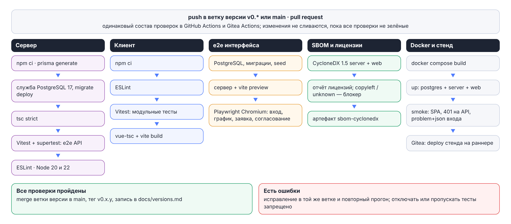

# О документе

Документ описывает процессы, которыми правообладатель поддерживает жизненный цикл программного обеспечения «Планировщик отпусков»: разработку и совершенствование, тестирование, выпуск и распространение версий, устранение неисправностей, техническую поддержку, а также сведения о персонале и инфраструктуре, задействованных в этих процессах. Документ входит в комплект для включения программы в единый реестр российских программ для ЭВМ и баз данных (постановление Правительства РФ от 16.11.2015 № 1236).

Процессы опираются на документы и файлы репозитория программы: план развития `docs/specs/03-backlog.md`, правила разработки с ИИ-ассистентами `docs/specs/06-ai-rules.md` и `AGENTS.md`, описание стендов и конвейеров `docs/specs/07-environments-cicd.md`, конвейеры `.github/workflows/ci.yml` и `.gitea/workflows/server-ci.yml`, историю версий `docs/versions.md` и `CHANGELOG.md`.

Сведения, которые может предоставить только правообладатель (реквизиты, контакты, численность персонала, сроки реакции), отмечены в тексте как `[заполняет правообладатель]`.

# Общие сведения

| Параметр | Значение |
| --- | --- |
| Программа | «Планировщик отпусков» — корпоративная система планирования и согласования ежегодных отпусков |
| Текущая версия | 1.0.0 от 30.10.2026 |
| Правообладатель | `[заполняет правообладатель: наименование, ИНН, адрес]` |
| Модель жизненного цикла | Итеративная: версии плана развития с историями и критериями приёмки, выпуск по готовности после полного прогона проверок |
| Нумерация версий | `MAJOR.MINOR.PATCH`; до выпуска 1.0.0 первая цифра была 0 (`v0.x.y`) |
| Средства разработки | Свободное ПО: Git, Node.js, TypeScript, PostgreSQL, Docker; разработка ведётся с применением ИИ-ассистентов под контролем человека (раздел «Разработка с применением ИИ-ассистентов») |
| Стандарты-ориентиры | ГОСТ Р ИСО/МЭК 12207-2010 (процессы жизненного цикла программных средств) |

## Схема жизненного цикла

| Этап | Результат | Ответственный |
| --- | --- | --- |
| 1. План версии | Истории бэклога с критериями приёмки и оценкой; ветка версии `vX.Y.Z` | Владелец продукта, технический лидер |
| 2. Проектирование | Запись архитектурного решения (ADR), изменения контракта OpenAPI и схемы БД — через ревью владельца | Технический лидер |
| 3. Разработка | Ветка истории `story/<id>`: сначала падающие тесты по критериям приёмки, затем код, миграции и документация | Разработчики с ИИ-ассистентами |
| 4. Проверка кода | Pull request по шаблону, независимое ревью, ревью человека для критичных областей, зелёные конвейеры GitHub и Gitea | Технический лидер, владелец кода |
| 5. Тестирование | Тесты API на PostgreSQL, модульные тесты клиента, e2e интерфейса, проверка обновления на данных, SBOM-гейт; нагрузочные прогоны и аудит интерфейса перед выпуском | Инженер по качеству, автоматика CI |
| 6. Выпуск | `docs/versions.md`, `CHANGELOG.md`, документы в PDF и DOCX, SBOM; слияние ветки версии в `main` и тег | Владелец |
| 7. Развёртывание | Раннер `deploy` в Gitea: сборка и запуск стенда, дымовые пробы | Оператор стенда |
| 8. Эксплуатация и поддержка | Резервные копии, мониторинг, обращения пользователей, исправляющие версии | Служба поддержки, администратор заказчика |

Замечания ревью и красный конвейер возвращают историю на этап 3; дефекты и пожелания из эксплуатации попадают в бэклог следующей версии (этап 1).

# Разработка и совершенствование

## Управление требованиями

Источники требований: техническое задание (`docs/specs/08-tz.md`), замечания кадровой службы и службы информационной безопасности при приёмке, результаты нагрузочных прогонов и аудитов интерфейса, обращения пользователей, анализ дефектов, изменения законодательства (Трудовой кодекс РФ).

Требования ведутся в плане развития `docs/specs/03-backlog.md`: версия → эпики → истории. Каждая история содержит формулировку «как <роль>, я …», критерии приёмки, артефакты, исполнителей, оценку и признак обязательного ревью технического лидера. Например, версия 1.0.0 включает эпики E50 «Приёмка HR и ИБ», E51 «Масштаб 1000–2000: нагрузка и отладка» и E52 «Комплект для реестра и эксплуатации».

Оперативные решения, открытые вопросы и обоснования новых зависимостей фиксируются в журнале `docs/decisions.md`; значимые архитектурные решения — записями ADR в `docs/adr/` (контекст, решение, альтернативы, последствия, критерии пересмотра). К версии 1.0.0 записано 17 решений, последнее — ADR-017 о плановых задачах.

## Проектирование

- контракт программного интерфейса — `contracts/openapi-vacation-api-v1.yaml` (OpenAPI 3.1), меняется до кода и только через ревью владельца; тест сверки контракта и реализации входит в CI;
- схема БД — `server/prisma/schema.prisma`; изменения — только версионными миграциями `server/prisma/migrations` с ревью SQL человеком; деструктивные изменения выполняются в два выпуска через добавляющие шаги;
- спецификации `docs/specs/` (архитектура, API, модель данных, тексты интерфейса, стенды и CI/CD, ТЗ, SBOM) меняются только через ревью владельца;
- эксплуатационные изменения сопровождаются регламентами (`docs/runbooks/`, `docs/performance/`) и разделами руководства по развёртыванию.

## Разработка с применением ИИ-ассистентов

Код, тесты и документация разрабатываются с применением ИИ-ассистентов (в истории версий указаны Claude Code и ZCode/GLM). Ассистент — заменяемый инструмент исполнителя: правила `AGENTS.md` и `docs/specs/06-ai-rules.md` не привязаны к конкретному продукту, а постановка задач, архитектурные решения, ревью и приёмка остаются за человеком. Программа не зависит от ИИ-ассистентов ни при сборке, ни при работе.

| Принцип | Содержание |
| --- | --- |
| История — это задача | Ассистент получает одну историю бэклога целиком: идентификатор, критерии приёмки, ссылки на документы и операции контракта; без истории — только исследование и вопросы |
| Тесты до кода | Сначала падающие тесты по критериям приёмки, затем минимальная реализация, затем зелёный прогон |
| Контракт и спецификации меняет человек | `contracts/` и `docs/specs/` правятся только через ревью владельца (CODEOWNERS); если ассистенту не хватает операции или поля, он останавливается и задаёт вопрос |
| Человек решает, ассистент исполняет | Архитектура, безопасность, права доступа и миграции данных — обязательное ревью технического лидера |
| Ничего лишнего | Никаких зависимостей, функций и рефакторинга за пределами истории |
| Нестабильный тест — это дефект | Тесты не отключаются, не пропускаются и не ослабляются; ищется причина |

Цикл истории закреплён шаблонами задач (`prompts/base/`, документ 10): план истории (P01) → падающие тесты (P02) → реализация (P03) → самопроверка (P04) → исправление CI (P05) → независимое ревью вторым ассистентом (P06) → критическое ревью человека (P07) → документация (P08) → закрытие истории (P09); закрытие итерации (P10), разбор дефекта (P11), остановка и эскалация вопроса человеку (P12).

Ассистенту запрещено: менять контракт и спецификации без ревью владельца; добавлять зависимости без обоснования и SBOM-отчёта; работать с рабочей БД; оставлять пароли, токены и секреты в коде, тестах, журналах и выгрузках; отключать или ослаблять тесты; отмечать историю выполненной без прохождения проверок. Ассистенту доступны только демонстрационные данные и синтетические фикстуры тестов с вымышленными ФИО; рабочая БД и персональные данные сотрудников организаций ему не передаются.

Права на результаты, созданные с применением ИИ-ассистентов, закреплены за правообладателем: `[заполняет правообладатель: основание — договоры, служебные задания, условия использования инструментов]`.

## Управление исходными текстами и конфигурацией

| Аспект | Практика |
| --- | --- |
| Система контроля версий | Git |
| Репозитории | Зеркала в GitHub и в Gitea организации; оба запускают основной набор проверок (раздел «Автоматические проверки») |
| Ветвление | `main` — только принятые версии; ветка на каждую версию (`v0.1.0` … `v0.6.0`, `v1.0.0`); истории — в ветках `story/<id>` от ветки версии с pull request по шаблону |
| Слияние и теги | Ветку версии в `main` сливает владелец после зелёных конвейеров и обновления истории версий; тег `vX.Y.Z` ставится владельцем на коммит слияния |
| Обязательное ревью владельца | Файл `CODEOWNERS` назначает владельца ревьюером всего репозитория и отдельно — контракта `contracts/`, спецификаций `docs/specs/`, конвейера `.github/workflows/` и `AGENTS.md`; по правилам разработки ревью человека обязательно также для `server/src/auth/`, миграций, `.gitea/workflows/`, матрицы прав, классификатора лицензий и любых зависимостей |
| Фиксация зависимостей | `package-lock.json` сервера и клиента; установка в CI и образах — `npm ci`; точные версии для отдельных пакетов (`nodemailer`, `@playwright/test`) и принудительные версии транзитивных зависимостей (`overrides`) для закрытия уязвимостей; базовые образы Docker — по тегам основных версий (`node:22-alpine`, `nginx:1.27-alpine`, `postgres:17-alpine`), Prometheus — по точной версии |
| Конфигурация | Только переменные окружения (образец — `.env.example`); файл `.env` с секретами в репозиторий не попадает |
| Резервирование репозитория | `[заполняет правообладатель: где размещены основная копия и зеркала, как проверяется их актуальность]` |

> **Независимость хранения исходных текстов.** Зеркало в Gitea организации и конвейер Gitea Actions на собственных раннерах позволяют вести разработку, проверку и выпуск без GitHub. Для подачи в реестр рекомендуется указать в качестве основной копию на собственном сервере Gitea или на российской платформе (GitFlic, GitVerse) и регулярно проверять актуальность зеркал.

## Стандарты кода

| Часть | Средства и правила |
| --- | --- |
| Сервер | NestJS 11, TypeScript в строгом режиме (`tsc`), ESLint 9; домен — каталог `server/src/<домен>/`: тонкий контроллер (DTO-валидация → сервис → problem+json) и сервис с логикой; изменение данных и запись аудита — в одной транзакции; ошибки — только из каталога |
| Клиент | Vue 3 и TypeScript в строгом режиме (`vue-tsc`), ESLint с правилами Vue; доступ к API — только через `web/src/api/client.ts`; оформление — токены `tokens.css`; пользовательские данные — интерполяцией Vue, `v-html` запрещён |
| Чистые вычисления | Баланс, интервалы, аналитика — модули без БД; дата расчёта передаётся аргументом, `new Date()` допустим только для «сейчас» в точке входа сервиса |
| Сообщения коммитов | Тип и версия, затем суть по-русски: `feat(v1.0.0): …`, `fix(v0.6.0): …`; типы `feat`, `fix`, `docs`, `perf`, `test`, `chore`, `ci` |

## Проверка кода

Каждое изменение оформляется pull request по шаблону (`.github/pull_request_template.md`): что сделано и ссылка на историю бэклога, как проверено, критерии приёмки, принятые решения, что осталось. Проверка выполняется в три ступени:

1. самопроверка исполнителем: линтеры, тесты, сборка обоих пакетов, при изменении API — тест сверки контракта, при новой зависимости — SBOM-отчёт;
2. независимое ревью вторым ассистентом, который не писал код (P06): соответствие контракту, права на каждой операции, транзакции и гонки, утечки секретов, полнота тестов, лишние изменения — с таблицей замечаний «файл:строка — замечание — критичность»;
3. критическое ревью человека (P07) для историй с признаком ревью технического лидера: решения, не описанные в документах, безопасность построчно, миграции на копии данных, гонки, соответствие контракту, честность CHANGELOG.

Изменение не сливается, пока конвейеры GitHub и Gitea не зелёные.

# Тестирование

## Автоматические проверки

Конвейеры запускаются при отправке изменений в `main` и ветки версий, в GitHub — также на pull request; повторный запуск отменяет устаревший прогон той же ветки.

| Задание | Инструменты | Что проверяется |
| --- | --- | --- |
| Сервер | `npm ci`, Prisma, PostgreSQL 17, TypeScript strict, Vitest + supertest, ESLint; в GitHub — на Node.js 20 и 22 | Миграции на чистой БД, проверка обновления на данных, сборка, модульные тесты чистых вычислений и e2e-тесты API на тестовой БД `vacation_test`: матрица прав «каждая операция контракта × каждая роль», жизненный цикл заявок, гонки, безопасность входа, сеансы, единый вход, импорт, почта, кадровый учёт, метрики, журнал; сверка контракта и маршрутов |
| Клиент | ESLint, Vitest, vue-tsc, Vite | Стиль, модульные тесты дат, раскладки графика, разбора производственного календаря, отображения людей; строгая проверка типов и сборка |
| e2e интерфейса | PostgreSQL, демонстрационные данные, Playwright (Chromium) | Сквозные сценарии в собранной системе: вход, график, заявка с подбором дат и согласованием, команда, график работы, кадровая служба и импорт, одноразовый пароль, сброс пароля, замещение, извещение, кампания планирования и форма Т-7; отсутствие нарушений Content Security Policy на всех экранах |
| SBOM и лицензии | CycloneDX 1.5 (`@cyclonedx/cyclonedx-npm`), `scripts/license-report.mjs` | Состав компонентов сервера и клиента; задание падает при лицензии среднего или высокого риска (copyleft) и при неопределённой лицензии; SBOM сохраняется артефактом прогона |
| Docker-образы и дымовой прогон (GitHub) | Docker Compose | Сборка образов; стенд postgres + server + web: отдача SPA, вход через nginx с ответом problem+json, `/metrics` внутри стенда и его отсутствие снаружи, поток событий через nginx без буферизации |
| Реплика PostgreSQL (GitHub) | `docker-compose.replica.yml` | Поток WAL на реплику, чтение на реплике и запрет записи, архив WAL и физическая копия, метрики реплики; авария основного сервера, повышение реплики, работа API на ней, архивирование новой линии времени |
| Развёртывание стенда (Gitea) | Раннер `deploy`, Docker Compose | После всех проверок — сборка и запуск стенда версии, дымовые пробы, включая закрытость `/metrics` снаружи |

Правила: красный конвейер блокирует слияние; отключать, пропускать или ослаблять тесты запрещено — исправляется причина; дифф контракта, SBOM и документов входит в тот же pull request, что и код. Число файлов и сценариев автоматических тестов приведено в «Описании архитектуры», раздел «Показатели кодовой базы».

## Проверка обновления на данных

Шаг `scripts/upgrade-check.sh` в обоих конвейерах воспроизводит обновление рабочей базы: применяет в отдельной схеме миграции ветки `main` (предыдущий выпуск), наполняет её данными прошлого выпуска (`scripts/upgrade-fixture.sql`), применяет новые миграции ветки версии и сверяет получившуюся схему со `schema.prisma`. Так находятся миграции, которые проходят на пустой базе и падают на данных: при подготовке v0.6.0 этот шаг нашёл миграцию замещения, падавшую с ошибкой «pending trigger events», и она была исправлена до выпуска.

## Нагрузочные испытания

| Средство | Описание |
| --- | --- |
| Генератор | `tools/load/run.mjs` без сторонних зависимостей: виртуальные сотрудники и руководители входят под своими логинами, держат поток событий и выполняют действия по весам; таблица p50 / p95 / p99 по операциям |
| Профили | `smoke` — проверка стенда; `average` — час пик последнего дня кампании планирования; `spike` — вход всей организации за 15 минут; `stress` — ступени ×1…×16 до исчерпания запаса; `soak` — длительная работа (по умолчанию 8 часов) |
| Данные | Отдельная БД, в имени которой есть `load` (`npm run db:seed:load`: численность и годы истории задаются параметрами); рабочая и тестовая БД не используются |
| Модель и регламент | `docs/performance/workday-model.md` — состав организации и её год; `docs/performance/runbook.md` — стенд, данные, сбор доказательств; диагностика — `docs/runbooks/diagnostics.md` |
| Результаты | v0.5.0 и v0.6.0: 500 одновременных пользователей при 5000 сотрудников в базе, 16 минут, 0 ошибок, p95 чтения 190 и 194 мс, записи 285 и 332 мс (`docs/progress/load-v0.5.0.md`, `docs/progress/load-v0.6.0.md`); для версии 1.0.0 выполняются прогоны профилей рабочего дня на 1000 и 2000 сотрудников |

Нагрузочные прогоны находят дефекты, которые не ловят функциональные тесты: при подготовке v0.5.0 так найдены взаимная блокировка при одновременной подаче заявок, срок refresh-cookie 15 минут вместо 30 дней и лишний разбор ключа JWT на каждом запросе — все исправлены до выпуска.

## Ручное и приёмочное тестирование

- **Сценарии приёмки** — 15 сценариев технического задания (`docs/specs/08-tz.md`, раздел «Сценарии приёмки»): от подачи и согласования заявки до блокировки после неверных паролей и смены одноразового пароля. Программа и методика испытаний с протоколом для подписи кадровой службой готовится в составе версии 1.0.0 (история E50-01).
- **Аудит интерфейса** перед выпуском: скрипт Playwright проходит экраны под ролями администратора, кадровой службы, руководителя и сотрудника на ширине 360, 768 и 1440 px в светлой и тёмной темах и на сенсорном телефоне, проверяет прокрутку, обрезку текста, контраст по WCAG 2.1 AA, доступные имена, размер целей нажатия, ошибки консоли и нарушения CSP; затем снимки просматриваются вручную (`docs/progress/audit-v0.5.0.md`, `docs/progress/audit-v0.6.0.md`).
- **Обновление с предыдущей версии** на копии данных и откат — по разделу «Обновление» «Руководства по развёртыванию».
- **Демонстрационный набор данных** — `npm run db:seed` (131 сотрудник, 14 отделов); seed идемпотентен и ничего не удаляет.

## Регрессионные тесты на дефекты

Каждый исправленный дефект сопровождается автоматическим тестом, который воспроизводит ошибку до исправления (шаблон разбора дефекта P11). Примеры: одновременная подача пересекающихся заявок и два одновременных решения по заявке — `server/test/concurrency.e2e.test.ts` (исправление v0.3.0); два одновременных обновления сеанса одним refresh-токеном — `server/test/auth.e2e.test.ts` (исправление v0.6.0); закрытие открытой вкладки после сброса пароля — e2e-сценарий интерфейса `web/e2e/staff.spec.ts` (исправление v0.5.0).

# Выпуск версий

## Порядок выпуска

1. Все истории версии закрыты, конвейеры GitHub и Gitea зелёные на ветке версии.
2. Версия с новыми функциями (`X.Y.0`) выпускается только после полного прогона всех тестов в обоих конвейерах.
3. Обновлены `docs/versions.md` (что получил пользователь, авторство), `CHANGELOG.md` (технические изменения: «Добавлено», «Изменено», «Исправлено»), номера версий в `package.json` сервера и клиента.
4. Сформированы SBOM и отчёт о лицензиях (`make sbom`), обновлены таблицы документов из кода (`tools/docs/gen_tables.py`), собран комплект документов в PDF и DOCX (`make docs`).
5. Владелец сливает ветку версии в `main` и ставит тег `vX.Y.Z` на коммит слияния.
6. Раннер `deploy` разворачивает стенд Gitea, выполняются дымовые пробы; проводится приёмка.
7. Версия передаётся в поставку; рабочий контур обновляется по регламенту: резервная копия → `docker compose up -d --build` → проверка.

## Виды версий

| Вид | Номер | Содержание | Периодичность |
| --- | --- | --- | --- |
| Мажорная | X.0.0 | Несовместимые изменения программного интерфейса или данных; несовместимый API получает новый префикс (`/api/v2`), прежний работает не меньше 6 месяцев | По мере необходимости |
| Минорная | 1.X.0 | Новые функции с обратной совместимостью | `[заполняет правообладатель]` |
| Исправляющая | 1.0.X | Исправления дефектов и уязвимостей | По мере необходимости; критические — вне плана |

## История версий

| Версия | Дата | Основные изменения |
| --- | --- | --- |
| 1.0.0 | 30.10.2026 | Приёмка кадровой службой и ИБ; масштаб 1000–2000 сотрудников: модель рабочего дня, сайзинг, пики, длительная работа; идентификатор запроса и журнал сервера в JSON, регламент диагностики; комплект для реестра и регламенты эксплуатации |
| 0.6.0 | 31.10.2026 | Кампания планирования, утверждение графика и форма Т-7; извещение о начале отпуска; замещение и эскалация согласования; журнал входов, блокировка, сеансы, политика паролей |
| 0.5.0 | 30.10.2026 | Эксплуатация на 5000 пользователей: нагрузочная проверка, живые обновления, метрики и оповещения, реплика и архив WAL, мгновенный отзыв доступа |
| 0.4.0 | 29.10.2026 | Импорт сотрудников и остатков, единый вход OIDC, письма и сводка руководителям, роль кадровой службы, производственный календарь в интерфейсе |
| 0.3.0 | 28.10.2026 | Новый интерфейс, аналитика пересечений и подбор дат, график работы, баланс по ТК РФ, защита от гонок, e2e интерфейса, руководства в PDF и DOCX |
| 0.2.1 | 28.10.2026 | Схемы документации в PNG, полосы графика, SBOM-гейт в Gitea CI |
| 0.2.0 | 27.10.2026 | Схемы комплекта, дизайн по внутренним стандартам, выгрузки XLSX, ограничение частоты входа |
| 0.1.0 | 27.10.2026 | Платформа: NestJS, PostgreSQL, Vue 3, Docker; перенос данных прототипа |

До версии 0.1.0 существовал прототип (SPA и Express/SQLite), полностью заменённый в 0.1.0. Полная история изменений — `CHANGELOG.md` и `docs/versions.md`.

# Распространение и обновление

## Состав поставки

| Элемент | Описание |
| --- | --- |
| Исходные тексты и сборочные файлы | Репозиторий на теге версии: сервер (`server/`), клиент (`web/`), контракт API (`contracts/`), Dockerfile, `docker-compose.yml`, `docker-compose.replica.yml`, конфигурация мониторинга и реплики (`deploy/`) |
| Образы контейнеров | Собираются у заказчика командой `docker compose --profile full up -d --build` или передаются готовыми: `[заполняет правообладатель: способ передачи образов]` |
| Документация | Руководства пользователя, администратора и по развёртыванию; документы комплекта для реестра; проектная документация `docs/specs/`; в форматах Markdown, PDF и DOCX |
| Состав компонентов | SBOM CycloneDX, отчёт о лицензиях `docs/sbom/licenses-report.md` и документ «Сторонние компоненты и лицензии» (`docs/registry/third-party-notices`) |
| Контрольные суммы | `[заполняет правообладатель: SHA-256 архивов дистрибутива и способ их публикации]` |

## Обновление у заказчика

- обновление выполняет администратор заказчика по своему решению; **программа не загружает и не устанавливает обновления самостоятельно**, не имеет механизмов удалённого управления и не связывается с серверами правообладателя;
- перед обновлением администратор читает `docs/versions.md` и `CHANGELOG.md` новой версии (особые шаги и изменения схемы) и делает внеочередную резервную копию БД;
- новая версия получается из репозитория по тегу (`git fetch --tags && git checkout vX.Y.Z`) и собирается командой `docker compose --profile full up -d --build`;
- миграции схемы применяются автоматически при старте контейнера `server`; их работоспособность на данных предыдущего выпуска проверяется в CI;
- возврат к предыдущей версии — предыдущий тег и восстановление резервной копии, снятой перед обновлением (миграции автоматически не откатываются);
- порядок описан в «Руководстве по развёртыванию», разделы «Обновление» и «Резервное копирование».

# Устранение неисправностей

## Источники сведений о дефектах

| Источник | Как выявляется дефект |
| --- | --- |
| Автоматические проверки | Красный конвейер CI на ветке версии |
| Проверка обновления на данных | Миграция падает на данных предыдущего выпуска |
| Нагрузочные прогоны | Ошибки и рост задержек под нагрузкой, подтверждённые метрикой сервера или БД |
| Аудит интерфейса | Нарушения вёрстки, контраста, доступности, CSP |
| Обращения пользователей | Сообщение об ошибке с «Кодом запроса», по которому находятся строки журнала nginx и сервера |
| Мониторинг заказчика | Срабатывание правил оповещений (`deploy/monitoring/alerts.yml`) |

## Классификация дефектов

| Приоритет | Признаки | Целевое время реакции | Целевой срок исправления |
| --- | --- | --- | --- |
| Критический | Система недоступна, потеря или искажение данных, уязвимость с риском несанкционированного доступа | `[заполняет правообладатель]` | Исправляющая версия вне плана, `[заполняет правообладатель]` |
| Высокий | Недоступна ключевая функция (вход, подача или согласование заявки, график, кадровый учёт), нет обходного пути | `[заполняет правообладатель]` | `[заполняет правообладатель]` |
| Средний | Функция работает с ограничениями, есть обходной путь | `[заполняет правообладатель]` | Ближайшая плановая версия |
| Низкий | Неудобство интерфейса, опечатка | `[заполняет правообладатель]` | По плану развития |

## Порядок работы с дефектом

1. Регистрация обращения: версия программы, описание, шаги воспроизведения, ожидаемый и фактический результат, время и «Код запроса» из сообщения интерфейса.
2. Классификация: консультация, дефект или пожелание; присвоение приоритета.
3. Диагностика по регламенту `docs/runbooks/diagnostics.md`: «симптом → метрика → причина → действие»; журнал сервера по коду запроса, медленные запросы, `pg_stat_statements`, при необходимости профиль процессора и снимок памяти.
4. Воспроизведение автоматическим тестом (сначала красным), поиск первопричины и соседних сценариев того же правила, минимальное исправление (P11).
5. Ревью и прохождение всех автоматических проверок.
6. Выпуск исправляющей или плановой версии, запись в разделе «Исправлено» `CHANGELOG.md` и в `docs/versions.md`.
7. Уведомление заказчика и закрытие обращения.

## Уязвимости

- SBOM и отчёт о лицензиях формируются в каждом прогоне CI и публикуются артефактом прогона — состав компонентов известен для каждого коммита;
- зависимости с известными уязвимостями обновляются или заменяются исправленными версиями через `overrides` (так в v0.4.0 закрыты уязвимости `multer` и `js-yaml`, а `nodemailer` зафиксирован на версии 10.2.1, выпущенной после исправления известных уязвимостей) с записью в `docs/decisions.md`;
- в версии 1.0.0 выполняются самооценка безопасности по OWASP ASVS (уровень 1), автоматическая проверка матрицы прав и подготовка пакета для внешнего теста на проникновение (история E50-02);
- о найденных уязвимостях можно сообщить по адресу `[заполняет правообладатель: адрес для сообщений об уязвимостях]`;
- критические уязвимости исправляются вне плана исправляющей версией.

# Техническая поддержка

| Параметр | Значение |
| --- | --- |
| Каналы обращения | `[заполняет правообладатель: электронная почта, телефон, портал]` |
| Время работы | `[заполняет правообладатель, например: рабочие дни 9:00–18:00 МСК]` |
| Язык поддержки | Русский |
| Состав услуг | Консультации по установке, настройке и использованию; приём и исправление дефектов; помощь при обновлении, переключении на реплику и восстановлении из резервной копии |
| Уровни | 1-я линия — приём обращений и консультации; 2-я линия — диагностика по журналам, метрикам и регламенту диагностики; 3-я линия — разработчики, исправление кода |
| Условия | `[заполняет правообладатель: входит ли поддержка в стоимость лицензии и на какой срок; расширенная поддержка]` |
| Самостоятельная диагностика | Разделы «Проверка», «Мониторинг» и «Устранение неполадок» «Руководства по развёртыванию»; регламент `docs/runbooks/diagnostics.md`; пробы `/healthz` и `/readyz`, метрики `/metrics`, журналы контейнеров |

# Персонал и инфраструктура

## Персонал

| Роль | Количество | Место работы | Квалификация |
| --- | --- | --- | --- |
| Владелец продукта, технический лидер | `[ ]` | `[заполняет правообладатель]` | Управление продуктом, архитектура, ревью безопасности и миграций |
| Разработчики серверной и клиентской части | `[ ]` | `[заполняет правообладатель]` | TypeScript, Node.js, NestJS, PostgreSQL, Vue |
| Инженер по качеству | `[ ]` | `[заполняет правообладатель]` | Автоматизированное и нагрузочное тестирование |
| Инженер эксплуатации (DevOps) | `[ ]` | `[заполняет правообладатель]` | Linux, Docker, PostgreSQL, мониторинг |
| Специалисты технической поддержки | `[ ]` | `[заполняет правообладатель]` | Linux, Docker, PostgreSQL |
| **Всего** | `[заполняет правообладатель]` | | |

Все работы по разработке и сопровождению выполняются `[заполняет правообладатель: сотрудниками правообладателя / подрядчиками — гражданами РФ на территории Российской Федерации]`. ИИ-ассистенты — инструменты разработки, а не персонал: ответственность за результат несут сотрудники правообладателя.

## Инфраструктура

| Назначение | Размещение |
| --- | --- |
| Хранение исходных текстов | GitHub и Gitea организации; `[заполняет правообладатель: адрес и место размещения сервера Gitea, основная копия]` |
| Автоматические проверки (CI) | GitHub Actions; Gitea Actions на собственных раннерах организации, включая раннер `deploy` |
| Тестовые и демонстрационные стенды | Стенд Gitea, разворачиваемый раннером `deploy`; `[заполняет правообладатель: размещение стендов, в том числе нагрузочного]` |
| Средства разработки | Свободное ПО: Git, Node.js, TypeScript, PostgreSQL, Docker, Playwright, pandoc |
| ИИ-ассистенты | Внешние сервисы, используемые разработчиками как инструмент; для сборки, тестирования, выпуска и работы программы не требуются |

Процессы жизненного цикла не зависят от услуг, которые могут быть прекращены иностранными правообладателями без возможности замены: средства разработки, сборки и тестирования — свободное ПО, конвейер воспроизводится на собственном сервере Gitea с собственными раннерами. Для полной автономии в контуре разработчика зеркалируются реестр npm, реестр образов Docker, действия конвейера и браузер для e2e-тестов.

# Документация

| Документ | Расположение |
| --- | --- |
| Руководство пользователя | `docs/manuals/user-guide.md`, `docs/pdf/user-guide.pdf`, `docs/docx/user-guide.docx` |
| Руководство администратора | `docs/manuals/admin-guide.md`, `docs/pdf/admin-guide.pdf`, `docs/docx/admin-guide.docx` |
| Руководство по развёртыванию | `docs/manuals/deployment-guide.md`, `docs/pdf/deployment-guide.pdf`, `docs/docx/deployment-guide.docx` |
| Документы комплекта для реестра | `docs/registry/` |
| Проектная документация (архитектура, API, модель данных, CI/CD, ТЗ, SBOM) | `docs/specs/` |
| Архитектурные решения | `docs/adr/` |
| Контракт программного интерфейса | `contracts/openapi-vacation-api-v1.yaml` |
| Эксплуатационные регламенты | `docs/runbooks/`, `docs/performance/` |
| Отчёты о проверках | `docs/progress/` (нагрузка, аудит интерфейса) |
| Состав компонентов | `docs/sbom/licenses-report.md`, `docs/specs/11-sbom-licenses.md` |
| История изменений | `docs/versions.md`, `CHANGELOG.md` |
| Правила разработки | `AGENTS.md`, `docs/specs/06-ai-rules.md`, `prompts/` |

Документация обновляется в той же ветке и в том же pull request, что и код, и проверяется при ревью; таблицы, сформированные из кода, обновляются скриптом `tools/docs/gen_tables.py`, руководства и документы пересобираются в PDF и DOCX при каждом выпуске.

# Контактная информация

| Параметр | Значение |
| --- | --- |
| Правообладатель | `[заполняет правообладатель]` |
| Адрес | `[заполняет правообладатель]` |
| Телефон, электронная почта поддержки | `[заполняет правообладатель]` |
| Сайт с описанием программы | `[заполняет правообладатель]` |
