# Архитектура и план развития корпоративного планировщика отпусков

| Параметр | Значение |
|---|---|
| Документ | Архитектура и план развития (документ 1 комплекта) |
| Версия | 2.0 (переработана под зрелый стек в v0.1.0) |
| Дата | 27.10.2026 |
| Статус | Утверждена |
| Связанные документы | 0 — Ревизия фич; 2 — Спецификация API; 3 — Бэклог; 4 — Модель данных; 7 — Стенды и CI/CD; 11 — SBOM и лицензии; `contracts/openapi-vacation-api-v1.yaml` |

## 1. Резюме

Планировщик отпусков — внутренний инструмент компании: график отпусков, заявки с согласованием, балансы дней, режимы офис/удалёнка, справочники, аудит. Масштаб — от 1000 до 5000 пользователей с горизонтом роста.

Целевая платформа **v0.x** (текущая, реализована в v0.1.0):

1. **Зрелый стек с первого этапа.** Сервер — NestJS 11 (TypeScript strict) + Prisma 6 + **PostgreSQL 17**; клиент — **Vue 3 + TypeScript + Vite + Pinia** с нуля; всё в **Docker** (docker compose, multi-stage сборки). Никаких «временных» решений, которые пришлось бы переписывать.
2. **Сервер — единственный источник истины.** Вся бизнес-логика (конечный автомат заявок, балансы, права, конфликты) — в серверных сервисах; клиент тонкий.
3. **Контракт прежде кода.** REST API v1 (`contracts/openapi-vacation-api-v1.yaml`) — источник истины; ошибки — RFC 9457; спецификация реализации генерируется NestJS (`/api/docs`) и сверяется с контрактом ревью.
4. **Безопасность корпоративного уровня.** Пароли scrypt, JWT access 15 мин + refresh с ротацией в httpOnly-cookie, глобальные guards, аудит каждого изменения в той же транзакции.
5. **SBOM и лицензии под реестр ОП.** CycloneDX для каждого пакета + автогенерируемый отчёт о соответствии лицензий (документ 11); новая copyleft-зависимость — блокер слияния.
6. **Версионирование 0.x.y.** До релиза первая цифра 0; вторая — крупные накопленные изменения (ветка и тег `v0.1.0`); третья — минорные исправления. `main` получает только смёрженные версии.

## 2. Цели и проблемы бизнеса

| Проблема прототипа | Цель | Как достигается |
|---|---|---|
| Гонки last-write-wins на всём состоянии | Никаких потерь при полной одновременности | Гранулярный API + транзакции PostgreSQL |
| Пароли открытым текстом, анонимный API | Приёмка ИБ без оговорок | scrypt, JWT, guards, problem+json |
| Бизнес-логика в браузере | Одинаковые правила для всех клиентов | Доменные сервисы NestJS |
| Год зашит в код | Многолетность | Таблица календарей, данные через API |
| Прототип нельзя поставить ИБ и эксплуатации | Продукт: стенд, бэкапы, обновления | Docker, миграции Prisma, health/readiness |
| Планируется рост до 1000–5000 | Запас производительности | PostgreSQL + пул соединений + пагинация везде |
| Регистрация в реестре ОП | Обоснование состава | SBOM + отчёт лицензий (док. 11) |

## 3. Требования

### 3.1. Функциональные — без изменений относительно версии 1.0 комплекта (Ф1–Ф10 этапа v0.1+; Ф11–Ф13 — v0.2+). Реализовано в v0.1.0: Ф1–Ф9 в базовом объёме (см. раздел 14).

### 3.2. Нефункциональные

| Показатель | Значение (масштаб 1000 → 5000) |
|---|---|
| Активные пользователи | 1000 → 5000 |
| Одновременные сессии | 100 → 500 |
| Нагрузка | 100 → 300 rps устойчиво; пик старта дня ×5 |
| Время ответа p95 | чтение ≤ 300 мс; операции ≤ 200 мс |
| Доступность | 99 % в рабочие часы |
| RPO / RTO | 24 ч / 1 ч (v0.1) → 15 мин / 30 мин (v0.3+) |
| Развёртывание | `docker compose up` одним командным файлом |
| Масштабирование | Вертикально до 5000; горизонтально — второй инстанс за балансировщиком (состояние в PostgreSQL, сессии stateless JWT) |
| Браузеры | Два последних major Chrome/Firefox/Edge/Safari |

## 4. Архитектурные принципы

1. **Сервер решает, клиент показывает.** Правила — в серверных сервисах; клиентские проверки — только UX.
2. **Контракт прежде кода.** Изменения `contracts/` — через ревью (CODEOWNERS).
3. **Одна операция — одна транзакция.** Изменение + аудит + уведомление — в одной транзакции БД.
4. **TypeScript strict везде.** Сервер и клиент компилируются в CI с нулевой ошибкой.
5. **Всё в контейнерах.** Локальная разработка и стенд отличаются только переменными окружения.
6. **Зависимости — актив.** Каждая новая проходит проверку лицензии (SBOM) и обоснование в `docs/decisions.md`.
7. **Идентификаторы выдаёт БД.** Последовательности PostgreSQL.
8. **Никаких секретов в коде и git.** Только переменные окружения/Docker secrets.

## 5. Ключевые архитектурные решения

| № | Решение | Альтернатива | Почему так |
|---|---|---|---|
| Р1 | NestJS 11 (TypeScript) модульный монолит | Fastify «своими руками», микросервисы | Стандарт корпоративной Node-разработки: DI, guards, interceptors, OpenAPI-генерация; структура модулей = структура команды; масштабируется до тысяч rps |
| Р2 | **PostgreSQL 17 сразу** | SQLite→PostgreSQL переходом | Задан масштаб 1000–5000: конкурентная запись, транзакции, репликация дальше; отсутствие миграционного долга |
| Р3 | Prisma 6 как ORM | TypeORM, чистый SQL | Типобезопасные запросы, декларативная схема = документация, миграции из коробки |
| Р4 | Гранулярный REST API v1 | Снимок состояния | Конкурентность, права, аудит, интеграции (унаследовано из версии 1.0 комплекта) |
| Р5 | JWT access 15 мин + refresh с ротацией в БД | Серверные сессии | Stateless для масштабирования; отзыв через таблицу refresh_tokens |
| Р6 | Пароли scrypt (node:crypto) | bcrypt, argon2id | Ноль нативных зависимостей, криптостойкость достаточна |
| Р7 | Vue 3 + TS + Vite + Pinia, **без компонентных библиотек** | PrimeVue/Quasar | Дизайн-система компании (токены todo-planner); минимальный SBOM для реестра ОП; полный контроль вёрстки |
| Р8 | Docker Compose (postgres/server/web+nginx) | Kubernetes | До 5000 пользователей достаточно; k8s — v0.4+ при второй ноде |
| Р9 | Аудит в той же транзакции | Асинхронные события | Непротиворечивость журнала |
| Р10 | SBOM CycloneDX + отчёт лицензий в CI | Ручной учёт | Требование сопровождения реестра ОП; блокер для copyleft |

## 6. Архитектура в нотации C4

Схемы рендерятся из исходников `tools/diagrams/src/*.mmd` (`cd tools/diagrams && npm run build`); актуальные SVG/PNG — в `docs/specs/diagrams/`.

### C1. Системный контекст



### C2. Контейнеры



### C3. Компоненты сервера



Три контейнера стенда (`web` — Nginx со статикой и прокси `/api`; `server` — NestJS на 8080; `postgres` — том `db-data`); health: `/healthz` (процесс), `/readyz` (БД). Каталоги доменов `server/src/`:

```text
auth/        login/logout/refresh/me, TokenService (JWT), guards (@Public, Roles)
employees/   CRUD, права, пароли, балансы, режимы работы
requests/    конечный автомат заявок, balance.ts (чистые функции)
directories/ отделы, проекты, группы
schedule/    интервалы графика + конфликты отделов
calendar/    производственный календарь по годам
settings/    настройки организации
audit/       append-only журнал
notifications/ входящие + события
infra/       PrismaService, ProblemException (RFC 9457)
```

**Данные клиента** (`web/src/`): `api/client.ts` (единственный fetch), `stores/auth.ts`, `views/` (7 экранов), `styles/` (токены + базовые паттерны).

## 7. Доменная модель — документ 4 (схема Prisma = единый источник DDL).

## 8. Состояния заявки — без изменений: `pending ⇄ approved`, переносы через `changeFrom`, удаления через `pendingDeletion`; инварианты (даты, пересечения 409, лимит, права) проверяет сервер. Диаграмма состояний и инвариантов:



Реализовано в v0.1.0, покрыто тест-таблицей `server/test/requests.e2e.test.ts`.

## 9. Безопасность — реализовано в v0.1.0: scrypt+соль+timingSafeEqual, JWT HS256, refresh-ротация (повторное использование старого refresh — 401), глобальная аутентификация с `@Public`-исключениями, version пароля убивает токены, problem+json без утечек. В план v0.2: лимит частоты входа, CSP-заголовки.

## 10. Технологический стек

| Слой | Выбор |
|---|---|
| Сервер | Node.js 20+, NestJS 11, TypeScript 5.7 strict |
| БД | PostgreSQL 17, Prisma 6 (миграции) |
| Клиент | Vue 3.5, Vite 6, Pinia 2, vue-router 4 |
| Тесты | vitest 3, supertest (e2e сервер) |
| Линтеры | ESLint 9 (flat), typescript-eslint, eslint-plugin-vue |
| Контракт | OpenAPI 3.1 (contracts/), @nestjs/swagger (генерация) |
| Поставка | Docker multi-stage, docker compose, Nginx |
| SBOM | @cyclonedx/cyclonedx-npm 6 (CycloneDX 1.5) |

## 11. Структура репозитория

```text
contracts/          OpenAPI-контракт v1 (ревью через CODEOWNERS)
docs/specs/00…11    комплект документов (+ PDF в docs/pdf/)
docs/sbom/          автогенерируемый отчёт лицензий
docs/versions.md    история версий и авторство
server/             NestJS: src/, prisma/ (schema+seed+seed-data), test/
web/                Vue 3 SPA
scripts/            license-report.mjs
tools/pdfgen/       генератор PDF документов
sbom/               CycloneDX артефакты (в CI)
docker-compose.yml  postgres | server | web(+nginx)
Makefile            типовые сценарии
```

## 12. Версионирование и ветвление (см. docs/versions.md)

- Формат **v0.x.y** до релиза: x — крупные накопленные изменения (новая ветка `v0.x.0`), y — минорные фиксы внутри.
- Работа ведётся в ветке версии; `main` получает merge только смёрженных и принятых версий; тег `v0.x.y` ставится на merge-коммит.
- История версий с авторством — `docs/versions.md` (формат todo-planner): ветка, коммит, автор, суть.

## 13. План развития

| Версия | Содержание | Статус |
|---|---|---|
| v0.1.0 | Зрелый стек, вертикальный срез: auth, заявки, график, справочники, настройки, аудит, уведомления, Docker, SBOM, CI, PDF-документация | Готово |
| v0.2.0 | Полнота фич: панели отдела/проекта, аналитика пересечений, XLSX-выгрузки, группы, режимы работы в UI, email-уведомления, SSE-обновления, лимит частоты, CSP | План |
| v0.3.0 | Эксплуатация: бэкапы с проверкой восстановления, метрики, репликация БД (RPO 15 мин), нагрузочная валидация 5000 |
| v0.4.0 | Интеграции: кадровая система (импорт), SSO (OIDC), вторая нода/балансировщик |
| v1.0.0 | Первый релиз: приёмка HR+ИБ, регистрация в реестре ОП (пакет документов по 1236) | План |

## 14. Что реализовано в v0.1.0 (приёмочная база)

Сервер: вход/выход/refresh/me, смена пароля (версия пароля), CRUD сотрудников + пароли, заявки (создание/правка/перенос/удаление/согласование/отклонение, пересечения, жёсткий лимит, авто-approve за подчинённого), баланс с ТК РФ 14 дней, график с конфликтами, календарь 2026–2027, отделы/проекты/группы, настройки, аудит, уведомления, health/ready. 19 e2e-тестов.
Клиент: вход, график-гант с фильтрами и легендой, мой отпуск (KPI/заявка/уведомления), согласование, сотрудники (CRUD+одноразовый пароль), справочники, настройки+смена пароля, аудит; light/dark.
Инфраструктура: docker compose (3 контейнера), миграция данных прототипа (131 сотрудник, 268 заявок), SBOM+отчёт лицензий, CI, PDF-документация.

## 15. Решения к согласованию — прежний список (документ 1 версии 1.0, раздел 18) закрыт: В1 сброс паролей выполнен при миграции; В2 жёсткая политика реализована (переключается настройкой); В3 согласующий = руководитель сотрудника; В4 state-протокол удалён вместе с прототипом; В5 email — v0.2.0.

## 16. Комплект документов

| № | Документ | № | Документ |
|---|---|---|---|
| 0 | Ревизия фич | 6 | Правила разработки с ИИ |
| 1 | Архитектура и план (этот) | 7 | Стенды, CI/CD и выпуск |
| 2 | Спецификация API v1 | 8 | ТЗ |
| 3 | Бэклог | 9 | OpenAPI-контракт (contracts/) |
| 4 | Модель данных | 10 | Промпты для ИИ |
| 5 | Тексты сообщений | 11 | SBOM и лицензии (реестр ОП) |
