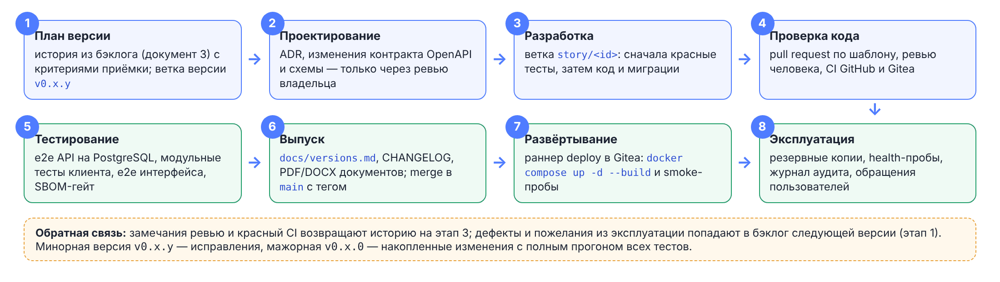

# О документе

Документ — план развития «Планировщика отпусков» по версиям и бэклог с критериями приёмки. Каждая история — законченный объём работы, который разработчик или ИИ-ассистент выполняет в ветке `story/<id>` и который проверяется ревью за 30–60 минут. Для выполненных историй указаны тесты, подтверждающие критерии; бэклог переносится в трекер один к одному.

| Связанный документ | Что в нём |
|---|---|
| 0 — Ревизия функциональности | Откуда взялись истории: состояние as-is и to-be |
| 1 — Описание архитектуры | Компоненты, на которые ссылаются истории |
| 2 — Спецификация API | Операции, коды ошибок и права |
| 6 — Правила разработки с ИИ | Как история передаётся ассистенту |
| 7 — Стенды, CI/CD и выпуск | Ветки, конвейеры и порядок выпуска |

# Правила бэклога

| Обозначение | Значение |
|---|---|
| `TL` | Технический лидер, архитектор |
| `BE`, `FE` | Разработчик сервера, клиента |
| `QA` | Инженер по тестированию |
| `DO` | Инженер эксплуатации |
| Оц. | Идеальные человеко-дни с учётом генерации кода ИИ-ассистентом |
| Ревью | `да` — обязательное ревью технического лидера (`auth/`, миграции, контракт, права, зависимости) |

**Готовность к работе:** есть ссылка на раздел документов 1–2 и операцию контракта; критерии проверяемы; зависимости закрыты или заменены заглушками; для историй с ревью назначен ревьюер.

**Закрытие:** критерии покрыты автотестами; оба конвейера CI зелёные; ревью пройдено; документы, `CHANGELOG.md` и при необходимости контракт обновлены в том же PR.

# План версий

| Версия | Цель | Статус |
|---|---|---|
| v0.1.0 | Зрелая платформа вместо прототипа: вход, заявки, график, справочники, аудит, Docker, SBOM, CI | выпущена |
| v0.2.x | Схемы документации, выгрузки XLSX, ограничение частоты входа, заголовки безопасности | выпущены |
| v0.3.0 | Корпоративное качество: новый интерфейс, аналитика пересечений и подбор дат, график работы, правильный баланс, защита от гонок, e2e интерфейса, документы и руководства | выпущена |
| v0.4.0 | Интеграции: импорт сотрудников и остатков, единый вход OIDC, письма и сводка, роль кадровой службы, календарь в интерфейсе | выпущена |
| **v0.5.0** | Эксплуатация на 5000 пользователей: кластер процессов и кэш графика, нагрузочная проверка, метрики, реплика и архив WAL, живые обновления | текущая |
| v1.0.0 | Приёмка HR и ИБ, комплект для реестра отечественного ПО | план |

# Версия 0.3.0

## Эпики

| Эпик | Название | Результат |
|--------|----------------------------|----------------------------------------------------------------|
| E20 | Интерфейс | Новые иконки и дизайн-токены, светлая и тёмная темы, адаптивная вёрстка, график с масштабом и полосой нагрузки |
| E21 | Правильный баланс | Праздники не входят в отпуск, лимит учитывает заявки на согласовании |
| E22 | Аналитика и подбор дат | Нагрузка отдела, конфликты, выводы, окна отпуска |
| E23 | График работы и команда | Шаблон и исключения офис/удалёнка, состав отдела на дату |
| E24 | Надёжность и безопасность | Блокировки, ротация токенов без гонок, лимит входа за прокси, CSP, области выгрузки |
| E25 | Качество и поставка | e2e интерфейса, сверка контракта, резервное копирование, работа в закрытом контуре |
| E26 | Документация | Конвейер документов PDF/DOCX, схемы, таблицы из кода, руководства пользователя, администратора и по развёртыванию |

## Истории

| ID | История | Критерии приёмки | Подтверждение | Исп. | Оц. | Ревью |
|-------------|------------------|--------------------------------|-------------------|-------|-----|------|
| E20-01 | Как пользователь, я работаю в аккуратном интерфейсе | Единые токены цвета и отступов; тонкие SVG-иконки; темы «как в системе / светлая / тёмная»; без `v-html`; ширина экрана от 360 px | e2e «вход», «CSP стенда» | FE | 4 | — |
| E20-02 | Как пользователь, я читаю график года | Полосы интервалов; масштаб 5/18/30 px на день; выходные, праздники, «сегодня»; полоса нагрузки под месяцами; штриховка конфликтов | e2e «график: отделы, масштаб и сравнение» | FE | 3 | — |
| E20-03 | Как руководитель, я сравниваю сотрудников | Отметка двух и более сотрудников; общие даты отсутствия списком и подсветкой | e2e «график… сравнение» | FE | 1 | — |
| E21-01 | Как сотрудник, я трачу дни отпуска по закону | Праздники внутри периода не входят в дни отпуска (ТК РФ, ст. 120) — в балансе, форме, выгрузке | unit «праздники внутри отпуска…»; e2e «праздник внутри отпуска не уменьшает остаток» | BE | 1 | да |
| E21-02 | Как организация, я не допускаю обхода лимита | Доступно = остаток − дни заявок на согласовании; несколько заявок не превышают лимит | e2e «жёсткий лимит…» | BE | 0,5 | да |
| E22-01 | Как руководитель, я вижу нагрузку отдела | Доля отдела по рабочим дням по месяцам, отдельно согласованные и на согласовании; периоды ≥ порога | unit coverage; e2e «руководитель видит свой отдел» | BE, FE | 3 | — |
| E22-02 | Как руководитель, я получаю выводы | Ближайшие конфликты, пиковый и спокойный месяц, нераспределённые дни, нет части в 14 дней, малочисленный отдел | unit «сообщает о нераспределённых днях…» | BE | 1 | — |
| E22-03 | Как сотрудник, я подбираю лучшие даты | До 5 окон: без превышения порога и пересечения со своими отпусками, с учётом праздников, без дублей; длина 1–60 | unit «не предлагает окна…»; e2e «сотрудник получает окна…», «длина вне 1..60» | BE, FE | 2 | — |
| E22-04 | Как сервер, я не раскрываю чужие отделы | Аналитика и подбор — только в своей области (403 иначе) | e2e «чужой отдел недоступен», «подбор для чужого…» | BE | 0,5 | да |
| E23-01 | Как сотрудник, я веду график работы | Недельный шаблон и разовые исключения; руководитель — подчинённым; изменения в аудите в той же транзакции | e2e «руководитель задаёт шаблон…», «сотрудник не может менять…» | BE, FE | 2 | — |
| E23-02 | Как руководитель, я вижу команду на дату | Офис / удалёнка / отпуск / выходной; отпуск важнее графика, исключение важнее шаблона | unit «отпуск важнее графика…»; e2e «состав отдела на дату» | BE, FE | 1,5 | — |
| E24-01 | Как сервер, я не создаю пересекающиеся заявки при гонке | Блокировка строки сотрудника; из одновременных пересекающихся заявок создаётся одна | e2e concurrency | BE | 1 | да |
| E24-02 | Как сервер, я применяю одно решение по заявке | Блокировка строки заявки; второе решение — 409 `stale-state` | e2e concurrency | BE | 0,5 | да |
| E24-03 | Как пользователь, я не теряю сеанс при параллельных запросах | Одно обновление токена на все запросы клиента | ручная проверка, e2e интерфейса | FE | 0,5 | да |
| E24-04 | Как пользователь, я не блокируюсь из-за коллег | Лимит входа по паре «адрес клиента + логин» (10/мин) и по адресу (60/мин); адрес из `X-Forwarded-For` доверенного прокси | e2e auth: три сценария лимита | BE | 1 | да |
| E24-05 | Как руководитель без отдела, я выгружаю только своих | Область выгрузки: администратор — всё, руководитель отдела — отдел, иначе — подчинённые и сам | e2e «руководитель без отдела…» | BE | 0,5 | да |
| E24-06 | Как ИБ, я получаю CSP для статики | CSP и заголовки в nginx и в `vite preview`; ни один экран не нарушает CSP | e2e «CSP стенда…» | DO | 0,5 | да |
| E25-01 | Как команда, я ловлю регрессии экранов | Playwright в обоих CI: вход, график, заявка с согласованием, команда, график работы, CSP | задание e2e в CI | QA | 2 | — |
| E25-02 | Как команда, я не допускаю расхождения контракта | Тест сверяет маршруты Nest и операции OpenAPI в обе стороны | e2e contract | BE | 0,5 | — |
| E25-03 | Как администратор, я восстанавливаю данные | Сервис `backup`: `pg_dump` по расписанию, атомарная запись, срок хранения; инструкция восстановления | дымовой прогон, руководство по развёртыванию | DO | 1 | — |
| E25-04 | Как администратор, я разворачиваю стенд без интернета | Образ содержит Prisma CLI и собранный seed; seed идемпотентен | дымовой прогон стенда | DO | 0,5 | да |
| E26-01 | Как читатель, я получаю документы в PDF и DOCX | Обложка, оглавление с номерами страниц, колонтитулы; схемы PNG; таблицы из кода генерируются | `make docs` | TL | 3 | — |
| E26-02 | Как пользователь, я читаю руководства | Руководства пользователя, администратора, по развёртыванию со снимками экранов | `docs/pdf` | TL | 2 | — |

# Версия 0.4.0 — интеграции

| ID | История | Критерии приёмки | Подтверждение | Исп. | Оц. | Ревью |
|-------------|------------------|--------------------------------|-------------------|-------|-----|------|
| E30-01 | Как кадровик, я импортирую сотрудников и остатки | Шаблон XLSX; файл XLSX/CSV; предпросмотр с ошибками по строкам; применение одной транзакцией с аудитом, только без ошибок; повторная загрузка ничего не меняет | import.unit (10), import.e2e (7), Playwright «импорт» | BE, FE | 3 | да |
| E30-02 | Как администратор, я синхронизирую сотрудников из кадровой системы | Тот же импорт принимает JSON `{ rows }`: выгрузка 1С:ЗУП или скрипт интеграции вызывает его по расписанию; план — отчёт сверки | import.e2e «JSON-импорт» | BE | 1 | да |
| E31-01 | Как сотрудник, я вхожу корпоративной учётной записью | OIDC, authorization code + PKCE; проверка id_token по JWKS; сопоставление по логину; `LOCAL_LOGIN=false` — пароль только у администраторов; refresh прежний | oidc.e2e (8) против тестового провайдера | BE, FE | 3 | да |
| E32-01 | Как сотрудник, я получаю письма о заявках и решениях | Очередь писем в транзакции события; отправка через SMTP с повторами; отписка в профиле; проверочное письмо администратору | mail.e2e (6) | BE, FE | 2 | — |
| E32-02 | Как руководитель, я получаю сводку | В пятницу после 12:00: кто из команды в отпуске на следующей неделе, сколько заявок ждут решения; один раз за неделю | mail.e2e «сводка», «окно сводки» | BE | 1 | — |
| E33-01 | Как кадровик, я работаю без прав администратора | Роль «кадровая служба»: сотрудники, импорт, оргструктура, календарь, выгрузки, аудит; без правил организации и согласования; не меняет администраторов; матрица прав в документе 2 | staff.e2e (14), Playwright staff.spec | BE, FE | 2 | да |
| E33-02 | Как кадровик, я веду календарь в интерфейсе | Сетка года, переносы, загрузка файла xmlcalendar.ru или CSV; праздники и переносы различаются; изменение в аудите | staff.e2e «календарь», calendar.spec, coverage.unit «производственный календарь» | BE, FE | 1,5 | — |

Найдено и исправлено попутно: демо-календарь 2026–2027 считал выходные и перенесённые дни праздниками (недосчёт дней отпуска); сброс пароля не попадал в аудит; контракт `Employee` расходился с API; файл больше 2 МБ и гонка уникальности возвращали 500.

# Версия 0.5.0 — эксплуатация на 5000

| ID | История | Критерии приёмки | Подтверждение | Исп. | Оц. | Ревью |
|------------|-----------------------|-----------------------------------------------|-------------------|-------|-----|------|
| E40-01 | Как эксплуатация, я вижу метрики | `/metrics` Prometheus: задержки p50/p95 по маршрутам, ошибки, пул соединений; панель Grafana в репозитории | metrics.e2e (9), concurrency.unit (4); дымовой прогон CI: метрики внутри стенда есть, через nginx — нет; `deploy/monitoring` | BE, DO | 2 | — |
| E40-02 | Как команда, я подтверждаю масштаб | 5000 пользователей в базе, 500 одновременных, 15 мин; p95 чтения ≤ 300 мс, записи ≤ 500 мс, 0 ошибок 5xx; отчёт в `docs/progress` | `docs/progress/load-v0.5.0.md`; генератор `tools/load/run.mjs`, наполнение `npm run db:seed:load` | QA, DO | 2 | — |
| E40-03 | Как организация, я теряю не больше 15 минут данных | Потоковая реплика PostgreSQL; архив WAL; проверка переключения | CI «Реплика PostgreSQL, архив WAL и переключение» на каждый push; восстановление из физической копии и архива проверено вручную (документ 7) | DO | 2 | да |
| E40-04 | Как пользователь, я вижу изменения без обновления | События сервера (SSE) для очереди заявок и уведомлений; откат на опрос раз в 30 с | events.e2e (4); дымовой прогон CI: поток через nginx | BE, FE | 2 | — |
| E40-05 | Как сервер, я масштабируюсь горизонтально | Лимит входа в PostgreSQL или Redis вместо памяти процесса; два экземпляра `server` за балансировщиком | auth.e2e «лимит общий для всех экземпляров»; кластер процессов `WEB_CONCURRENCY` | BE | 1,5 | да |
| E40-06 | Как сотрудник, я открываю график организации без ожидания | График 5000 сотрудников: сервер — кэш по версии данных и `304`, браузер — только видимые строки; выгрузка XLSX не останавливает другие запросы | schedule.e2e (5), schedule.spec «virtualWindow», «absentPerDay» | BE, FE | 2 | — |
| E40-07 | Как служба ИБ, я отзываю доступ сразу | Смена пароля и увольнение отзывают выданные access-токены; поток событий закрыт для отозванных | auth.e2e «смена убивает старые токены…», «увольнение сразу закрывает доступ…»; events.e2e «после смены пароля старый билет не открывает поток», «отзыв сеанса закрывает уже открытый поток» | BE | 0,5 | да |
| E40-08 | Как сотрудник, я работаю в интерфейсе с телефона, с клавиатуры и в тёмной теме | Аудит всех экранов за четыре роли: дефекты логики и масштаба исправлены; контраст текста не ниже 4,5:1 в обеих темах (WCAG 2.1 AA); на 360 px нет горизонтальной прокрутки страницы; модальные окна с именем, удержанием фокуса и Esc | `docs/progress/audit-v0.5.0.md`; audit-fixes.e2e (5); e2e интерфейса «диалог заявки: имя, фокус, Esc; праздники через Новый год», «сброс пароля: открытая вкладка сотрудника сама уходит на экран входа» | FE, QA | 1,5 | — |

E40-02 выполнен собственным генератором без зависимостей вместо k6: k6 распространяется под AGPL-3.0 и требует отдельного бинарного файла; генератор повторяет действия сотрудников и руководителей с весами и паузами (документ отчёта).

Найдено и исправлено попутно: 15-минутный прогон нашёл взаимную блокировку при одновременной подаче заявок сотрудником и его руководителем (ответ 500 раз на ~9 тыс. подач); защита сеанса проверяла версию пароля только при обновлении токена — смена пароля и увольнение не отзывали выданный access-токен до 15 минут (документ 1 обещал мгновенный отзыв); любой `401` превращался в `auth/invalid-credentials`; ответ `429` не нёс обещанного заголовка `Retry-After`; при `WEB_CONCURRENCY=auto` процессы могли исчерпать `max_connections`; после пересоздания контейнера `server` nginx отвечал `502` до своего перезапуска; хеширование пароля останавливало процесс на 100 мс и выдавало по времени ответа, существует ли логин.

# Версия 1.0.0 — приёмка

| ID | История | Критерии приёмки | Исп. | Оц. | Ревью |
|------------|-----------------------|-----------------------------------------------|-------|-----|------|
| E50-01 | Как HR, я принимаю сценарии | Демонстрация сценариев раздела «Приёмка» технического задания; замечания закрыты | все | 2 | — |
| E50-02 | Как ИБ, я принимаю безопасность | Чек-лист документа 1 (раздел «Безопасность»); внешний тест на проникновение; отчёт | TL | 2 | да |
| E50-03 | Как правообладатель, я подаю систему в реестр | Комплект: описание, руководства, SBOM и отчёт лицензий, сведения о правообладателе | TL | 2 | — |

# Критический путь и риски

v0.4.0: импорт (E30) открывает переход с кадровых таблиц; единый вход (E31) — условие пилота на 1000 пользователей. v0.5.0: метрики (E40-01) нужны до нагрузочного прогона (E40-02), а вынос лимита входа (E40-05) — до запуска второго экземпляра; оба условия выполнены.

| Риск | Влияние | Митигирование |
|---|---|---|
| Грязные данные кадровой системы | Задержка E30 | Предпросмотр с ошибками по строкам; прогон на копии заранее |
| Разные провайдеры единого входа в организациях | Задержка E31 | Только стандартный OIDC; интеграционный стенд Keycloak в CI |
| Нагрузка выше расчётной | Деградация p95 | Индексы под отчёты, пул соединений, второй экземпляр, реплика для чтения |
