# Модель данных и справочники

| Параметр | Значение |
|---|---|
| Документ | Модель данных (документ 4 комплекта) |
| Версия | 2.0 (PostgreSQL + Prisma) |
| Дата | 27.10.2026 |
| Источник DDL | `server/prisma/schema.prisma` — единственный источник схемы |

## 1. Назначение

Схема данных v0.1.0 реализована на PostgreSQL 17 через Prisma; документ описывает решения и соответствие исходному плану, DDL не дублирует.

## 2. ER-диаграмма

## 3. Сущности

| Таблица | Назначение | Ключевые решения |
|---|---|---|
| `employees` | Сотрудники | `login` уникален; `pw_version` — инвалидация JWT при смене пароля; soft delete `is_active` |
| `departments` | Отделы | Сущность с `id` (не строка, как в прототипе); `manager_id` — руководитель |
| `projects` | Проекты | Участники через `employees.project_id` |
| `groups` / `group_members` | Личные группы фильтров | Владелец; `unique(owner_id, name)` |
| `vacation_requests` | Заявки | Enum-статусы и типы на уровне БД; `change_from_*` для переносов; `pending_deletion` |
| `request_events` | История заявки | Append-only |
| `work_patterns` / `work_overrides` | Режимы офис/удалёнка | PK (employee, weekday) / (employee, date) |
| `org_settings` | Настройки организации | Одна строка id=1: порог конфликта, часовой пояс, политика лимита |
| `calendars` | Производственный календарь | PK `year`; праздники и переносы в JSON |
| `notifications` | Уведомления | Индекс входящих (employee, is_read, created_at) |
| `audit_events` | Аудит | Append-only; индексы (entity, entity_id, ts), (actor_id) |
| `refresh_tokens` | Refresh-сессии | Хеш токена SHA-256; `revoked_at` — ротация/отзыв |

Индексы под запросы графика: `vacation_requests(start_date, end_date)`, `(employee_id, status)`; сотрудники — `(dept_id)`, `(manager_id)`, `(is_active)`.

## 3. Инварианты (БД + сервер)

1. Даты заявки: `start ≤ end`; типы и статусы — CHECK через enum.
2. Пересечение периодов одного сотрудника в pending/approved — проверяет сервер (409), транзакция сериализует.
3. Баланс: `planned_days + carry_over − Σ одобрит. дней`; жёсткая политика — сервер, `org_settings.limit_policy`.
4. Последний администратор: сервер (409 `last-admin`) — при деактивации/разжаловании.
5. Аудит: пишется в той же транзакции; UPDATE/DELETE журнала отсутствуют в API.

## 4. Миграция данных прототипа (выполнена в v0.1.0)

`server/prisma/seed.ts` читает snapshot прототипа (`seed-data/seed.json`):

- 131 сотрудник: **id сохранены**; логины из snapshot; пароли — scrypt-хеши исходных демо-значений (В1: при эксплуатационной миграции — сброс на одноразовые).
- 14 отделов созданы из строк; руководители — из `deptManagers`.
- 268 заявок перенесены со статусами; легаси-массив `vacations` не переносится (сверка — v0.2).
- Недельные шаблоны режимов — в `work_patterns`.

## 5. Справочники и календарь — без изменений относительно версии 1.0 документа (раздел 4): календарь правится администратором по годам, операции с датами года без календаря — 400 `calendar-missing`. Загружены 2026 (точный) и 2027 (предварительный, официальный перенос выходных уточняется постановлением — обновление данными, не кодом).

## 6. Эволюция схемы

- Изменения — через `prisma migrate dev` с ревью SQL-миграции; деструктивные — в два шага.
- Prisma Client генерируется в CI перед сборкой; рассинхронизация схемы и миграций ломает сборку.
