# Стенды, CI/CD и порядок выпуска

| Параметр | Значение |
|---|---|
| Документ | Стенды, CI/CD и порядок выпуска (документ 7 комплекта) |
| Версия | 2.0 (зрелый стек, Docker) |
| Дата | 27.10.2026 |
| Связанные документы | 1 — Архитектура; 11 — SBOM; `docker-compose.yml`; `.github/workflows/ci.yml` |

## 1. Окружения

| Стенд | Назначение | Данные | Доступ |
|---|---|---|---|
| `local` | Разработка (WSL/Linux/macOS) | seed.json через `make seed` | Разработчик |
| `ci` (GitHub Actions) | Проверки PR | Синтетика + postgres-сервис | Автоматика |
| `stage` | Демонстрации, приёмка | Обезличенная копия прод-БД | Команда + HR |
| `prod` | Работа организации | Рабочая БД (том `db-data`) | Все сотрудники |

## 2. Локальное окружение

```bash
make up          # PostgreSQL в Docker
make seed        # миграции + демо-данные (131 сотрудник)
make server-dev  # API на :8080 (ts-node, авто-рестарт)
make web-dev     # SPA на :5173 (прокси /api → :8080)
make test        # e2e-тесты (vacation_test, отдельная БД)
make lint        # ESLint server + web
make sbom        # CycloneDX SBOM + отчёт лицензий
make compose-full# полный стенд: nginx :80 → api → postgres
```

Секреты: `server/.env` (см. `.env.example`): `DATABASE_URL`, `JWT_SECRET` (≥32 симв.). В git их нет.

## 3. Развёртывание



## 4. Контейнеры

- `postgres:17-alpine` — том `db-data`, healthcheck `pg_isready`.
- `server` — multi-stage `server/Dockerfile`: сборка (npm ci, prisma generate, tsc) → рантайм только с prod-зависимостями; при старте `prisma migrate deploy`, затем `node dist/main.js`; `/healthz`, `/readyz`.
- `web` — multi-stage `web/Dockerfile`: сборка Vite → `nginx:1.27-alpine` (статика + прокси `/api` → `server:8080`).

## 4. Конвейер CI

`.github/workflows/ci.yml`; запуск: push/PR в `main` и ветки `v0.*`.

| Задание | Что делает |
|---|---|
| server | npm ci → prisma generate → tsc build → vitest e2e (postgres-сервис, тестовая БД) |
| web | npm ci → vue-tsc + vite build |
| sbom | генерация SBOM + отчёт лицензий; падает при средних/высоких рисках; артефакты приложены |
| docker | build образов server и web (compose) |
| smoke | полный compose с postgres-сервисом: /healthz, вход, график |

Правила: красный CI блокирует слияние; `contracts/`, `docs/specs/` — через CODEOWNERS; SBOM-отчёт обновляется в том же PR, что и зависимости.

## 5. Версии, ветки, выпуск

1. Ветка версии `v0.x.0` — вся работа цикла; минорные фиксы — `v0.x.y` от неё.
2. `main` — только смёрженные версии (`--no-ff`), тег `v0.x.y` на merge-коммите.
3. История и авторство — `docs/versions.md`; технический журнал — `CHANGELOG.md`.
4. Семвер: до v1.0.0 первая цифра 0; x — крупные накопленные изменения; y — минорные.

Порядок выпуска версии: зелёный CI на ветке версии → обновлены CHANGELOG/versions.md/SBOM → merge в main с тегом → сборка образов по тегу → деплой стейджа (compose) → дымовой чек-лист → прод (бэкап БД → `docker compose pull && up -d` → дым) → релизная заметка.

## 6. Миграции БД

- Prisma migrate: схема — `server/prisma/schema.prisma`; миграции применяются автоматически при старте контейнера.
- Перед применением на проде — бэкап: `docker compose exec postgres pg_dump -U vacation vacation > backup-$(date +%F).sql`.
- Опасные миграции (удаление/переименование) — в два шага через additive-изменения.

## 7. Резервное копирование и мониторинг

- Ежедневный `pg_dump` + WAL-архив (v0.3) — хранение 30 дней; ежемесячная проверка восстановления фиксируется в `docs/progress/`.
- Health: `/healthz`, `/readyz` — для compose healthcheck и балансировщика.
- Логи: stdout контейнеров (JSON) → docker logging driver, ротация 14 дней.
- Метрики: v0.3 (p95, счётчики ошибок, пул соединений Prisma).

## 8. Доступы

Разработчики — GitHub; оператор стенда — SSH, `.env` вне git; администратор приложения — учётка isAdmin (управляется в самом приложении). Секреты стенда — в менеджере секретов компании.
