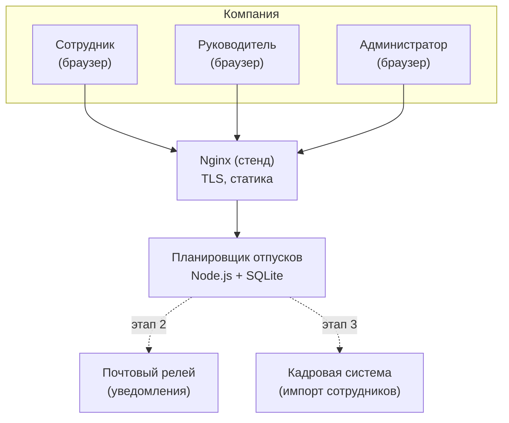
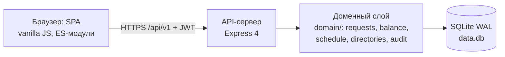
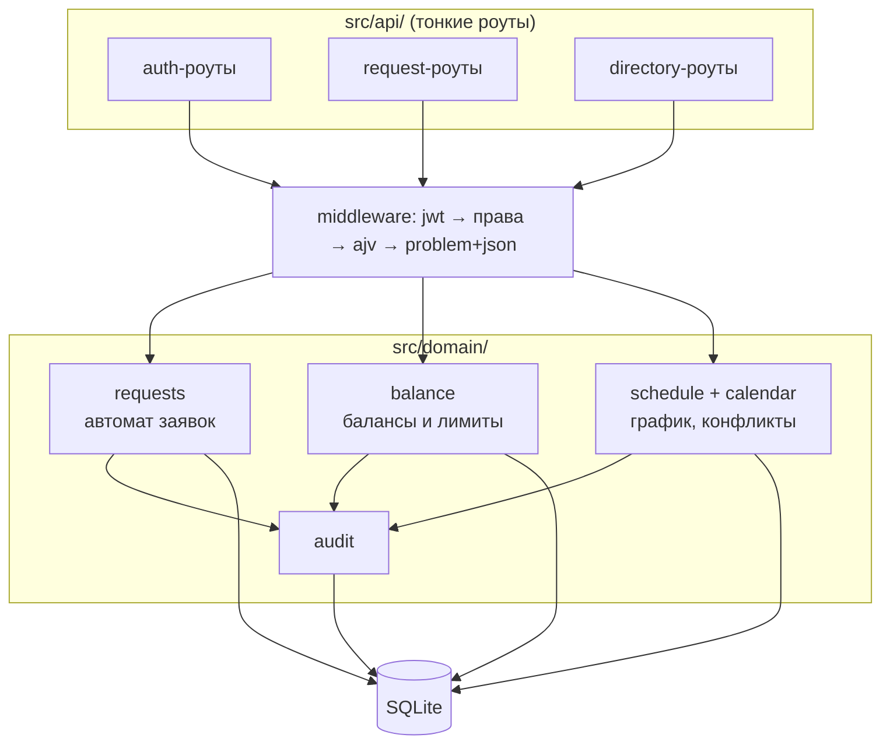
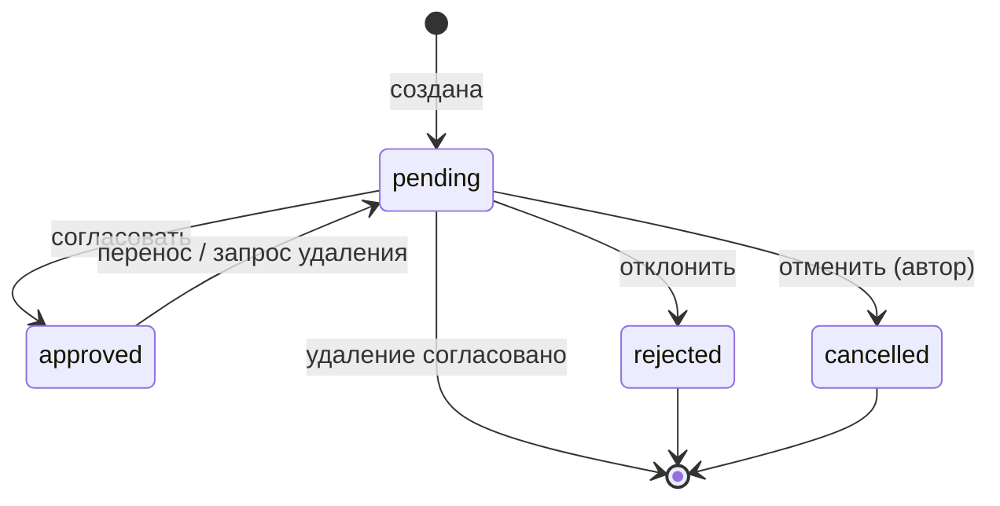
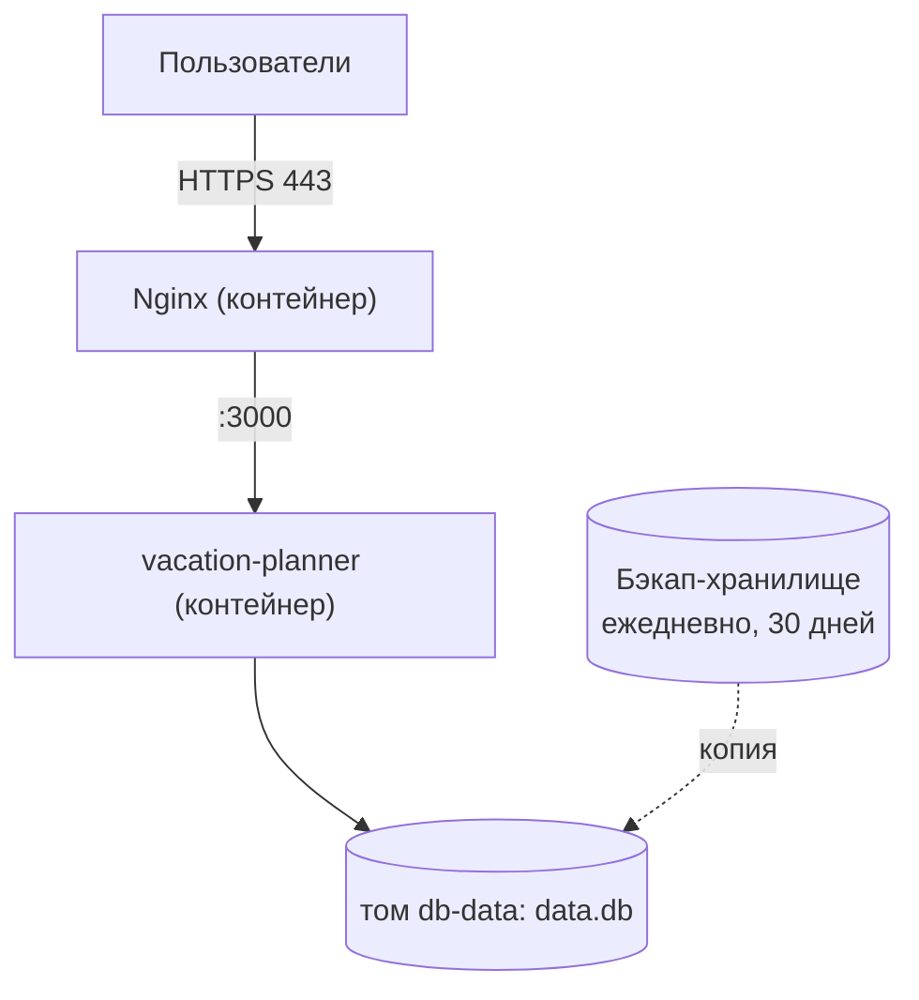

# Диаграммы (Mermaid)

Исходники целевой архитектуры. Рендер: mermaid.live, плагин VS Code Mermaid, или `npx -y @mermaid-js/mermaid-cli`.

## C1. Системный контекст

## C2. Контейнеры

## C3. Компоненты сервера

## Состояния заявки

## Развёртывание стенда

